# CLARSLIB v2

- [Параметры](#task)
- [Структура](#architecture)
- [Алгоритмы](#algorithms)
- [Формат](#format)
- [Тестирование](#experiments)
- [Бенчмарк](#benchmark)

## Постановка задачи и требования

| Параметр | Значение |
| --- | --- |
| Версия формата | 2 (сигнатура CLARSv02) |
| Кодирование | LZ77 => rANS => Reed-Solomon (независимы) |
| Защита заголовков | Троирование (3 копии, побайтовое голосование) |
| Защита данных | Reed-Solomon erasure coding (10 data + 2 parity shards) |
| Размер исходного блока | 1..=65536 байт |
| Число потоков T | 1..=64; по умолчанию min(число процессоров, 64) |
| Размер партии | 1 блок при T = 1; max(4, 2T) при T > 1 |
| Порядок блоков | Исходный, результат не зависит от числа T |
| Словарь и модель | Отдельные для каждого блока |
| Выбор сжатого представления | При S < N |
| Создание архива | Только новый файл; существующий не перезаписывается |
| Извлечение | Только новая папка; исключение сбрасывает результат |
| Источники | Несколько файлов и папок, пустые файлы и папки, имена только в UTF8 |
| Ссылки и reparse points | Запрещены |
| Архив внутри исходной папки | Исключается из входных данных |

### Сборка и команды

Требуется Rust ≥ 1.88; зависимости закреплены в Cargo.lock. 

~~~sh
cargo build --release --locked
cargo test --test all --locked
~~~

Исполняемый файл: target/release/arch; в Windows — arch.exe.

~~~sh
# Создать архив из файла и папки; LZ77 и rANS включены, RS выключен.
arch create backup.mrx report.txt photos

# Те же этапы с защитой; 4 рабочих потока.
arch create --protect --threads 4 backup.mrx report.txt photos

# Только rANS, без LZ77.
arch create --no-lz77 backup.mrx report.txt

# Без сжатия, но с защитой RS.
arch create --no-lz77 --no-rans --protect backup.mrx report.txt

# Просмотреть записи и полностью проверить читаемость потока.
arch info --threads 4 backup.mrx

# Извлечь в новую папку.
arch extract --threads 4 backup.mrx restored

# Имя источника, начинающееся с --, после разделителя не является параметром.
arch create -- backup.mrx --notes.txt
~~~

--no-lz77, --no-rans и --protect относятся к create; они должны стоять перед именем архива. --threads T допускается один раз до разделителя --, 1 ≤ T ≤ 64. Без параметра используется min(available_parallelism, 64), при невозможности определить параллельность — 1.

Если у имени архива нет расширения, добавляется .mrx; другое расширение отклоняется. Создание не перезаписывает существующий файл. Для извлечения нужна **несуществующая** папка. При ошибке созданный архив или папка извлечения удаляется; если удаление не удалось, это сообщается вместе с исходной ошибкой.

info не ограничивается чтением оглавления: оно декодирует блочный поток и проходит содержимое файлов, но не записывает файлы на диск. Статистика «Исправлено фрагментов» считает RS-фрагменты, а не исправленные байты.

### Модель данных и обозначения

#### Что является источником

Источник — поток байтов записей файлов и папок. Имена кодируются UTF-8, содержимое не преобразуется. Блоки до 64 КиБ; границы записей и блоков независимы.

| Обозначение | Смысл |
|---|---|
| X, N = \|X\| | Исходный блок потока записей; 1 ≤ N ≤ 65536 |
| C, K = \|C\| | Кандидат после включённых этапов сжатия |
| Y, S = \|Y\| | Сохранённые данные **до** RS; 1 ≤ S ≤ N |
| n | Длина входа отдельного вызова rANS; не обязательно равна N |
| D | Число разных байтов во входе rANS |
| v(s), f(s), c(s) | Число появлений, нормализованная частота, начало интервала |
| M = 4096 | Сумма нормализованных частот rANS |
| L = 2²³ | Нижняя граница и начальное состояние rANS |
| q в rANS | Остаток x mod M |
| q в RS | Длина одного фрагмента; контекст раздела отличает её от остатка |
| T | Число рабочих потоков |

#### Информация и кодирование

Для модели источника без памяти с вероятностями $p_s$ информация появления символа и энтропия равны:

~~~math
I(s)=-\log_2 p_s,\qquad H=-\sum_s p_s\log_2 p_s.
~~~

При равномерном алфавите из $D$ символов $H=\log_2 D$. Для независимых символов идеальная стоимость сообщения $s_0\ldots s_{n-1}$ составляет

~~~math
\ell_{\mathrm{ideal}}=-\sum_{i=0}^{n-1}\log_2 p_{s_i}.
~~~

rANS использует $p_s=f(s)/4096$. К этой стоимости добавляются модель, состояние, заголовки и защита; для короткого входа накладные расходы могут превысить выигрыш.

LZ77 заменяет повторяющиеся цепочки ссылками; rANS кодирует полученные байты. RS добавляет избыточность для восстановления.

## Структура архиватора

**Конвейер обработки блока.**

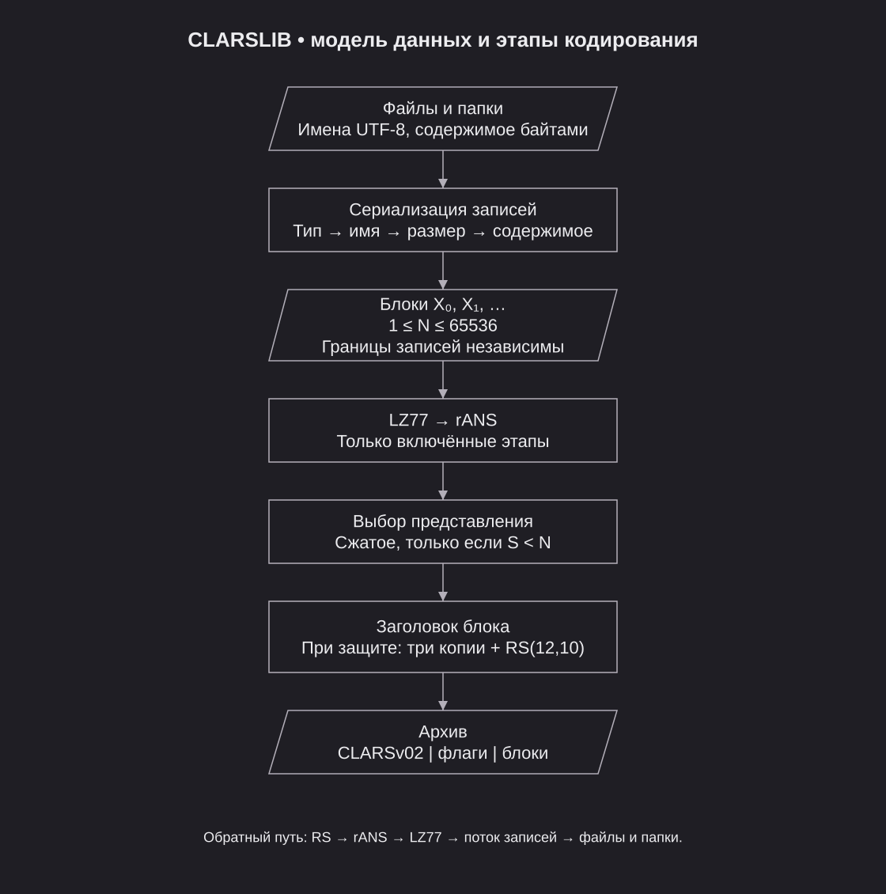

Заголовок архива хранит общие флаги режима (9 байт, сигнатура CLARSv02). При включённой защите заголовки блоков записываются тремя копиями (троирование), а данные блоков защищаются Reed-Solomon erasure coding. Побайтовое голосование большинства восстанавливает заголовки при повреждении одной из трёх копий.

Параллельные задания выполняются локальным пулом Rayon. Результаты записываются в исходном порядке.

### Выбор представления блока

Для блока $X$ сначала применяются только включённые этапы:

~~~math
C=\mathrm{rANS}_{\mathrm{opt}}(\mathrm{LZ77}_{\mathrm{opt}}(X)),
\qquad
Y=\begin{cases}C,& |C|\lt N,\\X,& |C|\ge N.\end{cases}
~~~

Отключённый этап тождественен. С исходным блоком сравнивается только результат комбинации, заданной флагами.

**Правило декодера:** S < N означает сжатое представление; тогда выполняются rANS, затем LZ77, если их флаги включены. При S = N оба этапа пропускаются. Отдельного бита «этот блок сжат» нет.

RS применяется после выбора Y. Независимые словари и модели позволяют параллельную обработку; ссылки между блоками отсутствуют.

Сравнение K < N происходит до RS. Размер защищённого блока монотонно зависит от S, поэтому меньший S не увеличивает его размер, но из-за заполнения фрагментов уменьшение S не всегда уменьшает физический размер защищённого блока.

**Связи структур и потоков.**

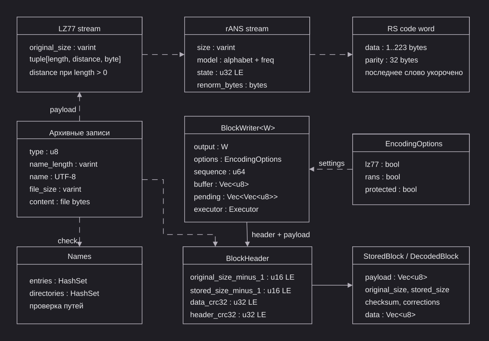

### Параллельная обработка

Локальный пул Rayon создаётся только когда есть более одного задания и T > 1. Размер партии:

~~~math
B(T)=\begin{cases}1,&T=1,\\\max(4,2T),&T\gt 1.\end{cases}
~~~

Результаты map собираются в исходном порядке. Чтение и запись партий последовательные, вычисления блоков могут идти параллельно. Каждый блок имеет собственный словарь и модель. На извлечении чтение физического потока формирует партию, затем блоки декодируются и выдаются в исходной последовательности.

**Партии, независимые задания и порядок.**

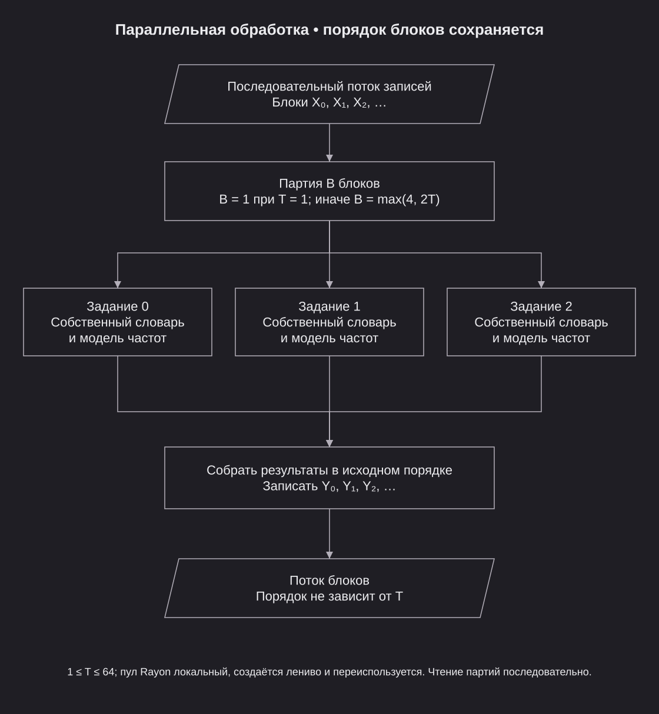

Память зависит от размера партии, промежуточных LZ77/rANS-буферов, таблиц и защищённых данных. Нельзя приравнивать расход памяти ко T × 64 КиБ: одновременно хранятся исходные и промежуточные результаты. Потоки не создаются отдельно на каждый блок.

### Имена и файловая система

| Проверка | Условие |
|---|---|
| Длина пути | 1…4096 байт UTF-8 |
| Глубина | До 128 компонентов |
| Длина компонента | До 255 байт |
| Число записей | До 100000 |
| Дубликаты | Проверяются после to_lowercase() |
| Родитель записи | Папка должна быть записана раньше ребёнка |
| Компоненты | Не пустые, не заканчиваются точкой/пробелом |
| Запрещённые символы | Управляющие, / \ : * ? " < > \| внутри компонента |
| Имена устройств | con, prn, aux, nul, conin$, conout$ до первой точки |
| Ссылки | Symlink; на Windows также reparse point отклоняются |
| Тип источника | Только обычный файл или папка |

Точки . и .. отклоняются правилом конечной точки. Это конкретный набор проверок, не заявление о полном покрытии всех зарезервированных имён всех ОС: например, com1 и lpt1 в списке кода не перечислены. Unicode-нормализация NFC не выполняется; регистронезависимое сравнение не является полной Unicode case-folding.

Архив, расположенный внутри исходной папки, исключается по каноническому пути. Размер файла фиксируется при открытии; слишком ранний конец или появление лишнего байта выявляются. Это не полноценный снимок файловой системы: изменение содержимого без изменения длины может остаться незамеченным.

### Повреждения и безопасность

Обнаруживаются неизвестная сигнатура или флаги, обрыв чтения, неправильные размеры, неканонический varint, недопустимые ссылки LZ77, неверная модель/состояние rANS, более двух стираний RS, неоднозначное голосование заголовка, недопустимые записи и лишние данные после конца.

Без RS нет независимой контрольной суммы исходного блока. С RS гарантии ограничены условиями подраздела «Что защита не гарантирует». Нет шифрования, цифровой подписи, аутентификации и лимита общего объёма извлечения. Для недоверенного архива следует ограничивать свободное место и использовать изолированную среду. Проверки путей не делают весь процесс устойчивым к внешним конкурентным изменениям файловой системы.

## Алгоритмы

Границы и масштабы записаны степенями двойки; произвольные значения — в hex с индексом ₁₆ и группами по четыре цифры. Рядом указаны десятичные эквиваленты. На рисунках верхняя строка пары — основная запись, нижняя с индексом ₁₀ — десятичная. Байты потока остаются парами hex-цифр; их десятичная расшифровка приведена отдельно. Индекс ₂ обозначает двоичную запись.

### LZ77

| Параметр | Значение |
| --- | --- |
| Единица обработки | Байт |
| Окно | 4096 байт |
| Максимальная длина совпадения | 255 байт |
| Результат | Длина совпадения, расстояние, следующий байт: (l, d, c) |
| Хеш | По первым двум байтам; 4096 цепочек позиций |
| Равные длины | Ближайшее совпадение |

#### Ограничения ссылки

В позиции $p$ выбирается самое длинное совпадение в окне:

~~~math
\begin{aligned}
0&\le l\le\min(255,N-p-1),\\
1&\le d\le\min(4096,p)\quad(l\gt 0),\\
X[p-d+j]&=X[p+j]\quad(0\le j\lt l),\\
c&=X[p+l],\qquad p'=p+l+1.
\end{aligned}
~~~

Верхняя граница N − p − 1 оставляет один байт для c. Поэтому каждая тройка заканчивается литералом, в том числе последняя. При l = 0 расстояние не записывается; математически можно обозначать его нулём, но в потоке этого поля нет.

Флагового байта литералов и ссылок нет.

#### Поиск совпадения

Хешируются первые два байта:

~~~math
h(a,b)=\left(\big((a+256b)\times\underset{2\,654\,435\,761_{10}}{\mathtt{9E37\,79B1}_{16}}\big)\bmod 2^{32}\right)\gg20.
~~~

Получаются 4096 цепочек позиций. Хеш лишь отбирает кандидатов: реальное совпадение проверяется побайтово, поэтому коллизия не превращается в неправильную ссылку.

1. Если допустимая длина не меньше 2, пройти цепочку от новых позиций к старым, пока расстояние не превышает 4096.
2. Сравнить байты до limit; заменить лучший результат только при **строго большей** длине.
3. При достижении limit поиск закончить — более длинного ответа нет.
4. Если совпадение длины ≥ 2 не найдено, проверить последнюю позицию текущего байта. Она может дать ссылку длины 1.
5. Внести в таблицы **все** пройденные позиции p … p + l, а не только начало тройки.

При равных длинах выбирается ближайшая ссылка. Все кандидаты в окне проверяются; глобальная оптимизация размера не выполняется.

**Блок-схема кодирования LZ77.** Слева — кодирование, справа — декодирование.

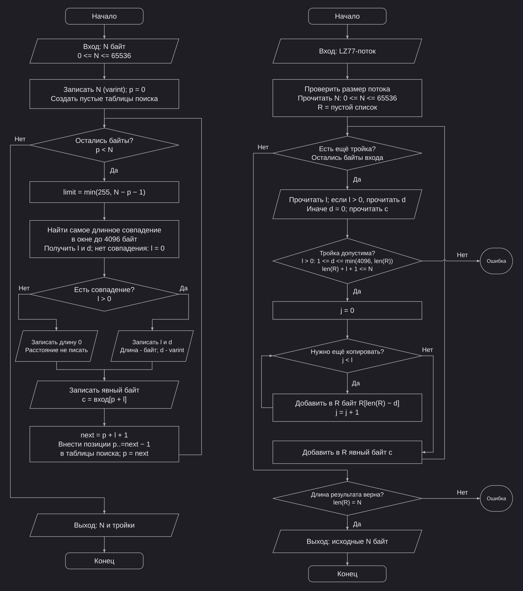

#### Поток и стоимость тройки

~~~text
N : unsigned LEB128
повторять до конца потока:
    l : u8
    если l > 0: d : unsigned LEB128
    c : u8
~~~

Если $v(d)$ — число байтов varint, то тройка занимает

~~~math
t(l,d)=\begin{cases}2,&l=0,\\2+v(d),&l\gt 0.\end{cases}
~~~

Она описывает $l+1$ исходных байтов. Без учёта префикса и влияния последующего rANS локальный выигрыш есть при $l+1\gt 2+v(d)$. Например, ссылка длины 1 может увеличить поток LZ77. Кодер её всё равно записывает; окончательный выбор представления делает блочный уровень.

Наихудшая верхняя граница выхода LZ77 для блока — 3 + 2 × 65536 = 131075 байт: трёхбайтовая длина и по два байта на каждый литерал. Поэтому длина входа rANS после LZ77 может быть больше 65536.

#### Декодирование и перекрытие

После чтения тройки проверяются допустимое расстояние и l + 1 ≤ N − |R|. Копирование выполняется **по одному байту**:

~~~math
\text{повторить }l\text{ раз: }R\leftarrow R\,\|\,R[|R|-d],
\qquad R\leftarrow R\,\|\,c.
~~~

Текущий |R| увеличивается после каждого добавления. Поэтому при l > d источник следующих байтов может находиться среди только что восстановленных данных. Копирование фиксированного среза старого буфера не эквивалентно этому правилу.

#### Разбор ABABABA

| p | limit | l | d | c | Новая позиция |
|---:|---:|---:|---:|:---:|---:|
| 0₁₆ (0) | 6₁₆ (6) | 0₁₆ (0) | — | A | 1₁₆ (1) |
| 1₁₆ (1) | 5₁₆ (5) | 0₁₆ (0) | — | B | 2₁₆ (2) |
| 2₁₆ (2) | 4₁₆ (4) | 4₁₆ (4) | 2₁₆ (2) | A | 7₁₆ (7) |

~~~text
07 | 00 41 | 00 42 | 04 02 41
₁₀: 7 | 0 65 | 0 66 | 4 2 65
 N    l  c    l  c    l  d  c
~~~

При третьей тройке буфер равен AB. Копируются позиции 00₁₆ (0), 01₁₆ (1), 02₁₆ (2), 03₁₆ (3); позиции 02₁₆ (2) и 03₁₆ (3) появились в ходе этой же ссылки. Затем литерал A завершает результат.

Размер потока 08₁₆ (8) превышает вход 07₁₆ (7); без rANS блочный кодер сохранит исходные байты.

Другие проверяемые случаи:

- AAAAAA → 06 00 41 04 01 41: l=04₁₆ (4), d=01₁₆ (1).
- 102₁₆ (258) байта A: первая тройка-литерал, ссылка длины FF₁₆ (255) с литералом, последний литерал.
- При limit = 0 совпадение не ищется: последний байт записывается явно.

**Ссылки в примере ABABABA.**

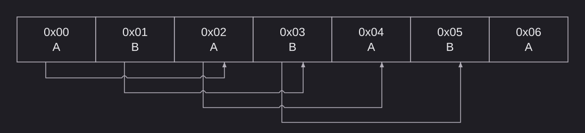

#### Поиск и выбор ближайшей ссылки: abXabYabZ

**Сравнение кандидатов и запись троек.** На позиции 03₁₆ (3) совпадение обрывается на разных байтах 58 и 59. На позиции 06₁₆ (6) ближайший кандидат достигает предельной длины: более дальний уже не нужен. Каждая ссылка оставляет следующий байт для литерала.

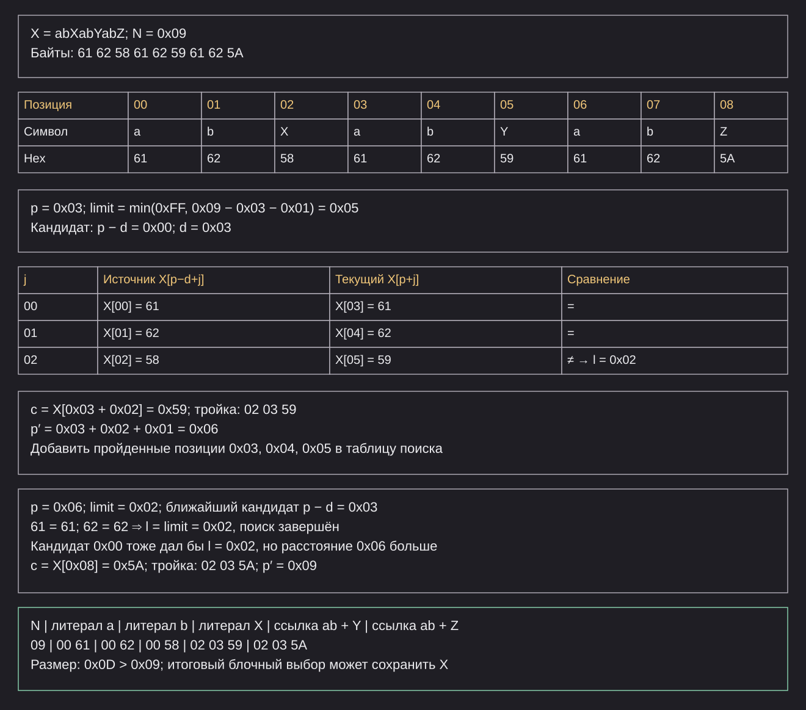

**Восстановление перекрывающейся ссылки ABABABA.** Источник вычисляется заново после каждого добавления. При j=02₁₆ (2) и j=03₁₆ (3) читаются байты, восстановленные на предыдущих шагах этой же ссылки.

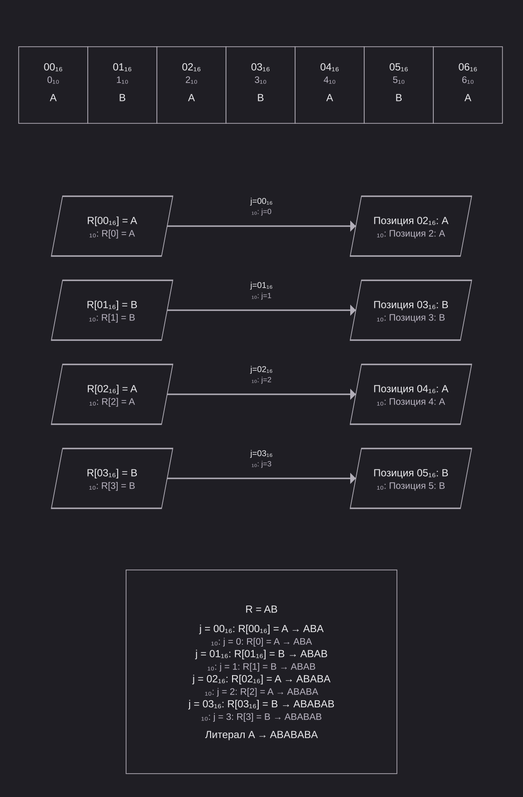

### rANS

| Параметр | Значение |
| --- | --- |
| Состояние | Одно 32-битное целое x |
| Байтовое основание | $2^8=256$ |
| Множитель порога | $2^{19}=524\,288$ |
| Верхняя граница состояния | $2^{31}=2\,147\,483\,648$ |
| Сумма частот M | $2^{12}=4096$ |
| Нижняя граница L | $2^{23}=8\,388\,608$ |
| Кодирование | Справа налево |
| Декодирование | Слева направо |

#### Статическая модель блока

Для ненулевого входа длины $n$ подсчитываются $v(s)$ и число присутствующих байтов $D$. Отсутствующим символам назначается частота 0. Присутствующим сначала назначается:

~~~math
\begin{aligned}
w_s&=v(s)(M-D),\\
f_s^{(0)}&=1+\left\lfloor\frac{w_s}{n}\right\rfloor,\\
r_s&=w_s\bmod n,\\
\Delta&=M-\sum_s f_s^{(0)},\qquad M=2^{12}=4096.
\end{aligned}
~~~

Добавить единицу первым $\Delta$ символам по убыванию $r_s$; при равенстве — по возрастанию байта. Получаются f(s) ≥ 1 и сумма M: деление определено, интервалы полностью разбивают таблицу состояний.

~~~math
c(s)=\sum_{t\lt s}f(t),\qquad [c(s),c(s)+f(s)).
~~~

**BANAN:** n=05₁₆ (5), D=03₁₆ (3), M−D=FFD₁₆ (4 093). Символы в порядке значения байта: A, B, N.

| Символ | v | w | floor(w/n) | Остаток | Начальная f⁰ | Поправка | Итог f | c |
|:---:|---:|---:|---:|---:|---:|---:|---:|---:|
| A | 2₁₆ (2) | 1FFA₁₆ (8 186) | 665₁₆ (1 637) | 1₁₆ (1) | 666₁₆ (1 638) | 0₁₆ (0) | 666₁₆ (1 638) | 0₁₆ (0) |
| B | 1₁₆ (1) | FFD₁₆ (4 093) | 332₁₆ (818) | 3₁₆ (3) | 333₁₆ (819) | 1₁₆ (1) | 334₁₆ (820) | 666₁₆ (1 638) |
| N | 2₁₆ (2) | 1FFA₁₆ (8 186) | 665₁₆ (1 637) | 1₁₆ (1) | 666₁₆ (1 638) | 0₁₆ (0) | 666₁₆ (1 638) | 99A₁₆ (2 458) |

Сумма начальных частот FFF₁₆ (4 095); остаток B максимален. После поправки интервалы покрывают [0,1000₁₆ (4 096)).

#### Переходы без перенормировки

Кодер начинает с $x=L=2^{23}$ и обрабатывает вход **справа налево**. Для символа $s$:

~~~math
C_s(x)=\left\lfloor\frac{x}{f(s)}\right\rfloor M+(x\bmod f(s))+c(s).
~~~

Декодер получает символы **слева направо**. Вычислить $q=x\bmod M$ и найти единственный $s$, для которого $c(s)\le q\lt c(s)+f(s)$. Затем:

~~~math
D_s(x)=f(s)\left\lfloor\frac{x}{M}\right\rfloor+q-c(s).
~~~

**Почему переход обратим.** Пусть $x=af+r$, $0\le r\lt f$. Тогда $C_s(x)=aM+r+c$. Остаток по $M$ равен $r+c$, поскольку интервал символа лежит внутри [0,M). Декодер выбирает тот же символ и получает $fa+(r+c)-c=af+r=x$.

#### Байтовая перенормировка

Чтобы состояние оставалось в 32-битном диапазоне, перед переходом кодер выполняет:

~~~math
\text{пока }x\ge 2^{19}f(s):\quad b=x\bmod2^8,\quad x\leftarrow\lfloor x/2^8\rfloor.
~~~

Байт $b$ откладывается. Порог выводится из параметров модели:

~~~math
T(s)=\frac{L}{M}\,2^8f(s)=2^{23-12+8}f(s)=2^{19}f(s)=524\,288\,f(s).
~~~

После обратного перехода декодер восстанавливает масштаб:

~~~math
\text{пока }x\lt L:\quad\text{прочитать }b,\quad x\leftarrow2^8x+b.
~~~

Поток хранит конечное состояние x : u32 LE, затем отложенные байты **в обратном порядке их выдачи**. Декодер начинает с последнего состояния, поэтому ему сначала нужен последний вынесенный байт. Проверка начального состояния: $L\le x\lt 2^8L=2^{31}$.

**Кодер, декодер и циклы перенормировки rANS.** Слева — кодирование, справа — декодирование.

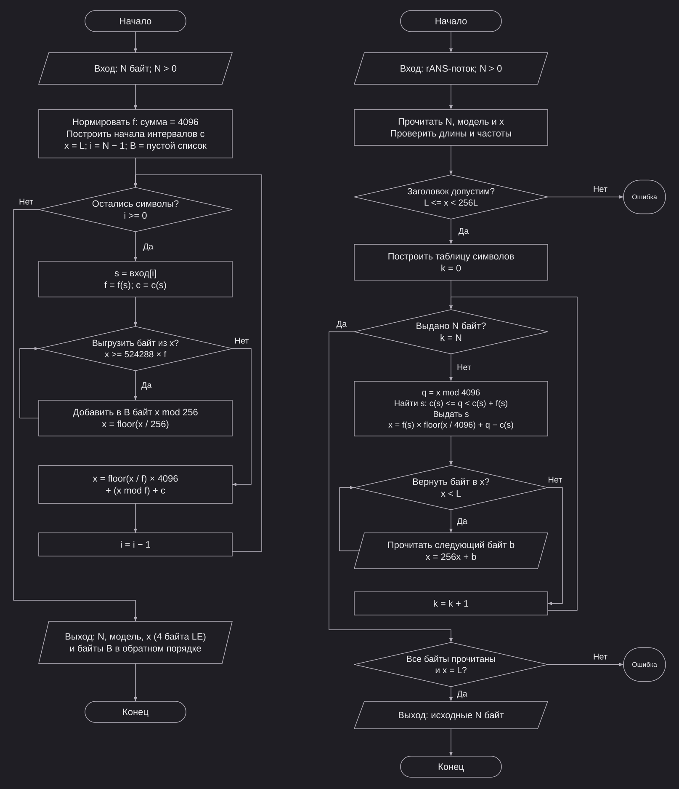

После вывода ровно $n$ символов требуется одновременно x = L и отсутствие непрочитанных байтов. Эти проверки выявляют многие повреждённые потоки, но не являются криптографической проверкой содержимого.

#### Пример ABAB

Частоты $f(A)=f(B)=2^{11}=2048$, начала интервалов c(A)=0, c(B)=800₁₆ (2 048). Порог $T(A)=T(B)=2^{19}\cdot f(A)=2^{19}\cdot2^{11}=2^{30}=1\,073\,741\,824$ не достигается, поэтому байты перенормировки отсутствуют. Прямой и обратный проход:

**Переходы состояния rANS для ABAB.** Слева — кодирование, справа — декодирование.

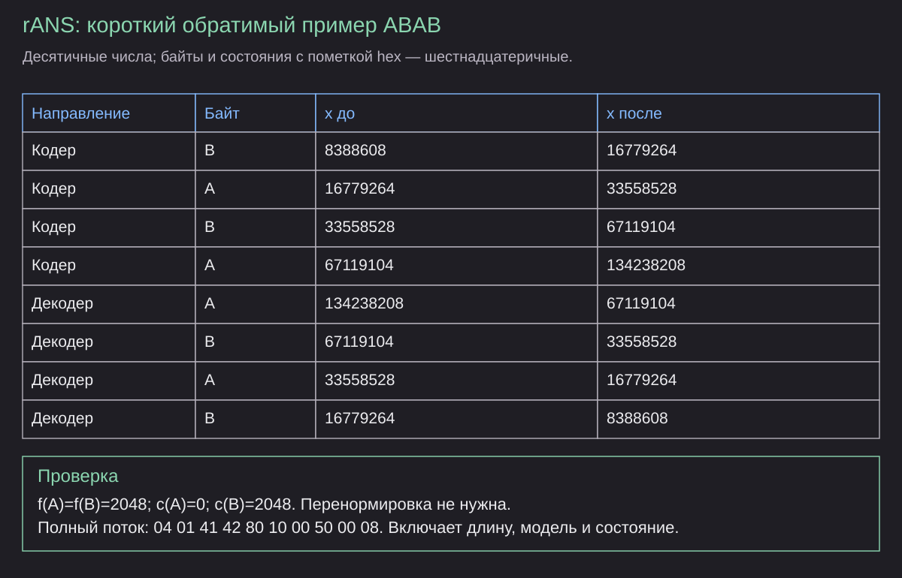

Последняя частота восстанавливается как 1000₁₆ (4 096) − 800₁₆ (2 048) = 800₁₆ (2 048). Конечное состояние 0800 5000₁₆ (134 238 208) записывается в LE:

~~~text
04 | 01 | 41 42 | 80 10 | 00 50 00 08
₁₀: 4 | 1 | 65 66 | 128 16 | 0 80 0 8
 n   D−1  алфавит  f(A)   состояние
~~~

Размер 0A₁₆ (10) превышает вход 04₁₆ (4): блочный кодер сохраняет исходное представление.

#### Полный разбор BANAN: модель, кодирование, декодирование

В отличие от арифметического кодирования, rANS **не сужает вложенный интервал сообщения**. Модель остаётся фиксированной; символ задаёт участок для остатка $q=x\bmod M$, а частное состояния переносит накопленную информацию. Ширины участков пропорциональны нормированным частотам. Голубая отметка на рисунках — точное положение q, жёлтая граница — выбранный участок.

**Кодирование BANAN справа налево.** Для каждого символа показаны проверка порога, деление состояния на частоту с остатком и вычисление нового состояния. Ни один порог не достигается: байтов перенормировки нет.

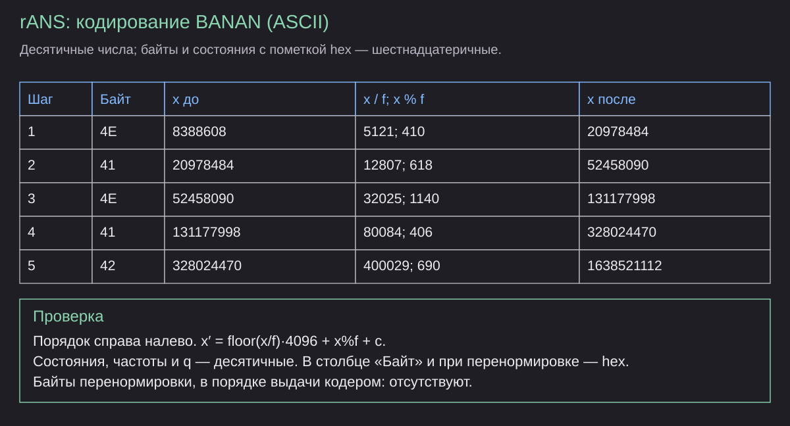

**Декодирование BANAN слева направо.** Остаток q однозначно выбирает участок модели. Вычитание начала участка даёт остаток исходного деления; умножение на частоту восстанавливает предыдущее состояние.

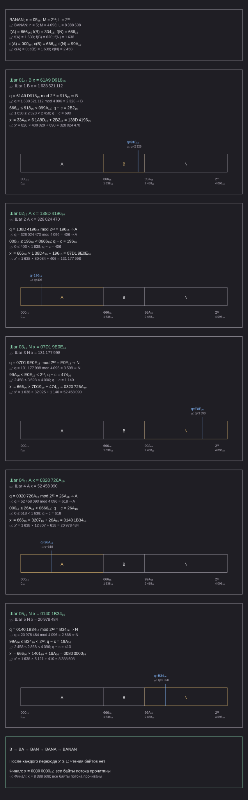

Последний обратный переход использует частное $\lfloor\underset{20\,978\,484_{10}}{\mathtt{0140\,1B34}_{16}}/\underset{4\,096_{10}}{\mathtt{1000}_{16}}\rfloor=\underset{5\,121_{10}}{\mathtt{1401}_{16}}$ и остаток $\underset{2\,868_{10}}{\mathtt{B34}_{16}}-\underset{2\,458_{10}}{\mathtt{99A}_{16}}=\underset{410_{10}}{\mathtt{19A}_{16}}$:

~~~math
\underset{1\,638_{10}}{\mathtt{666}_{16}}\cdot\underset{5\,121_{10}}{\mathtt{1401}_{16}}+\underset{410_{10}}{\mathtt{19A}_{16}}=\underset{8\,388\,608_{10}}{\mathtt{0080\,0000}_{16}}=L.
~~~

Полный поток занимает 0D₁₆ (13) байт при входе 05₁₆ (5). Этот пример показывает работу отдельного rANS; блочный уровень без предшествующего LZ77 выберет несжатое представление.

#### Перенормировка: AB × 10₁₆ (16)

Вход — 20₁₆ (32) байт; $f(A)=f(B)=2^{11}=2048$, поэтому $T=2^{19}\cdot f(A)=2^{30}=1\,073\,741\,824$. Следующие рисунки содержат **все 20₁₆ (32) переходов каждого прохода**, а не только события выдачи байтов. Строки с выдачей или чтением выделены голубым. В остальных строках байт не требуется: кодер остаётся ниже порога, декодер — не ниже L.

**Кодирование с четырьмя выгрузками байта.** Сначала проверяется порог, затем отделяется младший байт, после чего кодируется символ. Вынесенная часть состояния не теряется: её продолжение записывается отдельно.

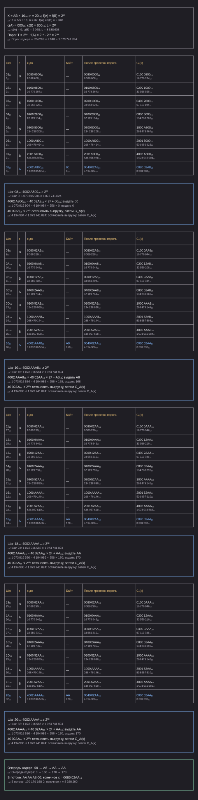

**Обратный проход и чтение байтов.** После восстановления символа и обратного перехода состояние может оказаться ниже L. Следующий байт присоединяется справа, обращая деление кодера на 100₁₆ (256).

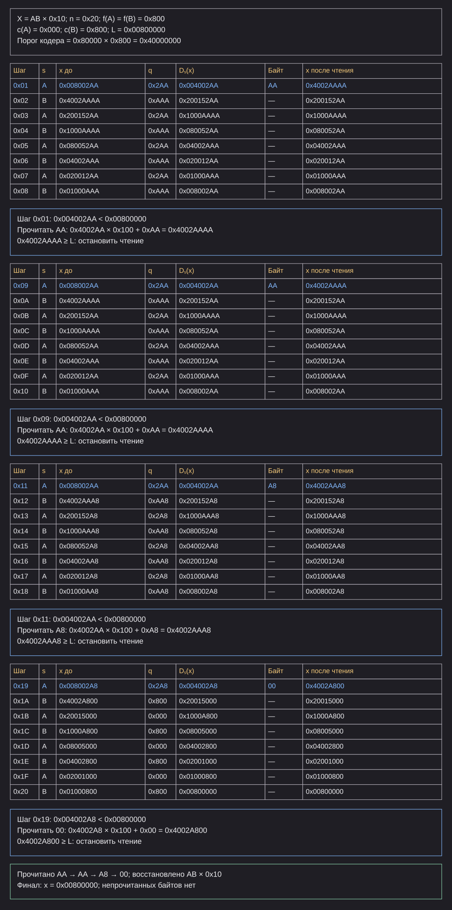

На первом шаге декодера q=2AA₁₆ (682) выбирает A; обратный переход даёт 40 02AA₁₆ (4 194 986). Затем $\underset{4\,194\,986_{10}}{\mathtt{40\,02AA}_{16}}\cdot\underset{256_{10}}{\mathtt{100}_{16}}+\underset{170_{10}}{\mathtt{AA}_{16}}=\underset{1\,073\,916\,586_{10}}{\mathtt{4002\,AAAA}_{16}}$. После 20₁₆ (32) символов x=L и все четыре байта прочитаны. Размер потока 0E₁₆ (14) меньше входа 20₁₆ (32). При включённом LZ77 вход rANS будет другим.

**Поля двух рассчитанных потоков.** Смещения, частоты LEB128, состояние LE и обратная очередь байтов. Последняя частота не записывается: она восстанавливается из суммы M.

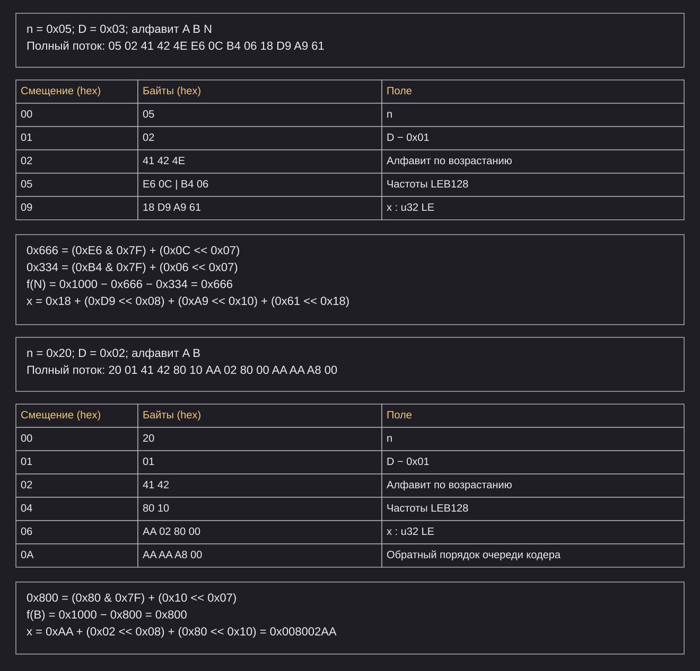

#### Двоичное представление модели

~~~text
n : varint
если n = 0: поток заканчивается здесь (единственный байт 00)
D − 1 : u8
если D ≤ 32: D разных байтов по возрастанию
иначе: bitmap[32]; символ s задан битом (s mod 8) в байте floor(s / 8)
f(s₀), …, f(s_{D−2}) : varint
x : u32 LE
байты перенормировки
~~~

Последняя частота вычисляется вычитанием из 4096. При D = 1 частоты в потоке вообще не нужны: единственный символ имеет частоту 4096. Проверяются порядок алфавита, число битов карты, D ≤ n, положительность частот и наличие четырёх байтов состояния.

Длина отдельного потока rANS ограничена длиной возможного выхода LZ77; минимальный ненулевой заголовок — 7 байт (n, D−1, один символ, состояние). Предельная консервативная оценка заголовка в коде — 550 байт. Это верхняя оценка, а не фиксированная длина модели.

### CRC32

Реализация использует crc32fast 1.4.2. Контрольная сумма вычисляется **отдельно для каждого RS-фрагмента**, включая два проверочных. Она хранится как u32 LE в таблице перед фрагментами.

CRC32 соответствует отражённому алгоритму IEEE: начальный регистр FFFF FFFF₁₆ (4 294 967 295), отражённый полином EDB8 8320₁₆ (3 988 292 384), финальный XOR FFFF FFFF₁₆ (4 294 967 295). При табличном вычислении очередного байта $b$:

~~~text
index = (crc AND FF₁₆) XOR b
₁₀: index = (crc AND 255) XOR b
crc = (crc >> 8) XOR TABLE[index]
~~~

Таблица эквивалентна восьми битовым шагам с полиномом для каждого возможного младшего байта. 

**Вычисление CRC32.**

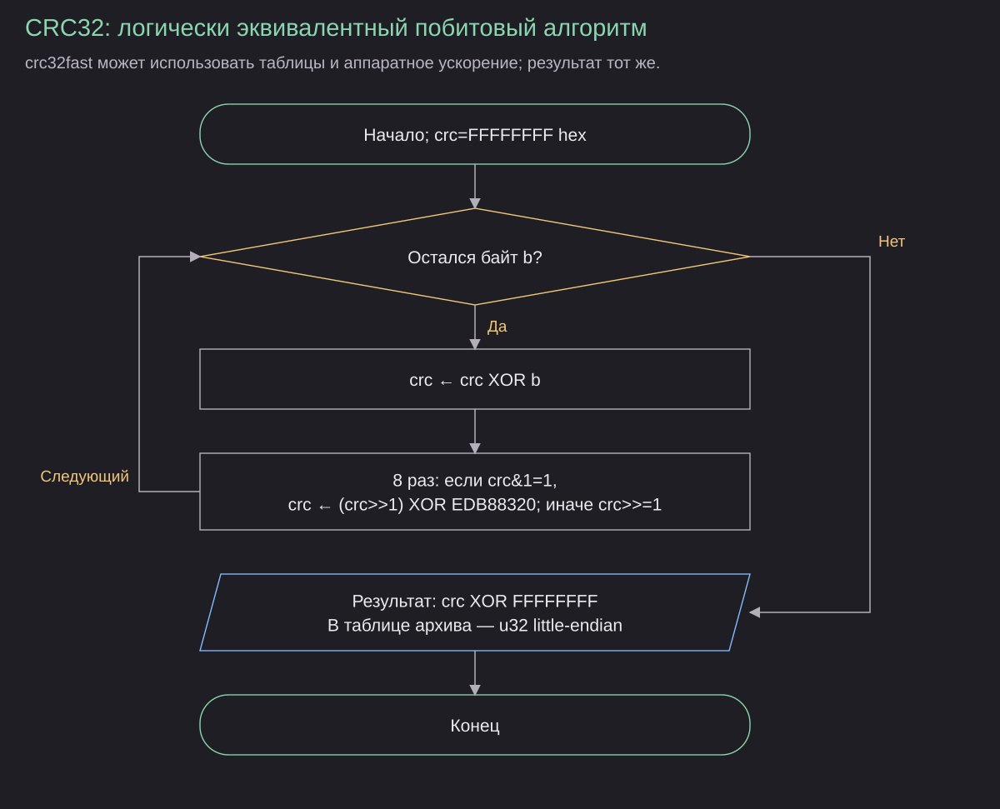

#### Битовый и байтовый разбор контрольной суммы

**Первый байт контрольного вектора.** Байт 31 сначала складывается XOR с регистром, затем выполняются 08₁₆ (8) битовых шагов. Отражённый полином применяется только при установленном младшем бите. Табличный переход объединяет те же шаги в одну операцию.

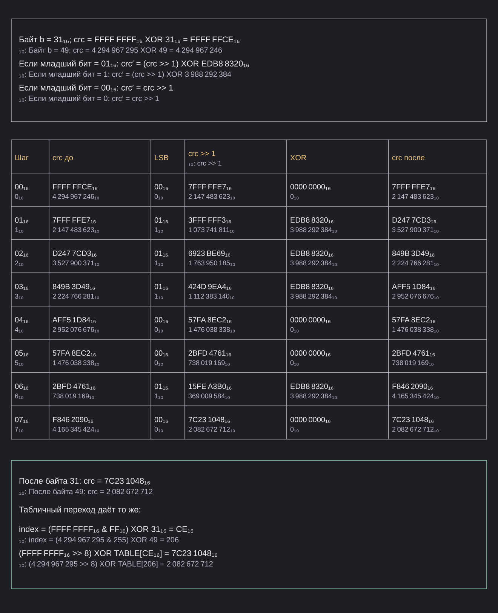

**Полный контрольный вектор.** Байты 31 … 39 соответствуют ASCII 123456789. Регистр передаётся между байтами без финального XOR; он выполняется один раз после последнего байта. Для пустого входа начальный и финальный XOR взаимно уничтожаются: CRC=00₁₆ (0).

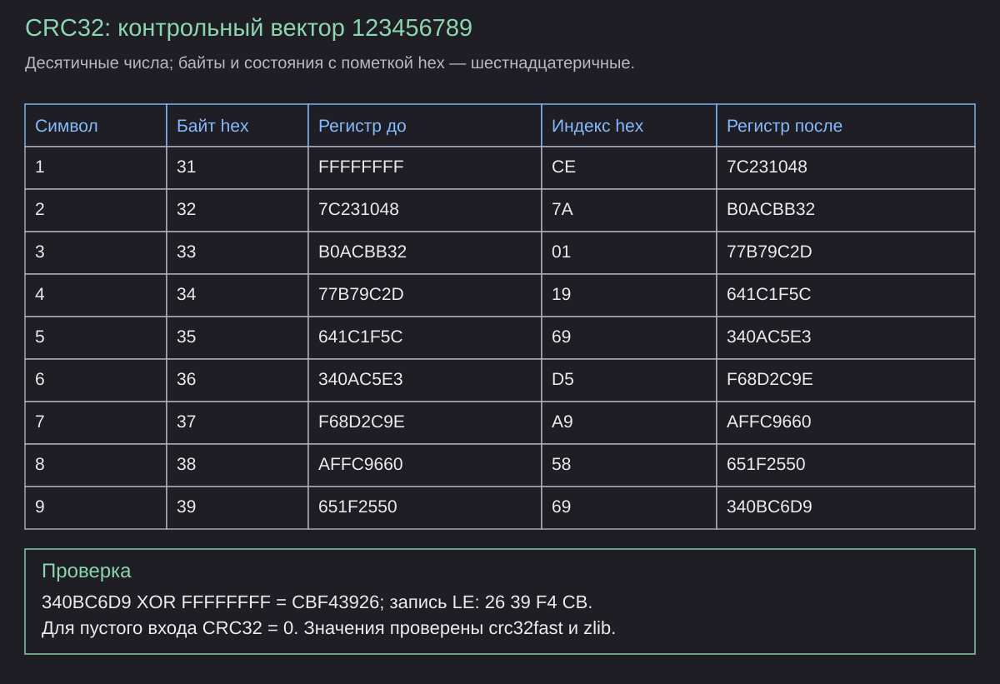

CRC **обнаруживает**, но не исправляет. Несовпадение сообщает RS, какой фрагмент считать отсутствующим. Коллизии возможны; CRC не защищает от умышленной подмены. Без --protect таблицы CRC нет, и неверные, но синтаксически допустимые данные могут быть приняты.

### Reed-Solomon (erasure coding)

**Reed-Solomon erasure.**

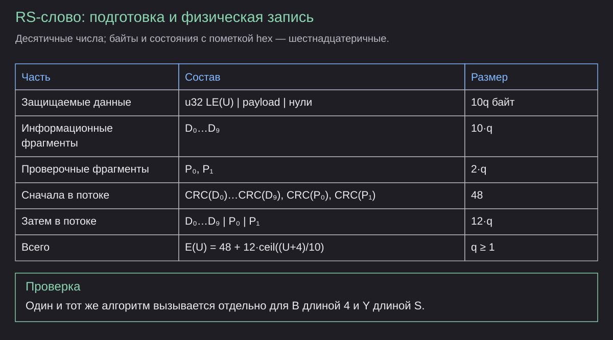

| Параметр | Значение |
| --- | --- |
| Код | RS erasure (10 data + 2 parity shards) |
| Подготовка данных | original_len (u32 LE) + payload |
| Разбиение | ceil((len+4) / 10) байт на фрагмент |
| Кодирование | ReedSolomon::encode добавляет 2 проверочных фрагмента |
| Формат выхода | CRC32 таблица (12 x 4 байта) + тела фрагментов (12 x shard_size) |
| Обнаружение повреждений | CRC32 каждого фрагмента |
| Восстановление | До 2 утраченных фрагментов (стираний) |
| Более 2 повреждений | Ошибка |

Восстановление выполняется обращением матрицы исправных строк.

#### Арифметика поля

Каждый байт — многочлен степени < 8 с коэффициентами в GF(2):

~~~math
a=a_7z^7+\cdots+a_1z+a_0,\qquad a_i\in\{0,1\}.
~~~

Модуль поля библиотеки:

~~~math
P(z)=z^8+z^4+z^3+z^2+1\quad(\underset{285_{10}}{\mathtt{11D}_{16}}).
~~~

Сложение и вычитание совпадают с XOR. Умножение — произведение многочленов с остатком по $P(z)$. Для ненулевого $a$, $a^{255}=1$ и $a^{-1}=a^{254}$. Например,

~~~math
\underset{128_{10}}{\mathtt{80}_{16}}\times\underset{2_{10}}{\mathtt{02}_{16}}=z^8\equiv z^4+z^3+z^2+1=\underset{29_{10}}{\mathtt{1D}_{16}}.
~~~

Результат 1D₁₆ (29) получен редукцией многочлена, не обрезанием целочисленного произведения.

**Умножение 57₁₆ (87) на 83₁₆ (131) в используемом поле.** Каждый установленный бит множителя добавляет текущий многочлен XOR. Сдвиг умножает его на z; перенос за разряд z⁷ требует редукции по 11D₁₆ (285). Таблица показывает оба действия и накопленный результат на каждом шаге.

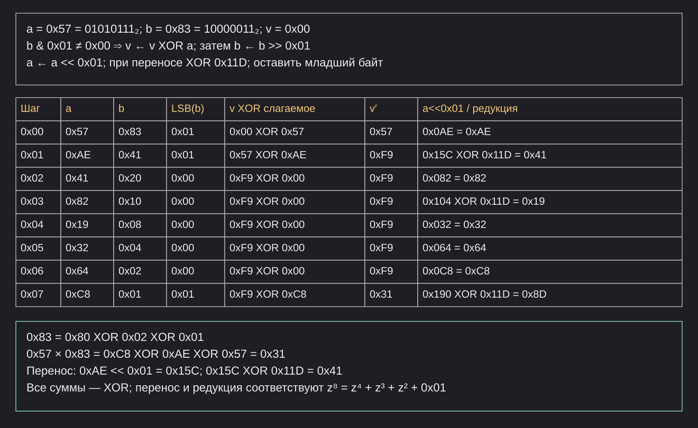

Это арифметика GF(100₁₆ (256)), а не целочисленное умножение по модулю 100₁₆ (256). Модуль 11B₁₆ (283) дал бы другое поле представления и другие таблицы; в архиваторе применяется именно 11D₁₆ (285).

#### Как готовятся фрагменты

1. Добавить перед выбранным payload $Y$ его длину $S$ как u32 LE.
2. Выбрать $q=\lceil(S+4)/10\rceil$; для блоков S ≥ 1, поэтому q ≥ 1.
3. Дополнить нулями до 10q байт и разрезать на $D_0,\ldots,D_9$ по $q$ байт.
4. Получить $P_0,P_1$, тоже по $q$ байт.
5. Записать 12 CRC32 в порядке $D_0,\ldots,D_9,P_0,P_1$, затем сами фрагменты в том же порядке.

Заполнение выравнивает фрагменты; префикс S задаёт точную длину результата. 

#### Порождающая матрица

Для каждого смещения $j$ берётся столбец из 10 байтов $\mathbf d_j$. Библиотека строит матрицу Вандермонда и приводит её к систематическому виду:

~~~math
V_{i,k}=i^k\text{ в GF(256)},\quad
0\le i\lt 12,\ 0\le k\lt 10,\qquad
T=V_{0:10,:},\quad G=VT^{-1}=\begin{bmatrix}I_{10}\\G_p\end{bmatrix}.
~~~

Число $i$ в этой формуле — элемент поля с байтовым представлением i; $i^0=1$, включая строку i=0. Верхние 10 строк единичные, поэтому исходные фрагменты остаются без изменения. Коэффициенты проверочных строк:

~~~math
P_r[j]=\bigoplus_{k=0}^{9}G_p[r,k]\cdot D_k[j],\qquad r\in\{0,1\}.
~~~

**Систематическая матрица RS(12,10).** Коэффициенты в шестнадцатеричном представлении.

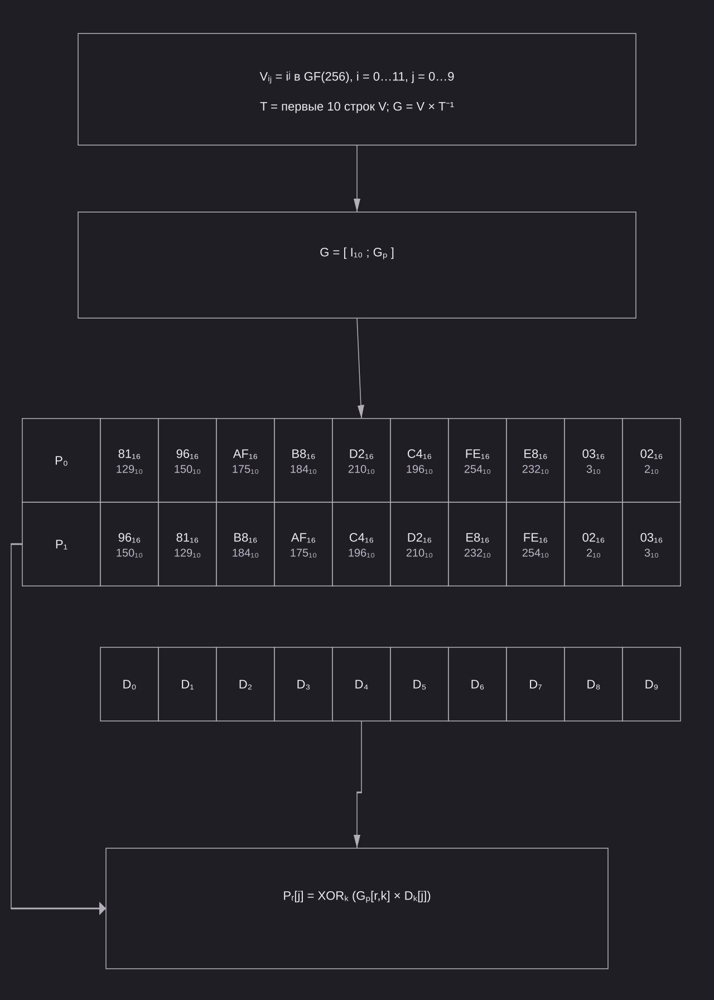

#### Восстановление и его предел

При чтении CRC каждого фрагмента сравнивается с таблицей. Несовпавший фрагмент заменяется на None. Если таких фрагментов больше двух, возвращается ошибка. При одном или двух библиотека выбирает исправные строки матрицы и восстанавливает неизвестные данные. При нуле реконструкция не вызывается.

Пусть $J$ — любые 10 исправных строк, $\mathbf y_J$ — соответствующие байты. Тогда

~~~math
\mathbf d=G_J^{-1}\mathbf y_J.
~~~

После реконструкции информационные фрагменты объединяются, читается внутренний $S$; проверяется $S\le10q-4$ и возвращается соответствующий срез. Внутренний размер не сравнивается непосредственно с аргументом _original_size; дальнейшие проверки блочного и энтропийного декодирования ограничивают допустимость результата.

Для абстрактного кода с двумя проверочными символами условие исправления смешанных ошибок и стираний имеет вид $2t+e\le2$, где $t$ — ошибки с неизвестными позициями, $e$ — известные стирания. **Текущая реализация выполняет путь стираний**, а не поиск неизвестных ошибок: CRC переводит обнаруженные повреждения в $e$. Под гарантией восстановления до двух фрагментов подразумеваются исправная таблица CRC, корректный заголовок и обнаружение фактических повреждений.

#### Численный пример: два отсутствующих фрагмента

$Y=\mathrm{ABCDEF}$, S=06₁₆ (6), q=01₁₆ (1). Префикс длины и payload заполняют ровно 0A₁₆ (10) информационных байтов. На рисунке каждой колонке соответствует один фрагмент: коэффициент строки Gₚ умножается на D в поле, произведения суммируются XOR.

**Вычисление обоих проверочных фрагментов.** Строки накопления позволяют проверить не только конечные BD и 94, но и каждое промежуточное слагаемое.

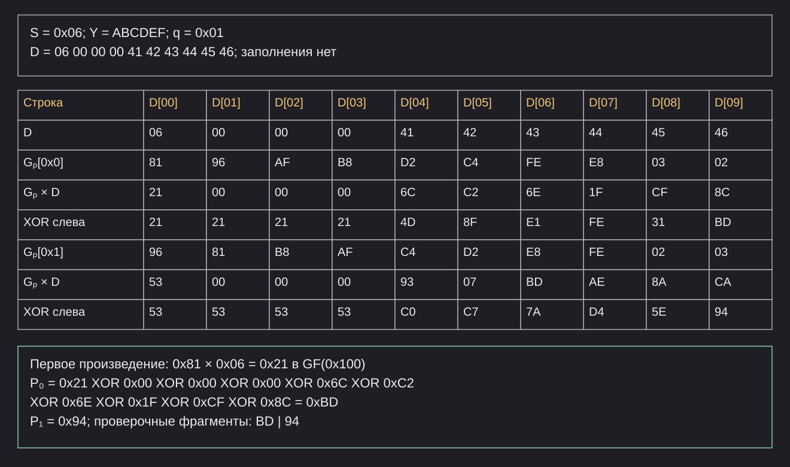

**Восстановление двух стираний.** CRC сообщает позиции D₀ и D₁; их значения неизвестны. Из parity удаляются известные слагаемые, затем решается оставшаяся система. Обращение A возможно, поскольку det A=08₁₆ (8)≠00₁₆ (0); «деление» — умножение на обратный элемент поля.

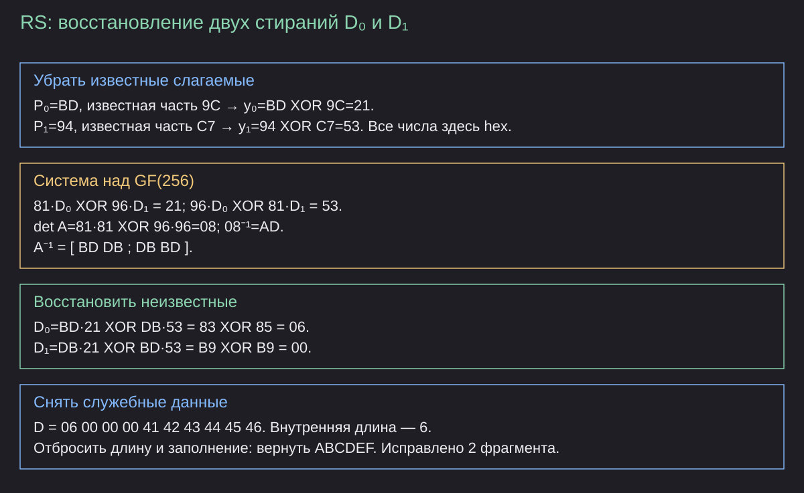

Почему достаточно этих уравнений: для каждого байтового смещения проверочные фрагменты содержат линейные комбинации всех D. После удаления известных членов остаются ровно две неизвестные. Это частный случай общего восстановления по любым десяти исправным строкам систематической матрицы G. Счётчик исправлений здесь равен 02₁₆ (2): он считает фрагменты, а не изменённые байты.

#### Что защита не гарантирует

- Сигнатура и флаги архива не входят в RS и не троируются.
- Таблица CRC32 находится вне RS. Её повреждение может ошибочно пометить исправный фрагмент или нарушить проверку.
- CRC допускает коллизии и не обеспечивает аутентификацию.
- После реконструкции код не выполняет повторную проверку всех CRC; при нуле несовпадений он также не проверяет уравнения parity.
- Более двух обнаруженных повреждённых фрагментов отклоняются, даже если каждый содержит только один изменённый байт.
- Защита — не шифрование; имена и содержимое не являются секретными.

**Полные алгоритмы RS(12,10).** Слева — кодирование, справа — декодирование.

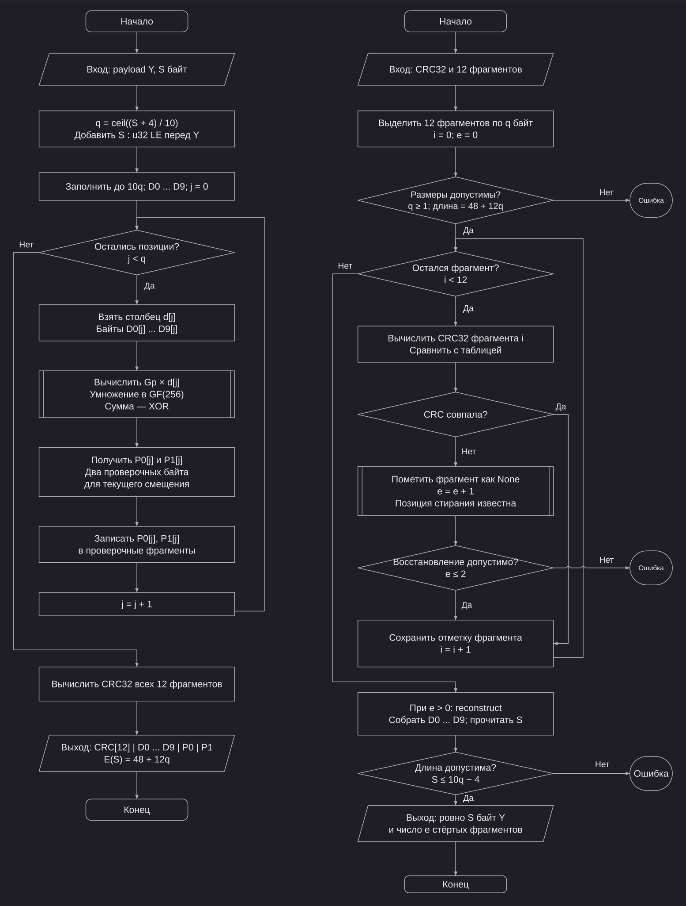

### Троирование заголовков

**Троирование.**

| Параметр | Значение |
| --- | --- |
| Принцип | Запись данных 3 раза подряд |
| Восстановление | Побайтовое голосование большинства (2 из 3) |
| Применение | Заголовки блоков при включённой защите |
| Исправление | До 1 полностью повреждённой копии |
| Три разных байта в одной позиции | Ошибка |

#### Правило голосования и пределы защиты

При --protect четырёхбайтовый заголовок блока записывается как H | H | H. Для каждой позиции i берутся байты $a,b,c$:

~~~math
H[i]=\begin{cases}
a,&a=b\text{ или }a=c,\\
b,&b=c,\\
\text{ошибка},&\text{все три различны}.
\end{cases}
~~~

Это **побайтовое**, не побитовое голосование. Разные позиции могут восстанавливаться из разных пар копий. Одна ошибочная копия каждого байта исправляется. Если две копии одного байта одинаково испорчены, неверное большинство принимается; если все три различны, архив отвергается. Троирование не позволяет обещать исправление любого сочетания «одна ошибка в каждом битовом разряде».

**Восстановление заголовка из трёх разных копий.** В примере повреждённые позиции различаются: правильная пара выбирается независимо в каждой колонке. Ни одна полная копия не обязана остаться исправной. Контрпримеры показывают отсутствие большинства и ошибочное большинство.

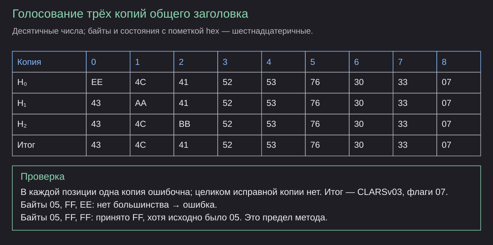

После голосования проверяются S ≤ N и допустимость режима сжатия.

## Формат

Формат CLARSLIB v2 рассчитан на последовательную запись и чтение. Числа записываются в порядке little-endian.

### Заголовок архива (9 байт)

| Смещение | Размер | Поле | Значение |
| --- | --- | --- | --- |
| 0 | 8 | Подпись | 43 4C 41 52 53 76 30 32 (CLARSv02) |
| 8 | 1 | Флаги | Биты: [0] LZ77, [1] rANS, [2] RS |

| Флаги | Этапы |
| --- | --- |
| 00 | Без сжатия и RS |
| 01 | LZ77 |
| 02 | rANS |
| 03 | LZ77 + rANS |
| 04 | RS |
| 05 | LZ77 + RS |
| 06 | rANS + RS |
| 07 | LZ77 + rANS + RS |

### Заголовок блока (4 байта; при RS — троированный 12 байт)

| Смещение | Размер | Поле | Значение |
| --- | --- | --- | --- |
| 0 | 2 | N - 1 | Исходный размер N = 1..=65536 |
| 2 | 2 | S - 1 | Сохранённый размер S = 1..=N |

### Данные блока

### Записи файлов и папок

| Поле | Размер | Значение |
| --- | --- | --- |
| Тип | 1 | 0 конец, 1 файл, 2 папка |
| Длина имени P | 1..2 | varint, 1..=4096 |
| Имя | P | UTF8, разделитель / |
| Размер F | 1..10 | varint (только файл) |
| Содержимое | F | (только файл) |

### Переменные целые (varint, LEB128)

| Число hex | Байты hex |
| --- | --- |
| 7F₁₆ (127) | 7F |
| 80₁₆ (128) | 80 01 |
| 1000₁₆ (4 096) | 80 20 |
| 1 0000₁₆ (65 536) | 80 80 04 |

### Поток LZ77

| Часть | Размер | Значение |
| --- | --- | --- |
| Исходная длина | 1..3 | varint 0..=65536 (на блочном уровне N ≥ 1) |
| Тройки | переменный | (длина, расстояние, байт) |

### Поток rANS

| Поле | Размер | Описание |
| --- | --- | --- |
| n | 1..3 | Длина результата отдельного rANS-вызова, до 131075 байт |
| D - 1 | 1 | Число символов |
| Алфавит | A | Список или битовая карта |
| Частоты | Q | D-1 значений |
| x | 4 | Состояние |
| Перенормировка | остаток | Байты перенормировки |

### Общая структура архива

Поток записей разрезается на блоки: запись, имя и содержимое могут пересекать границу блока. Последняя запись в архиве имеет тип 0 (конец).

### Проверки формата и пример

#### Проверка флагов

Биты 3…7 должны быть нулевыми; иначе формат отклоняется. Флаги едины для всего архива. По умолчанию 03; с защитой по умолчанию 07. Данные не обязаны сжиматься в каждом блоке, даже если эти биты установлены.

#### Смещённые размеры блока

Уменьшение на 1 позволяет представить диапазон 1…65536 в 16 битах: 00 00 → 1, FF FF → 65536. Нулевой блок отсутствует. CRC исходного блока и CRC заголовка не записываются.

#### Смещения полей защищённого блока

| Смещение | Длина | Поле |
|---:|---:|---|
| 0 | 4 | Первая копия H |
| 4 | 4 | Вторая копия H |
| 8 | 4 | Третья копия H |
| 12 | 48 | CRC32 фрагментов D₀…D₉, P₀, P₁; по 4 байта LE |
| 60 | 10q | Информационные фрагменты, по q байт |
| 60 + 10q | 2q | Проверочные фрагменты, по q байт |

$q=\lceil(S+4)/10\rceil$. Поле S в H описывает **Y до RS**, а не длину CRC и фрагментов.

**Раскладка архива и защищённого блока.**

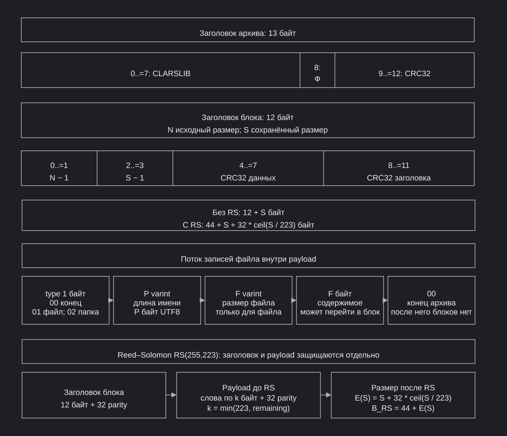

#### Границы логических записей

~~~text
Файл:
    01 | P : varint | имя : P байт UTF-8 | F : varint | содержимое : F байт
Папка:
    02 | P : varint | имя : P байт UTF-8
Конец:
    00
~~~

У папки нет полей F и содержимого. Пустой файл имеет F=0. Завершитель 00 — отдельная запись без имени и размера. После него не должно быть остатка декодированного блока, ожидающих блоков или дополнительных физических данных.

Имя хранится относительно корня извлечения с разделителем /. Корневая запись источника содержит его имя, а не абсолютный путь. При упаковке папка записывается перед детьми; дети сортируются по имени. Данные нескольких источников составляют один поток.

#### Unsigned LEB128 и битовые поля

~~~math
V=\sum_{i=0}^{k-1}(b_i\bmod128)2^{7i}.
~~~

Старший бит байта 1 означает продолжение, 0 — конец. Группы идут от младшей к старшей. Писатель выдаёт кратчайшую запись, читатель требует каноничность.

Предел для u64 — 10 байт; в десятом допустимы только 0 или 1, но завершающая избыточная нулевая группа в многобайтовой записи отвергается. Например, 80 00 неканонично, AC 82 00 неканонично. Отдельные читатели также накладывают предел значения: путь до 4096 байт, LZ77-длина до 65536, rANS-длина до 131075.

**Флаги, varint и смещённые поля.** Сверху вниз: флаги, LEB128, число символов rANS, карта алфавита, смещённые размеры.

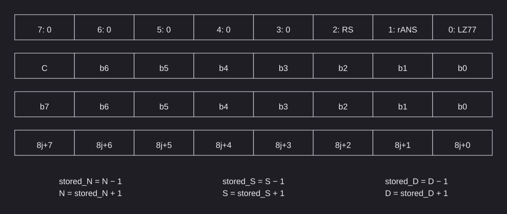

**Расчёт LEB128 для 12C₁₆ (300).** Рисунок отделяет бит продолжения от семи информационных битов. Младшая группа записывается первой; при чтении старшая сдвигается на 07₁₆ (7) разрядов. Поэтому AC 02 — каноническая запись, а AC 82 00 содержит лишнюю завершающую группу.

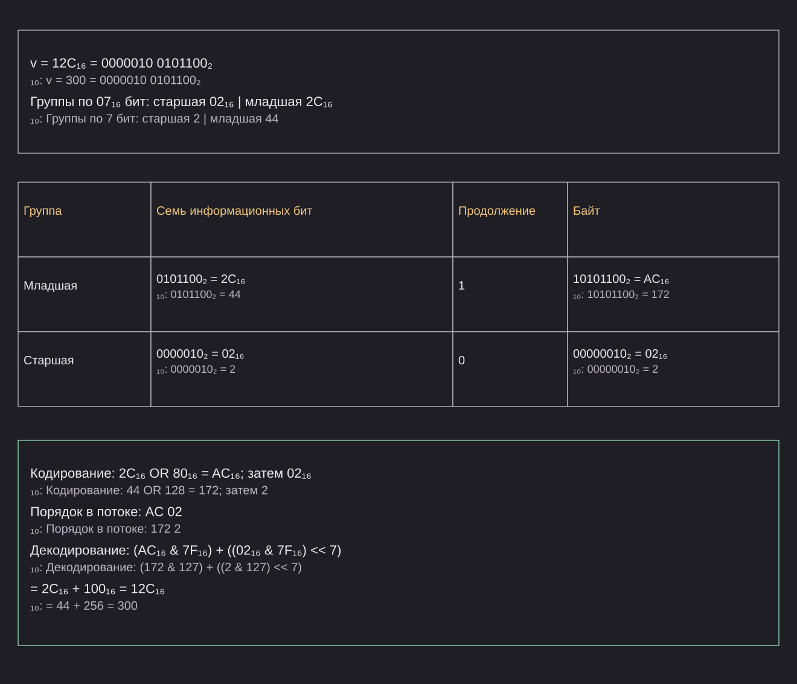

#### Полный минимальный пример

Файл с именем a и одним байтом A; сжатие и защита выключены. Логический поток:

~~~text
01 01 61 01 41 00
₁₀: 1 1 97 1 65 0
│  │  │  │  │  └ конец архива
│  │  │  │  └ содержимое: A
│  │  │  └ размер файла 01₁₆ (1)
│  │  └ имя a
│  └ длина имени 01₁₆ (1)
└ тип: файл
~~~

N=S=06₁₆ (6), поэтому заголовок блока равен 05 00 05 00. Весь архив — 13₁₆ (19) байт:

~~~text
43 4C 41 52 53 76 30 32 00
₁₀: 67 76 65 82 83 118 48 50 0
05 00 05 00
₁₀: 5 0 5 0
01 01 61 01 41 00
₁₀: 1 1 97 1 65 0
~~~

**Тот же файл с защитой и без сжатия.** Флаги 04, заголовок повторён, q=01₁₆ (1). Длина S включена в RS, а CRC — нет. На рисунке приведены все поля, смещения и CRC каждого фрагмента; вместе они однозначно задают архив размером 51₁₆ (81) байт. При повреждении не более двух фрагментов восстановление выполняется так же, как в разобранной системе выше.

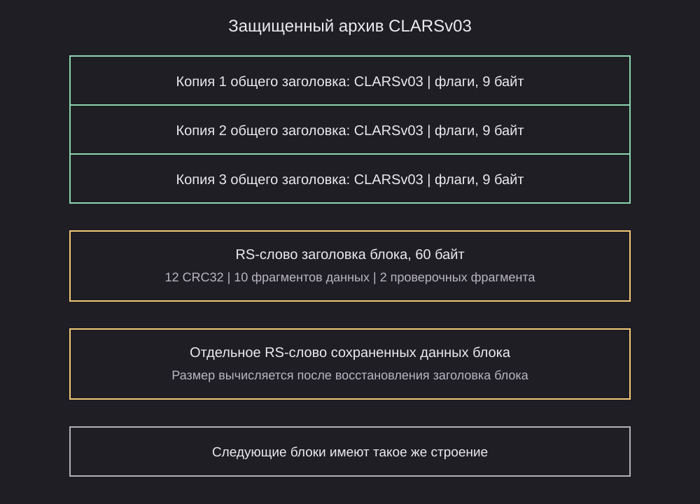

## Тестирование

Запуск: cargo test --test all --locked. Проверки:

| Группа | Тест | Описание |
| --- | --- | --- |
| LZ77 | Перебор коротких входов | Алфавит 3, длина до 8, 9841 вход |
| LZ77 | Повторяющиеся префиксы | 2308 байт |
| LZ77 | Пример ABABABA | Проверка кодирования |
| LZ77 | Сравнение с прямым поиском | 4 входа |
| LZ77 | Границы длины и окна | 258 байт, окно 4094-4095 |
| rANS | Кодирование и декодирование | 1..256 символов |
| RS | Кодирование и декодирование | 1, 10, 100, 1000, 65536 байт |
| RS | Исправление фрагментов | 2 повреждённых из 12 |
| RS | Превышение числа повреждений | 3 > parity=2 |
| Троирование | Кодирование и декодирование | Roundtrip |
| Троирование | Исправление одной копии | 1 из 3 повреждена |
| Троирование | Все копии различны | Ошибка |
| Блочный поток | С защитой и без | 2 блока, roundtrip |
| Блочный поток | Все 8 режимов | flags 0..7, 4 входа |
| Многопоточность | Параллельное выполнение | 2 потока |
| Многопоточность | Партии и границы | 2-3 потока |
| Команды | Создание и распаковка | CLI roundtrip |
| Команды | 8 режимов через CLI | flags 0..7 |

~~~text
OK: 18
ERR: 0
~~~

## Бенчмарк

Справочные измерения: Windows x86_64, 12 процессоров, release. Точный корпус и версия Rust не зафиксированы; повторные измерения не проводились.

### Степень сжатия (1 МиБ)

| Набор данных | Исходный | Архив | Экономия |
| --- | --- | --- | --- |
| Одинаковые байты | 1 048 576 | 2 953 | 99.72% |
| Повторяющиеся строки | 1 048 576 | 3 193 | 99.70% |
| Текст и исходники | 1 048 576 | 7 324 | 99.30% |
| Все значения байта | 1 048 576 | 15 817 | 98.49% |
| Псевдослучайные данные | 1 048 576 | 1 048 649 | -0.01% |
| Смешанные блоки | 1 048 576 | 525 801 | 49.86% |

### Скорость (1 МиБ, LZ77+rANS)

| Набор данных | Упаковка МБ/с | Распаковка МБ/с |
| --- | --- | --- |
| Одинаковые байты | 57.8 | 128.5 |
| Повторяющиеся строки | 59.9 | 258.8 |
| Текст и исходники | 57.4 | 236.9 |
| Все значения байта | 51.4 | 225.7 |
| Псевдослучайные данные | 8.9 | 554.2 |
| Смешанные блоки | 15.4 | 256.8 |

### Масштабирование по потокам (2 МиБ, смешанные)

| Потоков | Упаковка МБ/с | Ускорение | Распаковка МБ/с |
| --- | --- | --- | --- |
| 1 | 18.0 | 1.00x | 263.1 |
| 2 | 30.0 | 1.67x | 239.8 |
| 4 | 48.6 | 2.70x | 350.6 |
| 8 | 73.0 | 4.05x | 364.6 |

### Цена RS-защиты

| Набор данных | Без RS | С RS | Прирост размера |
| --- | --- | --- | --- |
| Одинаковые байты | 2 953 | 4 617 | +56.3% |
| Текст и исходники | 7 324 | 9 825 | +34.1% |
| Все значения байта | 15 817 | 19 977 | +26.3% |
| Псевдослучайные данные | 1 048 649 | 1 259 337 | +20.1% |
| Смешанные блоки | 525 801 | 631 977 | +20.2% |

### Демо-корпус (128 МиБ)

| Параметр | Значение |
| --- | --- |
| Исходный размер | 134 264 307 байт (128.04 МиБ) |
| Размер архива | 67 324 715 байт (64.20 МиБ) |
| Экономия | 49.86% |
| Скорость упаковки | 12.4 МБ/с |
| Скорость распаковки | 63.7 МБ/с |

### Память

| Режим | Потоков | Упаковка | Распаковка |
| --- | --- | --- | --- |
| Без RS | 1 | 6.07 МиБ | 5.34 МиБ |
| С RS | 1 | 6.11 МиБ | 5.50 МиБ |

### Расчёт физического размера

Для сохранённого payload $S$:

~~~math
\begin{aligned}
B_0(S)&=4+S,\\
q(S)&=\left\lceil\frac{S+4}{10}\right\rceil,\\
E(S)&=48+12q(S),\\
B_{RS}(S)&=12+E(S)=60+12q(S).
\end{aligned}
~~~

$E$ — только защищённое содержимое после троированного заголовка; $B$ — весь физический блок. Архив из $m$ блоков занимает

~~~math
A=9+\sum_{i=0}^{m-1}B(S_i).
~~~

Имена источников входят в исходный поток.

Пусть $z=10q-(S+4)$ — число байтов заполнения, $0\le z\le9$. Тогда

~~~math
B_{RS}(S)=64+S+z+2q.
~~~

Состав накладных расходов: 12 байт заголовков, 48 байт CRC, 4 байта внутреннего размера, $z$ заполнения и $2q$ parity. Сама RS-часть фрагментов имеет скорость $10/12=5/6$ и 20% проверочных байтов относительно информационной части. **Весь блок** имеет большие относительные расходы, особенно при малом S.

| S | q | Без RS: B₀ | С RS: B_RS |
|---:|---:|---:|---:|
| 1₁₆ (1) | 1₁₆ (1) | 5₁₆ (5) | 48₁₆ (72) |
| 6₁₆ (6) | 1₁₆ (1) | A₁₆ (10) | 48₁₆ (72) |
| 40₁₆ (64) | 7₁₆ (7) | 44₁₆ (68) | 90₁₆ (144) |
| 100₁₆ (256) | 1A₁₆ (26) | 104₁₆ (260) | 174₁₆ (372) |
| 400₁₆ (1 024) | 67₁₆ (103) | 404₁₆ (1 028) | 510₁₆ (1 296) |
| 1000₁₆ (4 096) | 19A₁₆ (410) | 1004₁₆ (4 100) | 1374₁₆ (4 980) |
| 1 0000₁₆ (65 536) | 199A₁₆ (6 554) | 1 0004₁₆ (65 540) | 1 3374₁₆ (78 708) |

При переходе границы фрагмента RS-блок увеличивается на 0C₁₆ (12) байт. Между границами он постоянен. При больших S отношение $B_{RS}(S)/S$ стремится к 1.2; при максимальном S=1 0000₁₆ (65 536) дополнительный размер относительно payload составляет 3374₁₆ (13 172) байта, около 20.10%.

### Показатели эффективности

Необходимо указывать знаменатель. Для блока до защиты:

~~~math
\rho_{payload}=S/N,\qquad g_{payload}=1-S/N.
~~~

Для всего архива, если исходные файлы занимают F байт:

~~~math
\rho_{archive}=A/F\quad(F\gt 0).
~~~

Эти показатели различаются: архив содержит имена, папки, завершающую запись, заголовки и, при защите, parity. Для набора только пустых файлов F=0, отношение не определено. Размер на диске с учётом кластеров файловой системы не равен размеру потока архива.

Статистика original_bytes считает содержимое файлов, а compressed_blocks и stored_blocks — блоки потока записей. Нельзя напрямую считать средний выигрыш блока из количества файлов или обещать ускорение T-кратное числу потоков.
