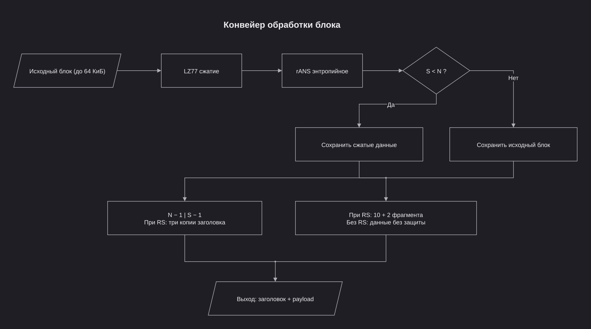
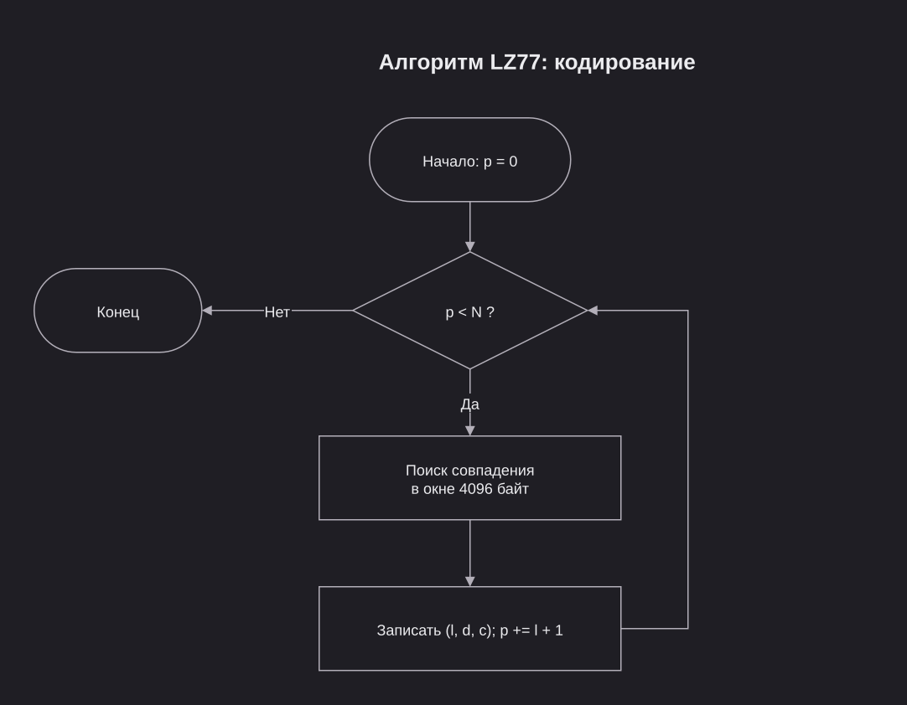
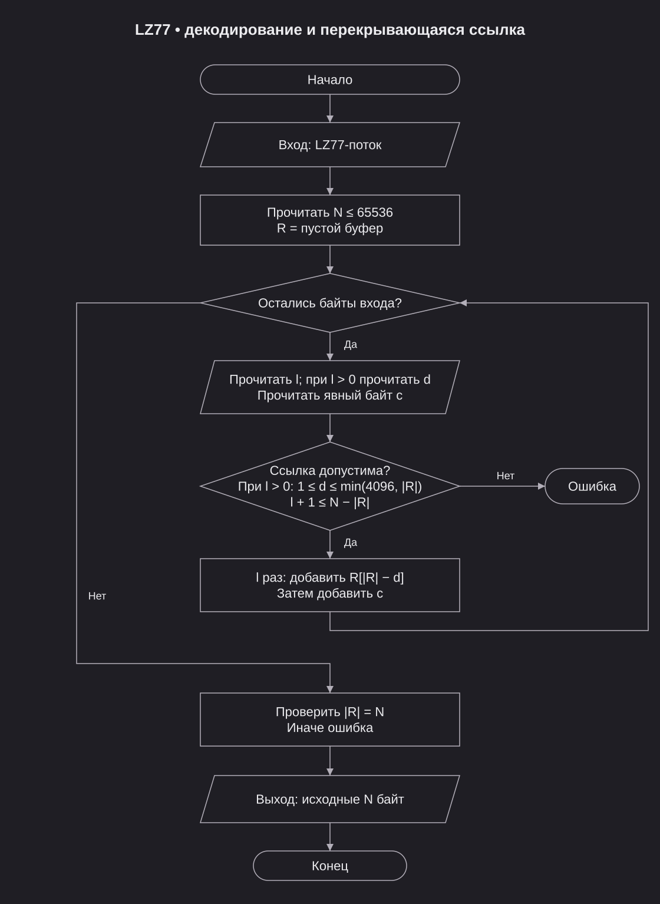
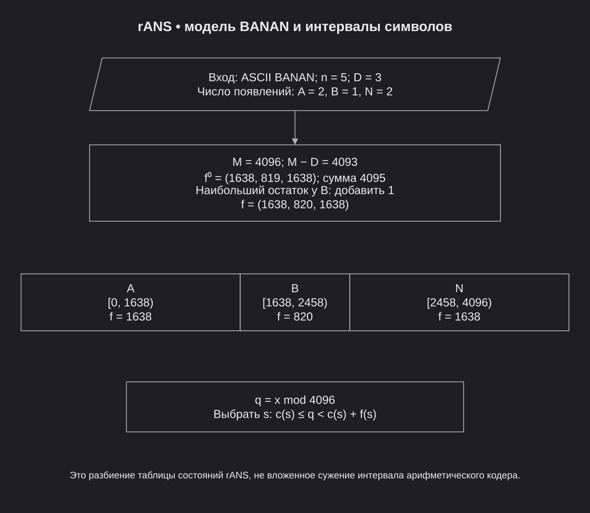
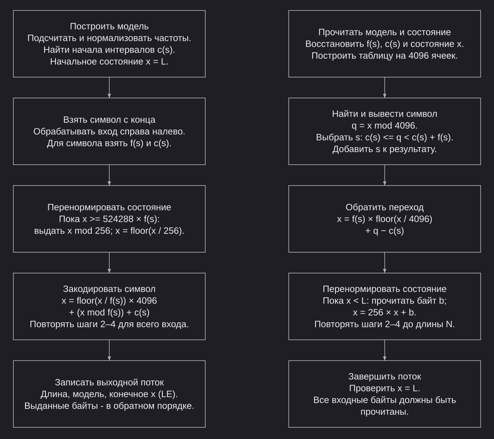
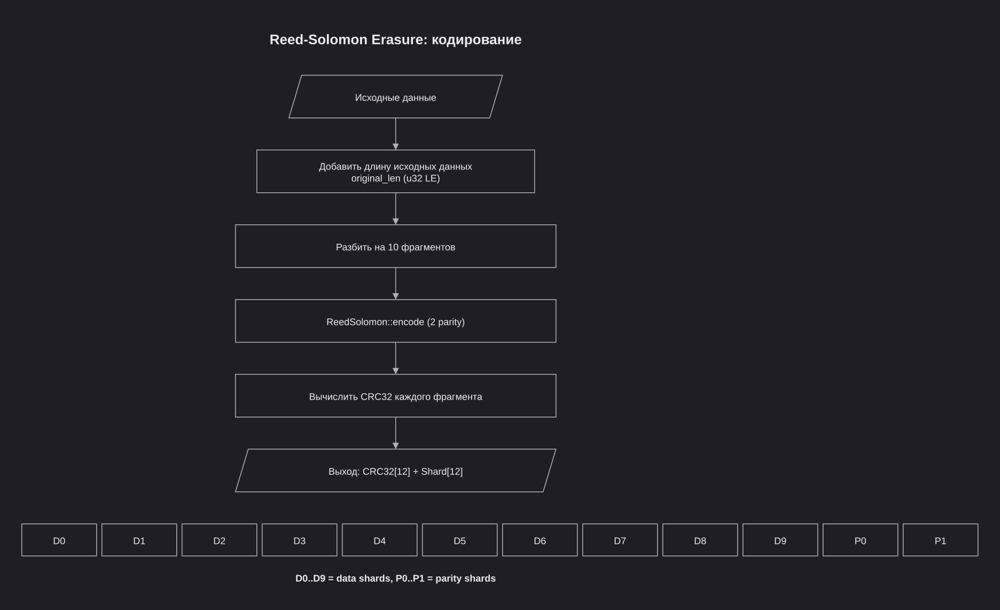
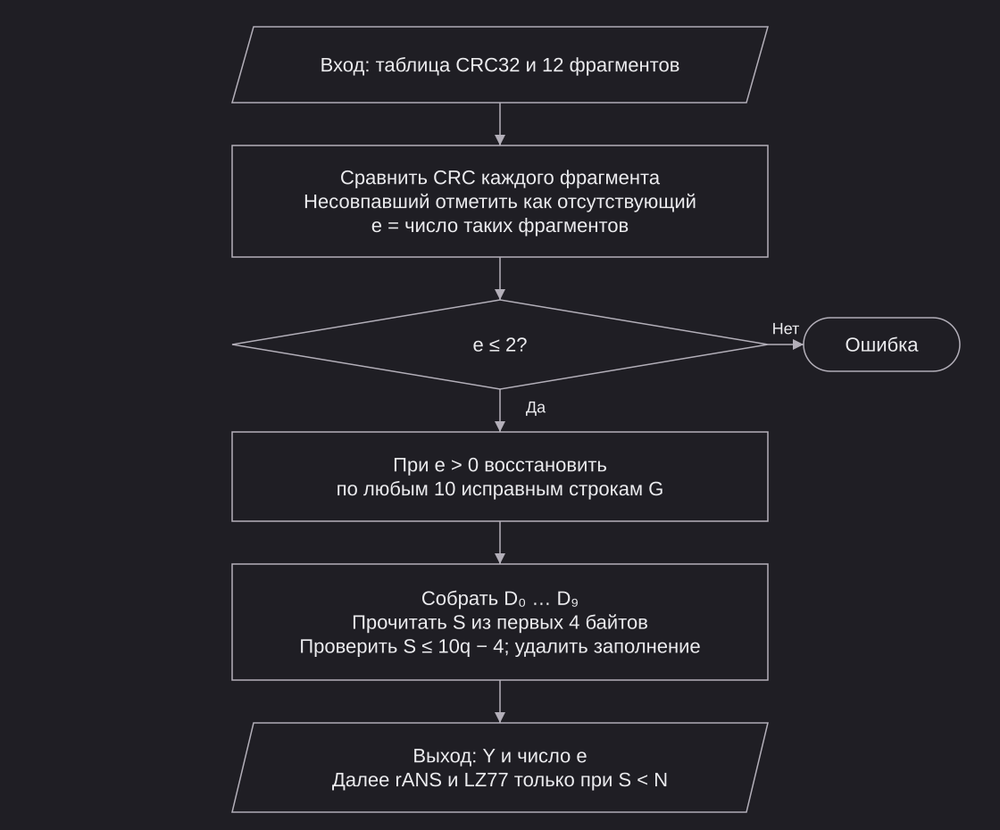
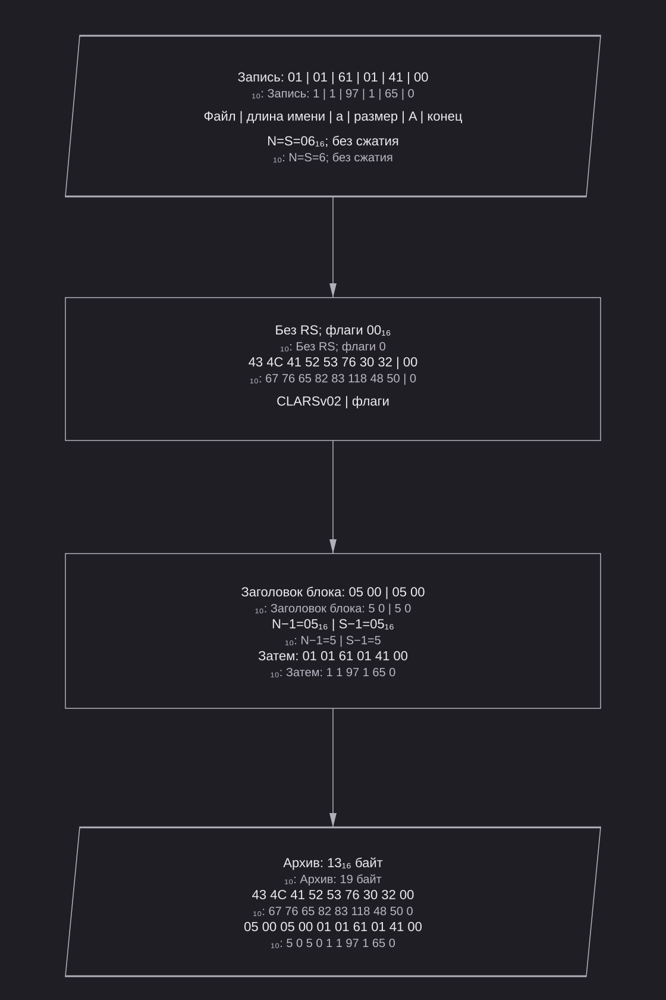
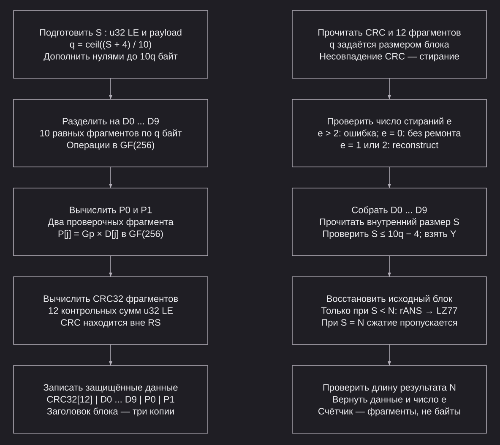

# CLARSLIB v2

- [Параметры](#task)
- [Структура](#architecture)
- [Алгоритмы](#algorithms)
- [Формат](#format)
- [Тестирование](#experiments)
- [Бенчмарк](#benchmark)
- [Справочные материалы](#reference)

<a name="task"></a>

## Постановка задачи и требования

| Параметр | Значение |
| --- | --- |
| Кодирование | LZ77 => rANS => Reed–Solomon (независимы) |
| Версия формата | 2; сигнатура CLARSv02 |
| Контроль целостности | CRC32 каждого RS-фрагмента при включённой защите |
| Защита заголовков блоков | Три копии по 4 байта; побайтовое голосование большинства |
| Защита данных | Reed–Solomon erasure: 10 информационных и 2 проверочных фрагмента |
| Размер исходного блока | 1..=65536 байт |
| Число потоков T | 1..=64; по умолчанию min(число процессоров, 64) |
| Размер партии | 1 блок при T = 1; max(4, 2T) при T > 1 |
| Порядок блоков | Исходный, результат не зависит от числа T |
| Словарь и модель | Отдельные для каждого блока |
| Выбор сжатого представления | При S < N |
| Создание архива | Только новый файл; существующий не перезаписывается |
| Извлечение | Только новая папка; исключение сбрасывает результат |
| Источники | Несколько файлов и папок, пустые файлы и папки, имена только в UTF8 |
| Ссылки и reparse points | Запрещены |
| Архив внутри исходной папки | Исключается из входных данных |

Все схемы находятся в [docs/diagrams.drawio](docs/diagrams.drawio). Файлы SVG находятся в `docs/figures/`. Обозначения блок-схем: прямоугольник — процесс, ромб — решение, параллелограмм — данные, скруглённый терминатор — начало, конец или аварийное завершение (ГОСТ 19.701–90). Структурные схемы и раскладки полей показывают состав данных, а не ветвления алгоритма.

Формат `CLARSv02` использует erasure coding и несовместим с форматом с сигнатурой `CLARSLIB` и RS(255,223). Справочные материалы последнего приведены отдельно.

<a name="architecture"></a>

## Структура архиватора



Исходные записи файлов и папок делятся на блоки до 64 КиБ. Включённые этапы LZ77 и rANS применяются последовательно; отключённые этапы пропускаются. Сжатое представление сохраняется только при S < N, иначе записывается исходный блок. N — исходный размер, S — сохранённый размер до добавления RS.

Заголовок архива содержит сигнатуру CLARSv02 и флаги (9 байт). Заголовок блока содержит N − 1 и S − 1 (4 байта). При RS этот заголовок записывается тремя копиями (12 байт), а payload защищается 10 информационными и 2 проверочными фрагментами с таблицей CRC32. Без RS контрольные суммы блоков не записываются.

Параллельные задания выполняются локальным пулом Rayon. Результаты записываются в исходном порядке; пул создаётся по мере необходимости и переиспользуется.

<a name="algorithms"></a>

## Алгоритмы

### LZ77




**Обозначения на схеме:**

|  |  |
| --- | --- |
| `N` | Общее число исходных байтов. |
| `p` | Позиция ещё не обработанного байта при кодировании. |
| `l` | Длина найденного совпадения. |
| `d` | Расстояние назад от текущей позиции до начала совпадения. |
| `c` | Явный байт, добавляется после скопированного совпадения. |
| `R` | Буфер уже восстановленных байт при декодировании. |
| `j` | Колличество скопированных байт текущего совпадения. |



**Обозначения на схеме:**

| Параметр | Значение |
| --- | --- |
| Единица обработки | Байт |
| Окно | 4096 байт |
| Максимальная длина совпадения | 255 байт |
| Результат | Расстояние, длина совпадения, следующий байт |
| Последний байт | Явный |
| Хеш | По первым двум байтам; 4096 цепочек позиций; совпадение проверяется побайтово |
| Порядок поиска | От новых позиций к старым |
| Равные длины | Ближайшее совпадение |
| Совпадение длины 1 | Таблица последних позиций каждого байта |
| Обновление таблиц | Все пройденные позиции |
| Окончание поиска | Максимально допустимая длина; ограничения числа кандидатов нет |

#### Пример ABABABA


| Позиция | Совпадение | Тройка | Результат |
| --- | --- | --- | --- |
| 0 | Нет | 0, 0, A | A |
| 1 | Нет | 0, 0, B | AB |
| 2 | ABAB, расстояние 2 | 2, 4, A | ABABABA |

```text
07 | 00 41 | 00 42 | 04 02 41
7      A       B    длина 4, расстояние 2, A
```

| Граничные случаи | Результат |
| --- | --- |
| AAAAAA | (0, 0, A), (1, 4, A); перекрытие ссылки |
| abXabYabZ | На позиции 6: длина 2, расстояние 3 вместо 6 |
| 258 байт A | (0, 0, A), (1, 255, A), (0, 0, A) |
| AB, 4094 нулевых байта, AB! (граница окна)| Последняя ссылка на B: расстояние 4096 |
| AB, 4095 нулевых байтов, AB! | B вне окна, явный байт |

### rANS




**Обозначения на схеме:**

|  |  |
| --- | --- |
| `N` | Число байтов входа rANS. |
| `s` | Текущий кодируемый или восстанавливаемый символ. |
| `f(s), f` | Нормализованная частота текущего символа. |
| `c(s), c` | Начало интервала символа в общей таблице частот. |
| `x` | Текущее числовое состояние rANS. |
| `L` | Нижняя граница состояния и его начальное значение. |
| `i` | Индекс символа при кодировании справа налево. |
| `B` | Список байтов, временно вынесенных из состояния x. |
| `b` | Очередной байт перенормировки, прочитанный декодером. |
| `k` | Число уже восстановленных символов. |
| `q` | Позиция состояния в таблице частот. |



| Параметр | Значение |
| --- | --- |
| Состояние | Одно 32 битное целое x |
| Сумма частот M | 4096 = 2^12 |
| Нижняя граница L | 8388608 = 2^23 |
| Начальное состояние кодера | L |
| Кодирование | Справа налево |
| Декодирование | Слева направо |
| Таблица декодирования | 4096 ячеек |

#### Модель частот

| Параметр | Значение |
| --- | --- |
| N | Ненулевая длина входа |
| D | Число различных байтов |
| n(s) | Число появлений символа s |
| f(s) | Нормализованная частота |
| c(s) | Сумма частот символов, меньших s |

$$
f(s)=1+\left\lfloor\frac{n(s)(4096-D)}{N}\right\rfloor
$$

| Параметр | Значение |
| --- | --- |
| Распределение остатка | Единицы по убыванию остатков деления n(s) * (4096 - D) на N |
| Равные остатки | Первым меньший байт |
| Пример ABC | Первоначально 1365, 1365, 1365; итог 1366, 1365, 1365 |

#### Операции

| Параметр | Значение |
| --- | --- |
| Перенормировка кодера | Пока x ≥ 524288 * f(s): выдать x mod 256, затем x = floor(x / 256) |
| Кодирование | x = floor(x / f(s)) * 4096 + (x mod f(s)) + c(s) |
| Выбор символа | q = x mod 4096; c(s) ≤ q < c(s) + f(s) |
| Декодирование | x = f(s) * floor(x / 4096) + q - c(s) |
| Перенормировка декодера | Пока x < L: прочитать b, затем x = 256x + b |
| Порядок байтов в потоке | Обратный порядку выдачи кодером |

#### Пример ABAB


| Параметр | Значение |
| --- | --- |
| Выданные байты | Нет |
| Итоговое состояние | 08 00 50 00 |
| Частота B | 4096 - 2048; не хранится |
| Размер потока | 10 байт |

```text
04 | 01 | 41 42 | 80 10 | 00 50 00 08
N   D-1   A,  B    f(A)    состояние
```

#### Пример перенормировки ABABABABABABABAB

`f(A) = f(B) = 2048; порог = 1073741824`

| Переход | Символ | x до выдачи | Байт | x после деления на 256 | x после перехода |
| --- | --- | --- | --- | --- | --- |
| 8 | A | 1073915904 | 00 | 4194984 | 8389288 |
| 16 | A | 1073916584 | A8 | 4194986 | 8389290 |

| Параметр | Значение |
| --- | --- |
| Итоговое состояние 00 80 02 AA | AA 02 80 00 |
| Перенормировка | A8 00 |
| Полный поток | 10 01 41 42 80 10 AA 02 80 00 A8 00 |

### CRC32

В режиме RS контрольная сумма каждого из 12 фрагментов определяет стирания. CRC32 обнаруживает повреждение, но сама не исправляет его. Повреждение таблицы CRC32 также может повлиять на восстановление.


**Обозначения на схеме:**

|  |  |
| --- | --- |
| `i` | Номер элемента при построении таблицы CRC32. |
| `c` | Временное значение для расчёта одного элемента таблицы. |
| `TABLE, TABLE[i]` | Готовая таблица CRC32 и её элемент с номером i. |
| `crc` | Рабочий регистр контрольной суммы. |
| `b` | Очередной байт исходных данных. |
| `index` | Номер элемента таблицы для обработки текущего байта. |
| `0xFFFFFFFF` | Начальное значение регистра. |
| `0xEDB88320` | Константа отражённого полинома CRC32. |

#### Расчёт для A = 41

| Шаг | Регистр |
| --- | --- |
| После XOR | FF FF FF BE |
| 1 | 7F FF FF DF |
| 2 | D2 47 7C CF |
| 3 | 84 9B 3D 47 |
| 4 | AF F5 1D 83 |
| 5 | BA 42 0D E1 |
| 6 | B0 99 85 D0 |
| 7 | 58 4C C2 E8 |
| 8 | 2C 26 61 74 |
| После инверсии | D3 D9 9E 8B |

| Вход | CRC32 |
| --- | --- |
| Пустой | 00 00 00 00 |
| 123456789 | CB F4 39 26 |
| ABABABA | DB C2 50 ED |

### Reed-Solomon (erasure coding)





| Параметр | Значение |
| --- | --- |
| Код | RS erasure (10 data + 2 parity shards) |
| Подготовка данных | original_len (u32 LE) + payload |
| Разбиение | ceil((len+4) / 10) байт на фрагмент |
| Кодирование | ReedSolomon::encode добавляет 2 проверочных фрагмента |
| Формат выхода | CRC32 таблица (12 x 4 байта) + тела фрагментов (12 x shard_size) |
| Обнаружение повреждений | CRC32 каждого фрагмента |
| Восстановление | До 2 утраченных фрагментов (стираний) |
| Более 2 повреждений | Ошибка |

### Троирование заголовков


| Параметр | Значение |
| --- | --- |
| Принцип | Запись данных 3 раза подряд |
| Восстановление | Побайтовое голосование большинства (2 из 3) |
| Применение | Заголовки блоков при включённой защите |
| Исправление | До 1 полностью повреждённой копии |
| Все 3 копии различны | Ошибка |

Троируются только заголовки блоков при включённом RS. Внешний заголовок архива (9 байт) записывается один раз. Для каждой позиции байта берётся совпадающее значение двух копий; если все три значения различны, декодирование завершается ошибкой.


<a name="format"></a>

## Формат



Формат CLARSLIB v2 рассчитан на последовательную запись и чтение. Числа записываются в порядке little-endian.

### Заголовок архива (9 байт)

```
+---+---+---+---+---+---+---+---+---+
| C   L   A   R   S   v   0   2 | F |
+---+---+---+---+---+---+---+---+---+
|<-------- сигнатура (8) ------->|1б|
```

| Смещение | Размер | Поле | Значение |
| --- | --- | --- | --- |
| 0 | 8 | Подпись | 43 4C 41 52 53 76 30 32 (CLARSv02) |
| 8 | 1 | Флаги | Биты: [0] LZ77, [1] rANS, [2] RS |

| Флаги | Этапы |
| --- | --- |
| 00 | Без сжатия и RS |
| 01 | LZ77 |
| 02 | rANS |
| 03 | LZ77 + rANS |
| 04 | RS |
| 05 | LZ77 + RS |
| 06 | rANS + RS |
| 07 | LZ77 + rANS + RS |

### Заголовок блока (4 байта; при RS — троированный 12 байт)

```
Без RS:
+-------+-------+
| N-1   | S-1   |
+-------+-------+
| 2 LE  | 2 LE  |

С RS (троирование):
+-------+-------+-------+-------+-------+-------+
| Копия 1 (4 б) | Копия 2 (4 б) | Копия 3 (4 б) |
+-------+-------+-------+-------+-------+-------+
```

| Смещение | Размер | Поле | Значение |
| --- | --- | --- | --- |
| 0 | 2 | N - 1 | Исходный размер N = 1..=65536 |
| 2 | 2 | S - 1 | Сохранённый размер S = 1..=N |

### Данные блока

```
Без RS:
+---------------------------+
|     Данные (S байт)       |
+---------------------------+

С RS:
+---+---+---+---+---+---+---+---+---+---+---+---+
|CRC32 таблица: 12 x u32 LE = 48 байт             |
+---+---+---+---+---+---+---+---+---+---+---+---+
|D0 |D1 |D2 |D3 |D4 |D5 |D6 |D7 |D8 |D9 |P0 |P1 |
+---+---+---+---+---+---+---+---+---+---+---+---+
|<-- data shards (10) -->|<-- parity (2) -->|
```

Размер RS-защищённых данных:

```
E(S) = 12 * 4 + 12 * ceil((S + 4) / 10)
```

### Записи файлов и папок

| Параметр | Значение |
| --- | --- |
| P | Длина имени в байтах UTF8 |
| F | Размер файла |
| a, b | Длины переменной записи P и F |

| Смещение | Размер | Поле | Допустимые значения |
| --- | --- | --- | --- |
| 0 | 1 | Тип | 0 конец архива, 1 файл, 2 папка; прочие запрещены |
| 1 | a = 1..=2 | Длина имени P | 1..=4096; только типы 1 и 2 |
| 1 + a | P | Имя | UTF8; разделитель `/` |
| 1 + a + P | b = 1..=10 | Размер F | 0..2^64 - 1; только тип 1 |
| 1 + a + P + b | F | Содержимое | Ровно F байт; только тип 1 |

| Ограничение | Значение |
| --- | --- |
| Конец архива | Один байт 00; последующие данные и блоки запрещены |
| Пустой файл | F = 0 |
| Пустая папка | Обычная запись типа 2 |
| Порядок записей | Родительская папка раньше её содержимого |
| Компонент имени | Не более 255 байт |
| Глубина | Не более 128 уровней |
| Число записей | Не более 100000 |
| Запрещённые пути | Абсолютные, `.` и `..`, обратный слеш, управляющие символы, имена устройств Windows |
| Повторы | Запрещены без учёта регистра; одинаковое имя файла и папки запрещено |

### Переменные целые и битовые поля

$$
V=\sum_{i=0}^{k-1}(b_i\bmod 128)\,2^{7i}
$$

где `b_i` — i-й байт varint, `k` — число байтов, `i` — индекс группы с нуля. `b_i mod 128` удаляет бит продолжения.

| Поле байта | Размер | Значение |
| --- | --- | --- |
| Биты 0-6 | 7 бит | Очередная группа числа, начиная с младших разрядов |
| Бит 7 | 1 бит | 1 продолжение, 0 последний байт |

| Ограничение | Значение |
| --- | --- |
| Длина записи | 1..=10 байт; только кратчайшая запись |
| Десятый байт | Только 01 |
| Ноль | Только однобайтовое 00; 80 00 запрещено |

| Число | Байты |
| --- | --- |
| 127 | 7F |
| 128 | 80 01 |
| 4096 | 80 20 |
| 65536 | 80 80 04 |


**Обозначения на схеме:**

|  |  |
| --- | --- |
| `C` | Бит продолжения в байте varint. |
| `V` | Число, которое восстанавливается из всех байтов varint. |
| `i` | Номер байта или семибитной группы в varint. |
| `k` | Количество байтов записи varint. |
| `D` | Число разных символов непустого потока rANS. |
| `s` | Номер символа, отмечаемого в битовой карте rANS. |
| `j` | Номер байта битовой карты, в котором находится символ s. |
| `N, S` | Исходный размер блока и сохранённый размер без RS. |

### Поток LZ77

| Часть | Размер | Значение |
| --- | --- | --- |
| Исходная длина | 1..=3 | Переменное целое 0..=65536 |
| Тройки | Переменный | Последовательность полей из таблицы ниже |

| Смещение в тройке | Размер | Поле | Допустимые значения |
| --- | --- | --- | --- |
| 0 | 1 | Длина совпадения | 0..=255 |
| 1 | d = 0, 1 или 2 | Расстояние | Отсутствует при длине 0; иначе переменное целое 1..=4096 |
| 1 + d | 1 | Следующий байт | 00..=FF |

| Ограничение | Значение |
| --- | --- |
| Расстояние | Не больше длины уже восстановленной части |
| Перекрытие | Допустимо; последовательное побайтовое копирование |
| Длина результата тройки | Длина совпадения + 1 |
| Пустой вход | Поток 00 |
| Максимальный размер потока | 131075 байт: до 3 байтов длины и до двух байтов на каждый исходный байт, когда все записываются литералами: 3 + 2 * 65536 |

### Поток rANS

| Параметр | Значение |
| --- | --- |
| n | Размер переменной записи исходной длины |
| D | Число различных символов |
| A | Размер записи алфавита |
| Q | Суммарный размер записанных частот |
| Вход | Исходный блок или результат LZ77 |

| Смещение | Размер | Поле | Допустимые значения |
| --- | --- | --- | --- |
| 0 | n = 1..=3 | Длина результата | 0..=131075; без LZ77 итог ограничен размером блока |
| n | 1 | D - 1 | 0..=255; D = 1..=256, D не больше длины результата |
| n + 1 | A | Алфавит | D байт при D ≤ 32; иначе битовая карта из 32 байт |
| n + 1 + A | Q | Частоты | D - 1 положительных частот; каждая переменным целым в 1..=2 байта |
| n + 1 + A + Q | 4 | Состояние x | 2^23 ≤ x < 2^31 |
| n + 5 + A + Q | Остаток потока | Байты перенормировки | Обратный порядок выдачи |

| Ограничение | Значение |
| --- | --- |
| Нулевая длина | Только 00; остальных полей нет |
| Список символов | Строго возрастающий |
| Битовая карта | Символ s: бит s mod 8 в байте floor(s / 8); число единиц равно D |
| Сумма частот | 4096 |
| Последняя частота | 4096 минус сумма записанных частот; отдельно не хранится |
| D = 1 | Единственная частота 4096, записанных частот нет |
| D > 1 | Каждая частота 1..=4095; сумма оставляет хотя бы единицу каждому оставшемуся символу |
| Окончание декодирования | Состояние 2^23, неиспользованных байтов нет |

### Общая структура архива

```
+------------------+
| Заголовок (9 б)  |  CLARSv02 + флаги
+------------------+
| Блок 0           |  заголовок (4 или 12 б) + данные
+------------------+
| Блок 1           |
+------------------+
| ...              |
+------------------+
| Блок K-1         |
+------------------+
```

Каждый блок содержит одну или несколько файловых записей. Последняя запись в архиве имеет тип 0 (конец).

Перед разбиением на 10 фрагментов к S байтам добавляется длина S как u32 LE, затем нулевое заполнение. Поэтому размер одного фрагмента равен ceil((S + 4) / 10), а таблица CRC32 занимает 48 байт. Полный защищённый блок занимает 12 + E(S) байт.


<a name="experiments"></a>

## Тестирование

Набор интеграционных тестов `tests/all.rs` содержит следующие проверки:

| Группа | Тест | Описание |
| --- | --- | --- |
| LZ77 | Перебор коротких входов | Алфавит 3, длина до 8, 9841 вход |
| LZ77 | Повторяющиеся префиксы | 2308 байт |
| LZ77 | Пример ABABABA | Проверка кодирования |
| LZ77 | Сравнение с прямым поиском | 4 входа |
| LZ77 | Границы длины и окна | 258 байт, окно 4094-4095 |
| rANS | Кодирование и декодирование | 1..256 символов |
| RS | Кодирование и декодирование | 1, 10, 100, 1000, 65536 байт |
| RS | Исправление фрагментов | 2 повреждённых из 12 |
| RS | Превышение числа повреждений | 3 > parity=2 |
| Троирование | Кодирование и декодирование | Roundtrip |
| Троирование | Исправление одной копии | 1 из 3 повреждена |
| Троирование | Все копии различны | Ошибка |
| Блочный поток | С защитой и без | 2 блока, roundtrip |
| Блочный поток | Все 8 режимов | flags 0..7, 4 входа |
| Многопоточность | Параллельное выполнение | 2 потока |
| Многопоточность | Партии и границы | 2-3 потока |
| Команды | Создание и распаковка | CLI roundtrip |
| Команды | 8 режимов через CLI | flags 0..7 |

```text
OK: 18
ERR: 0
```

<a name="benchmark"></a>

## Бенчмарк

Платформа: Windows x86_64, 12 процессоров, Rust 1.99.0, release.

### Степень сжатия (1 МиБ)

| Набор данных | Исходный | Архив | Экономия |
| --- | --- | --- | --- |
| Одинаковые байты | 1 048 576 | 2 953 | 99.72% |
| Повторяющиеся строки | 1 048 576 | 3 193 | 99.70% |
| Текст и исходники | 1 048 576 | 7 324 | 99.30% |
| Все значения байта | 1 048 576 | 15 817 | 98.49% |
| Псевдослучайные данные | 1 048 576 | 1 048 649 | -0.01% |
| Смешанные блоки | 1 048 576 | 525 801 | 49.86% |

### Скорость (1 МиБ, LZ77+rANS)

| Набор данных | Упаковка МБ/с | Распаковка МБ/с |
| --- | --- | --- |
| Одинаковые байты | 57.8 | 128.5 |
| Повторяющиеся строки | 59.9 | 258.8 |
| Текст и исходники | 57.4 | 236.9 |
| Все значения байта | 51.4 | 225.7 |
| Псевдослучайные данные | 8.9 | 554.2 |
| Смешанные блоки | 15.4 | 256.8 |

### Масштабирование по потокам (2 МиБ, смешанные)

| Потоков | Упаковка МБ/с | Ускорение | Распаковка МБ/с |
| --- | --- | --- | --- |
| 1 | 18.0 | 1.00x | 263.1 |
| 2 | 30.0 | 1.67x | 239.8 |
| 4 | 48.6 | 2.70x | 350.6 |
| 8 | 73.0 | 4.05x | 364.6 |

### Цена RS-защиты

| Набор данных | Без RS | С RS | Прирост размера |
| --- | --- | --- | --- |
| Одинаковые байты | 2 953 | 4 617 | +56.3% |
| Текст и исходники | 7 324 | 9 825 | +34.1% |
| Все значения байта | 15 817 | 19 977 | +26.3% |
| Псевдослучайные данные | 1 048 649 | 1 259 337 | +20.1% |
| Смешанные блоки | 525 801 | 631 977 | +20.2% |

### Демо-корпус (128 МиБ)

| Параметр | Значение |
| --- | --- |
| Исходный размер | 134 264 307 байт (128.04 МиБ) |
| Размер архива | 67 324 715 байт (64.20 МиБ) |
| Экономия | 49.86% |
| Скорость упаковки | 12.4 МБ/с |
| Скорость распаковки | 63.7 МБ/с |

### Память

| Режим | Потоков | Упаковка | Распаковка |
| --- | --- | --- | --- |
| Без RS | 1 | 6.07 МиБ | 5.34 МиБ |
| С RS | 1 | 6.11 МиБ | 5.50 МиБ |

<a name="reference"></a>

## Справочные материалы: CLARSLIB и RS(255,223)

Эти схемы, примеры и измерения описывают формат с сигнатурой `CLARSLIB`: CRC32 внешнего заголовка, CRC32 исходного блока, CRC32 заголовка блока и RS(255,223). Они не описывают двоичный формат `CLARSv02` и не являются результатами тестов текущей реализации erasure coding. Параметры LZ77 и rANS, битовые поля и varint описаны в основных разделах.

### Структурные схемы формата CLARSLIB (RS(255,223))


**Обозначения на схеме:**

|  |  |
| --- | --- |
| `N` | Размер исходного блока до сжатия. |
| `S` | Размер данных, выбранных для хранения, без заголовка и проверочных байтов RS. |


**Обозначения на схеме:**

|  |  |
| --- | --- |
| `W, output` | Поток, куда BlockWriter записывает готовый архив. W тип потока. |
| `BlockWriter<W>` | Объект, который собирает блоки и записывает архив в output. |
| `buffer` | Байты текущего блока, которые ещё накапливаются перед обработкой. |
| `pending` | Список блоков, ожидающих обработки одной партией. |
| `executor, Executor` | Исполнитель, который обрабатывает блоки последовательно или в нескольких потоках. |
| `content` | Содержимое файла. |
| `data в RS code word` | Данные одного слова Reed–Solomon до добавления защиты. |
| `parity` | Проверочная часть слова Reed–Solomon. |
| `original_size, stored_size в StoredBlock` | Исходный размер блока и сохранённый размер без RS. |
| `original_size_minus_1, stored_size_minus_1` | Размеры блока, записанные в заголовке. |
| `payload` | Данные блока в том виде, в котором они хранятся в архиве. |
| `corrections` | Общее число исправленных байтов в заголовке и данных блока. |
| `entries, directories` | Наборы уже встреченных путей записей и папок. |
| `varint, LE` | Компактная запись целого; порядок байтов числа. |

Заголовок архива хранит общие флаги режима. Заголовок каждого блока содержит исходный и сохранённый размеры, CRC32 данных и собственную контрольную сумму. Номер блока не записывается в отдельное поле, он известен по порядку чтения и используется в расчёте CRC32 заголовка.

Параллельные задания выполняются локальным пулом Rayon. Результаты записываются в исходном порядке. Пул создаётся по мере необходимости и переиспользуется для следующих партий блоков.

### Систематический RS(255,223)


**Обозначения на схеме:**

|  |  |
| --- | --- |
| `S` | Размер данных до добавления защиты Reed–Solomon. |
| `E(S)` | Размер этих данных после добавления проверочных байтов. |
| `p` | Количество уже обработанных кодером исходных байтов. |
| `k` | Число исходных байтов в текущем слове. |
| `m, m(z)` | Текущий фрагмент данных и его запись в виде многочлена. |
| `r(z)` | Многочлен проверочной части. |
| `g(z)` | Порождающий многочлен, задающий правила защиты RS. |
| `z` | Формальная переменная в записи многочленов. |
| `R` | Буфер результата текущей ветви алгоритма. |
| `n` | Число исправленных байтов в одном кодовом слове. |
| `C` | Общее число исправленных байтов во всех обработанных словах. |



| Параметр | Значение |
| --- | --- |
| Код | RS(255,223), систематический |
| Данные | До 223 байт в слове |
| Проверочная часть | 32 байта после данных каждого слова |
| Последнее слово | Укороченное, без заполнения до 223 байт |
| Заголовок блока | Отдельное слово 12 + 32 байта |
| Исправление | До 16 неизвестных замен байтов в слове, включая проверочную часть |
| Более 16 замен | Восстановление не гарантируется |
| Дополнительная проверка | CRC исходного блока после восстановления |


#### Поле GF(256)

| Операция или параметр | Значение |
| --- | --- |
| Представление байта | Многочлен степени ≤ 7 с коэффициентами 0 и 1 |
| Пример 83 hex | x^7 + x + 1 |
| Сложение и вычитание | XOR |
| Умножение | Произведение многочленов по модулю p(x) |
| Модуль p(x) | x^8 + x^4 + x^3 + x^2 + 1, 11D hex |
| Примитивный элемент α | 02 hex; период степеней 255 |
| Пример 80 * 02 | x^8 mod p(x) = x^4 + x^3 + x^2 + 1 = 1D hex |
| Умножение и деление ненулевых элементов | Таблицы степеней и логарифмов α |

#### Проверочные байты

$$
g(x)=\prod_{i=0}^{31}(x+\alpha^i)
$$

где g(x) — порождающий многочлен; α — примитивный элемент GF(256).

$$
r(x)=m(x)x^{32}\bmod g(x)
$$

где m(x) — многочлен данных; r(x) — многочлен проверочных байтов; g(x) — порождающий многочлен.

$$
c(x)=m(x)x^{32}+r(x),\qquad c(x)\bmod g(x)=0
$$

где c(x) — многочлен кодового слова. Операции выполняются в GF(256).

| Первые множители g(x) | Коэффициенты, hex |
| --- | --- |
| 1 | 01 01 |
| 2 | 01 03 02 |
| 3 | 01 07 0E 08 |

Кодовое слово для сообщения 01, слева данные, справа 32 проверочных байта:

```text
01 | 74 40 34 AE 36 7E 10 C2 A2 21 21 9D B0 C5 E1 0C
3B 37 FD E4 94 2F B3 B9 18 8A FD 14 8E 37 AC 58
```

#### Исправление первого байта 01 => 54

| Величина | Значение |
| --- | --- |
| Ошибка e | 01 XOR 54 = 55 hex |
| Синдромы S_i | Значения повреждённого слова в α^i, i = 0..=31 |
| Синдромы неповреждённого слова | Все нулевые |
| Первые синдромы | S_0 = 55, S_1 = 62 hex |
| Одна ошибка в степени j | S_i = e * (α^j)^i |
| Локализация | S_1/S_0 = 9D hex = α^32; j = 32 |
| Позиция в слове из 33 байт | 33 - 1 - 32 = 0 |
| Исправление | 54 XOR 55 = 01 |
| Контроль | Все синдромы снова нулевые |

### Формат с сигнатурой CLARSLIB

Формат CLARSLIB рассчитан на последовательную запись и чтение. Смещения отсчитываются от начала соответствующей структуры, размеры выражаются в байтах.
Числа, занимающие несколько байтов, записываются в порядке little-endian. Имена, размеры и содержимое файлов записываются друг за другом, а полученный поток делится на блоки до 64 КиБ.


**Обозначения на схеме:**

|  |  |
| --- | --- |
| `Ф` | Байт флагов этапов обработки архива. |
| `N` | Размер исходного блока до сжатия. |
| `S` | Размер сохранённых данных блока без заголовка и защиты RS. |
| `N − 1, S − 1` | Размеры, записываемые в заголовке. |
| `P` | Длина имени или относительного пути записи в байтах UTF8. |
| `F` | Размер содержимого файла. |
| `k` | Размер очередного фрагмента данных перед защитой RS. |
| `remaining` | Сколько байтов ещё осталось защитить. |
| `E(S)` | Размер payload после добавления проверочной части RS. |
| `B_RS` | Полный размер защищённого блока без внешнего заголовка архива. |
| `payload` | Данные блока, отдельно от его заголовка. |
| `parity` | Проверочные байты Reed–Solomon. |

### Заголовок архива

| Смещение | Размер | Поле | Допустимые значения |
| --- | --- | --- | --- |
| 0 | 8 | Подпись | `43 4C 41 52 53 4C 49 42` => CLARSLIB |
| 8 | 1 | Флаги | (таблица ниже) |
| 9 | 4 | CRC32 | Контрольная сумма первых 9 байт, без защиты RS |

| Флаги | Этапы |
| --- | --- |
| 00 | Без сжатия и RS |
| 01 | LZ77 |
| 02 | rANS |
| 03 | LZ77 => rANS |
| 04 | RS |
| 05 | LZ77 => RS |
| 06 | rANS => RS |
| 07 | LZ77 => rANS => RS |

### Заголовок блока

| Смещение | Размер | Поле | Допустимые значения |
| --- | --- | --- | --- |
| 0 | 2 | N - 1 | Исходный размер N = 1..=65536; записано 0..=65535 |
| 2 | 2 | S - 1 | Сохранённый размер S = 1..=N, без проверочных байтов RS |
| 4 | 4 | CRC данных | CRC32 исходного блока с именами, размерами и содержимым записей |
| 8 | 4 | CRC заголовка | CRC32 от номера блока в 8 байтах и первых 8 байт заголовка |

| Условие | Представление и ограничения |
| --- | --- |
| Номер блока | От 0; не хранится, определяется порядком чтения; в расчёте CRC младшим байтом вперёд |
| Проверка при чтении | RS заголовка, CRC заголовка, ограничения размеров, восстановление данных, размер N и CRC данных |

$$
E(S)=S+32\left\lceil\frac{S}{223}\right\rceil
$$

где S — число байтов до добавления RS; E(S) — размер данных с проверочной частью.

$$
B_{RS}=44+E(S)
$$

где B_RS — размер защищённого блока; 44 — размер заголовка блока с проверочной частью.

### Пример архива

| Параметр | Значение |
| --- | --- |
| Имя файла | `a` |
| Содержимое | `ABABABA`, 7 байт без перевода строки |
| Этапы | LZ77 и rANS, без RS |
| Размер логической записи | 12 байт |
| Размеры блока | N = S = 12, сжатие невыгодно |
| Размер архива | 37 байт |

```text
01 | 01 | 61 | 07 | 41 42 41 42 41 42 41 | 00
тип  P    a    F           данные          кц
```

```text
00000000  43 4C 41 52 53 4C 49 42 03 13 B3 62 56 0B 00 0B
00000010  00 36 3B FA 12 B3 72 82 3B 01 01 61 07 41 42 41
00000020  42 41 42 41 00
```

```text
43 4C 41 52 53 4C 49 42 | подпись CLARSLIB, 8 байтов
03                      | флаги: LZ77 и rANS включены, RS выключен
13 B3 62 56             | CRC32 заголовка архива = 0x5662B313
```

```text
0B 00       | N − 1 = 11 исходный размер блока N = 12 байтов
0B 00       | S − 1 = 11 сохранённый размер блока S = 12 байтов
36 3B FA 12 | CRC32 исходных данных блока = 0x12FA3B36
B3 72 82 3B | CRC32 заголовка блока с учётом номера = 0x3B8272B3
```

```text
01                   | тип записи: файл
01                   | длина имени: 1 байт, varint
61                   | имя файла: a
07                   | размер файла: 7 байтов, varint
41 42 41 42 41 42 41 | содержимое файла: ABABABA
00                   | конец архива
```

| Область | Смещения без RS | Смещения с RS |
| --- | --- | --- |
| Заголовок архива | 00–0C | 00–0C |
| Заголовок блока | 0D–18 | 0D–18 |
| Проверочные байты заголовка | Нет | 19–38 |
| Запись файла и конец | 19–24 | 39–44 |
| Проверочные байты данных | Нет | 45–64 |
| Размер | 37 байт | 101 байт |
| Флаги | 03 | 07; CRC заголовка архива пересчитывается |

Без RS
```text
00–0C | заголовок архива          | 13 байтов
0D–18 | заголовок блока           | 12 байтов
19–24 | запись файла + конец      | 12 байтов
```

С RS
```text
00–0C | заголовок архива          | 13 байтов
0D–18 | данные заголовка блока    | 12 байтов
19–38 | проверочные байты к нему  | 32 байта
39–44 | запись файла + конец      | 12 байтов
45–64 | проверочные байты данных  | 32 байта
```

### Измерения формата CLARSLIB с RS(255,223)

### 5.1 ТЕСТИРОВАНИЕ

Перед измерением производительности был выполнен набор автоматических тестов для проверки корректности архиватора:
- вычисление CRC32;
- кодирование и декодирование LZ77;
- граничные случаи длины совпадений и размера окна;
- работа rANS и модели частот;
- Reed–Solomon и восстановление намеренно повреждённых данных;
- обработка блоков архива;
- многопоточное выполнение;
- файловые операции;
- все восемь комбинаций LZ77, rANS и Reed–Solomon.

```text
OK: 26
ERR: 0
```

Проверка производительности архиватора проводилась на тестовой папке **128,04 MB**, содержащей **265 файлов**.
Данные представлены усреднёнными результатами **3 запусков**. Корректность распаковки проверялась сравнением SHA-256 исходных и восстановленных файлов.

| Режим | LZ77 | rANS | RS | Исходный объём, MB | Архив, MB | Коэффициент сжатия | Упаковка, с | Распаковка, с | SHA-256 |
|---|---|---|---|---:|---:|---:|---:|---:|---|
| 000 | OFF | OFF | OFF | 128,04 | 128,08 | 1,000 | 0,291 | 0,645 | OK |
| 100 | ON | OFF | OFF | 128,04 | 68,86 | 1,859 | 0,497 | 0,648 | OK |
| 010 | OFF | ON | OFF | 128,04 | 100,71 | 1,271 | 0,313 | 0,679 | OK |
| 001 | OFF | OFF | RS(255,223) | 128,04 | 146,53 | 0,874 | 0,718 | 1,535 | OK |
| 110 | ON | ON | OFF | 128,04 | **64,22** | **1,994** | 0,553 | 0,662 | OK |
| 101 | ON | OFF | RS(255,223) | 128,04 | 78,83 | 1,624 | 0,724 | 1,212 | OK |
| 011 | OFF | ON | RS(255,223) | 128,04 | 115,24 | 1,111 | 0,668 | 1,398 | OK |
| 111 | ON | ON | RS(255,223) | 128,04 | 73,52 | 1,742 | 0,770 | 1,160 | OK |

По результатам видно, что основное уменьшение объёма обеспечивает LZ77:

```text
без сжатия: 128,08 MiB
LZ77:        68,86 MiB
```

Самостоятельное применение rANS уменьшило архив до:

```text
100,71 MB
```

Совместная последовательность LZ77 + rANS дала наименьший размер среди режимов без защиты:

```text
64,22 MB
```

Работа коррекции ошибок с помощью алгоритма Reed–Solomon проверялась автоматическими тестами. В тестовых данных намеренно изменялись байты, после чего выполнялось восстановление.

После намеренного повреждения 32 байтов исходный поток был полностью восстановлен:

```text
input_len=589841
damaged_bytes=32
corrected=32
restored=input
```

Также отдельно проверялось исправление ошибки в одном кодовом слове:

```text
data=01
codeword_len=33
error_pos=7
corrected=1
```

Для оценки стоимости защиты Reed–Solomon сравнивались режимы:

- `110` -> LZ77 + rANS
- `111` -> LZ77 + rANS + RS(255,223)

|| Без RS | С RS |
|---|---:|---:|
| Размер архива | 64,22 MB | 73,52 MB |
| Упаковка | 0,553 с | 0,770 с |
| Распаковка | 0,662 с | 1,160 с |

Полученная избыточность:

```text
размер:       +14,48 %
упаковка:     +39,24 %
распаковка:   +75,23 %
```

В сравнении с теоретической для RS(255,223):

```text
32 / 223 ≈ 14,35 %
```

Защита Reed–Solomon увеличивает объём и время обработки, но позволяет восстанавливать повреждённые данные.

### Сравнение формата CLARSLIB с ZIP

Для сравнения использовались два режима ZIP из PowerShell `Compress-Archive` / .NET:

- `Fastest`;
- `Optimal`.

| Архиватор | Режим | Защита | Исходный объём, MB | Архив, MB | Коэффициент сжатия | Упаковка, с | Распаковка, с | SHA-256 |
|---|---|---|---:|---:|---:|---:|---:|---|
| CLARSLIB | LZ77 + rANS | нет | 128,04 | 64,22 | 1,994 | **0,553** | **0,662** | OK |
| CLARSLIB | LZ77 + rANS + RS | RS(255,223) | 128,04 | 73,52 | 1,742 | 0,770 | 1,160 | OK |
| ZIP | Fastest | нет | 128,04 | 62,32 | 2,055 | 3,478 | 1,729 | OK |
| ZIP | Optimal | нет | 128,04 | **59,51** | **2,152** | 3,945 | 1,716 | OK |

По размеру CLARSLIB без RS оказался:

- примерно на **3,05 %** больше ZIP Fastest;
- примерно на **7,91 %** больше ZIP Optimal.

При этом на данном тестовом корпусе упаковка выполнялась:

- примерно в **6,29 раза быстрее ZIP Fastest**;
- примерно в **7,13 раза быстрее ZIP Optimal**.

Распаковка выполнялась примерно в **2,6 раза быстрее** обоих режимов ZIP.
