# CLARSLIB v3

## Содержание

[Общее](#sec1)
[Архитектура и блочный конвейер](#sec2)
[Логический поток и LEB128](#sec3)
[LZ77: поиск, команды и восстановление](#sec4)
[rANS: модель, состояния и байтовый поток](#sec5)
[CRC32: от битового шага к таблице](#sec6)
[Reed-Solomon: поле, матрица, восстановление](#sec7)
[Троирование общего заголовка](#sec8)
[Формат CLARSv03 и полные байтовые примеры](#sec9)
[Параллельность, пути и обработка ошибок](#sec10)
[Проверки и измерения v3](#sec11)
[Основания разбора и обозначения схем](#sec12)
[Справочник констант и функций](#sec13)

<a id="sec1"></a>

## 1 Общее

| Параметр | Значение |
| --- | --- |
| Сжатие по умолчанию | LZ77 → rANS; RS выключен |
| Размер исходного блока | 1…65536 байт; модель и словарь отдельные для блока |
| Общий заголовок | 9 байт, всегда три копии: 27 физических байт |
| Заголовок блока | 4 байта; с RS — отдельное слово 60 байт |
| Защита | 10 информационных и 2 проверочных фрагмента в каждом RS-слове |
| Потоки | 1…64; партия 1 при T=1, иначе max(4,2T) |
| Сохранение сжатого блока | Только если итог всех включённых этапов короче исходного блока |
| Порядок блоков | Исходный; байты архива не зависят от числа потоков |
| Результат | Новый файл архива или новый каталог извлечения; откат при ошибке |

### 1.3 Обозначения и единицы

| Обозначение | Смысл |
| --- | --- |
| X, N=\|X\| | Исходный блок потока записей; 1 ≤ N ≤ 65536 |
| C, K=\|C\| | Кандидат после всей включённой комбинации сжатия |
| Y, S=\|Y\| | Сохранённое представление до RS; 1 ≤ S ≤ N |
| B | Четырёхбайтовый заголовок блока: N−1 и S−1 |
| H | Общий заголовок: сигнатура и флаги, 9 байт |
| n, D | Длина входа одного вызова rANS и число разных байтов во входе |
| v(s), f(s), c(s) | Число появлений байта s; его нормализованная частота; начало интервала |
| M=4096, L=8388608 | Сумма частот и нижняя граница состояния rANS |
| x, q | Состояние rANS; q=x mod M. В разделе RS длина фрагмента обозначена h |
| U, h, E(U) | Длина произвольного payload RS; h=ceil((U+4)/10); длина RS-слова |
| T, b(T) | Число потоков и число блоков в партии |
| F, A | Сумма размеров содержимого файлов; полный размер архива в байтах |

### 1.4 Количество информации и фактический размер

Для модели без памяти p(s)=v(s)/n. Информация появления байта I(s)=−log₂p(s), энтропия H₀=−Σp(s)log₂p(s), оценка сообщения nH₀=−Σv(s)log₂p(s). Это оценка информационной части относительно выбранной модели, без заголовков и таблицы частот.

Для ASCII `BANAN`: n=5, p(A)=p(N)=2/5, p(B)=1/5. H₀≈1,521928 бит/байт; nH₀≈7,609640 бит. Исходные данные занимают 40 бит. rANS с моделью и состоянием занимает 13 байт = 104 бита. Противоречия нет: короткий пример имеет большие служебные расходы. Блочный уровень отказывается от такого сжатия.

LZ77 использует повторяемость цепочек. rANS использует распределение байтов своего входа, в том числе байтов команд LZ77. Поэтому энтропию исходного текста нельзя автоматически считать энтропией промежуточного потока.

[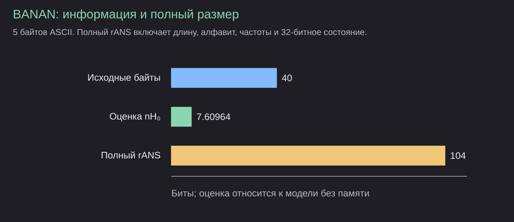](docs/figures/entropy-cost.svg)

Рисунок 1 — Оценка информации и служебные расходы на коротком примере BANAN.

<a id="sec2"></a>

## 2 Архитектура и блочный конвейер

Модули файловых записей передают общий поток в блочный слой. Сжатие и защита выполняются независимо для каждого блока; следующий рисунок связывает операции записи и чтения.

[](docs/figures/data.svg)

Рисунок 2 — Прямой и обратный конвейер v3.

### 2.1 Где выполняется каждый шаг

`cli::run` разбирает команду и параметры. `archive::create_with_options` открывает новый архив, обходит источники и передаёт записи в `BlockWriter`. `BlockWriter::write` набирает блоки до 65536 байт, `queue_block` собирает партию, `flush_batch` кодирует её и последовательно записывает результаты.

`archive::unpack::process` используется и для `extract`, и для `info`. Он получает логические записи через `BlockReader`. Читатель сначала голосует по общему заголовку, затем `read_stored` читает и проверяет физические поля блока. `decode_block` восстанавливает RS и снимает сжатие. Метод `Read::read` выдаёт исходные байты записей в нужном порядке.

[](docs/figures/data-espd.svg)

Рисунок 3 — Связи модулей, структур и потоков данных.

### 2.2 Как выбирается представление

Для каждой пары флагов строится один кандидат:

| LZ77 | rANS | Кандидат C |
| --- | --- | --- |
| 0 | 0 | Не строится; сохранить X |
| 1 | 0 | LZ77(X) |
| 0 | 1 | rANS(X) |
| 1 | 1 | rANS(LZ77(X)) |

Если K<N, Y=C и S=K; иначе Y=X и S=N. Равенство размеров не является выигрышем. При двух включённых этапах программа не сравнивает отдельно X, LZ77(X) и rANS(X): проверяется только результат заданной комбинации. Это нужно для однозначного обратного прохода без отдельного набора флагов на каждый блок.

Ключевой фрагмент: [src/block/writer.rs](src/block/writer.rs), строки 29–32.

```rust
    // Неравенство размеров служит признаком сжатого блока в формате.
    let raw_bytes = ((raw_size - 1) as u16).to_le_bytes();
    let stored_bytes = ((stored.len() - 1) as u16).to_le_bytes();
    let header: [u8; BLOCK_HEADER_SIZE] =
```

Здесь `raw` — X, `raw_size` — N, `compressed` — необязательный кандидат C, `stored` — выбранный Y. `Some` означает наличие кандидата; `_` охватывает его отсутствие и все случаи без выигрыша. Этот фрагмент сохраняет исходный блок при любом отсутствии выигрыша. После выбора заголовок B содержит размеры **до RS**. Защита добавляется и к несжатому блоку, если включён `--protect`.

[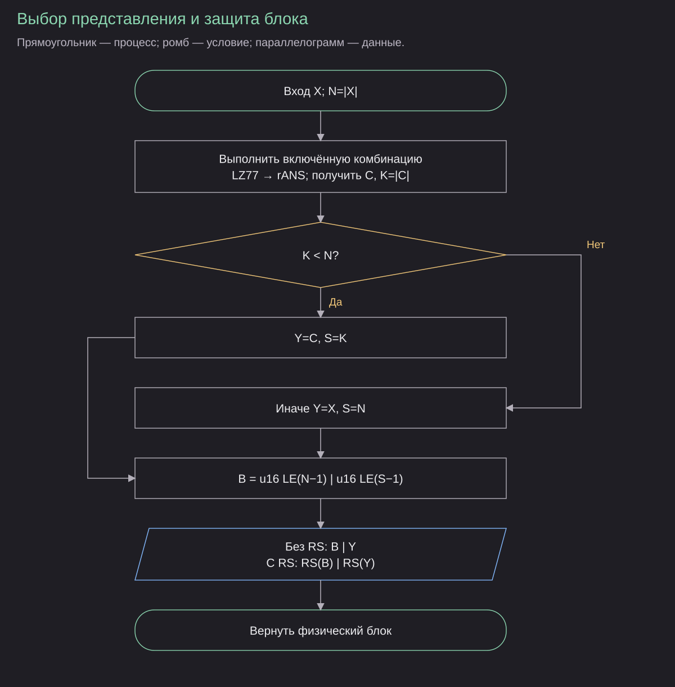](docs/figures/block-choice.svg)

Рисунок 4 — Решение о сжатии и отдельная защита B и Y.

### 2.3 Почему S<N достаточно декодеру

У сжатого блока все включённые этапы снимаются: rANS, затем LZ77. У блока с S=N оба этапа пропускаются. Проверки `S≤N` и допустимости режима исключают ссылку на несуществующий декодер. После восстановления размер результата должен быть ровно N.

Словарь LZ77 и модель rANS независимы для каждого блока. Межблочных ссылок нет. Изменение числа потоков меняет расписание работы, но не формат и не байтовый результат.

[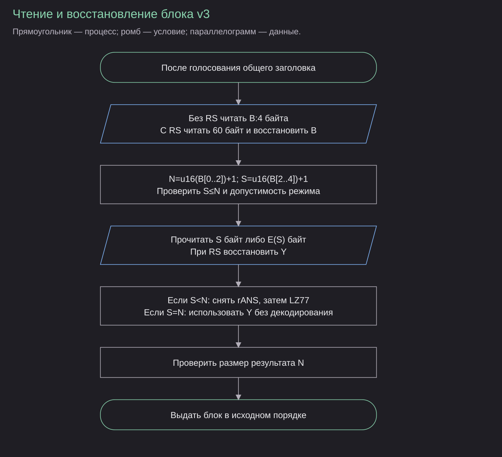](docs/figures/reader.svg)

Рисунок 5 — Чтение защищённого заголовка до вычисления длины payload.

<a id="sec3"></a>

## 3 Логический поток и LEB128

### 3.1 Записи файловой системы

```text
Файл:  01 | P:LEB128 | имя:P байт UTF-8 | F:LEB128 | содержимое:F байт
Папка: 02 | P:LEB128 | имя:P байт UTF-8
Конец: 00
```

P — длина имени в байтах, не в буквах; F — размер содержимого. Папка не имеет поля F. Пустой файл имеет F=0. Корневой источник сохраняется под собственным именем, без абсолютного пути. Дочерние записи папки сортируются по `file_name`, сама папка записывается первой.

Блочный слой режет этот общий поток, а не каждый файл отдельно. Если осталось два места в блоке, начало имени или LEB128 может попасть в этот блок, а продолжение — в следующий. Интерфейсы `Write` и `Read` скрывают эти границы от `pack_file` и `process`.

[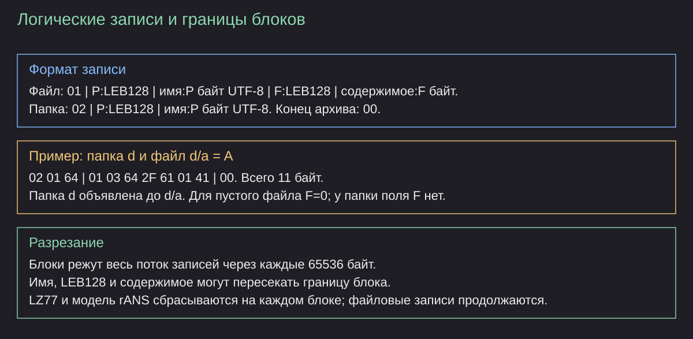](docs/figures/records.svg)

Рисунок 6 — Байтовые записи и независимость файловых и блочных границ.

### 3.2 Unsigned LEB128

В каждом байте младшие семь бит — данные, старший — продолжение. Младшая группа числа записывается первой. Для байтов b₀…bₖ₋₁:

```text
V = Σ (b_i & 127) · 2^(7i)
```

| Число, dec | Байты hex | Число байтов |
| --- | --- | --- |
| 0 | 00 | 1 |
| 127 | 7F | 1 |
| 128 | 80 01 | 2 |
| 300 | AC 02 | 2 |
| 4096 | 80 20 | 2 |
| 65536 | 80 80 04 | 3 |

[](docs/figures/leb128-example.svg)

Рисунок 7 — Разложение 300 на 7-битовые группы и обратный расчёт.

Ключевой фрагмент: [src/varint.rs](src/varint.rs), строки 7–14.

```rust
        let more = value >= 128;
        output.write_all(&[(value as u8 & 0x7F) | ((more as u8) << 7)])?;
        value >>= 7;
        if !more {
            return Ok(());
        }
    }
}
```

`value` — ещё не записанная часть числа V, `output` — выходной поток байтов. `more` показывает, останутся ли группы после текущей. Маска `0x7F` оставляет данные; `more<<7` ставит бит продолжения. Затем число сдвигается на 7 разрядов. Для значения 0 цикл всё равно пишет один байт `00`.

Читатель принимает не более 10 байтов для u64. В десятом допустим только младший значащий бит. Многобайтовая запись, заканчивающаяся нулевой группой, отклоняется: `80 00`, `AC 82 00` неканоничны. `read_bounded` дополнительно проверяет предел значения: например, путь ≤4096, исходный блок LZ77 ≤65536, вход rANS ≤131075 байт.

### 3.3 Little-endian и смещённые размеры

Little-endian относится к фиксированным u16/u32, а LEB128 задаёт собственный порядок групп. Для u16: 256 хранится как `00 01`. В заголовке блока хранится N−1, поэтому N=256 даёт `FF 00`. Смещение на 1 использует все 65536 комбинаций u16 для положительных длин 1…65536; нулевого физического блока нет.

[](docs/figures/bits.svg)

Рисунок 8 — Флаги, карта алфавита и смещённые поля.

<a id="sec4"></a>

## 4 LZ77: поиск, команды и восстановление

### 4.1 Вариант алгоритма в проекте

Реализация заменяет совпавшую цепочку на тройку (l,d,c): длина совпадения, расстояние назад и обязательный следующий явный байт. Для l=0 расстояние отсутствует в потоке. Это конкретный вариант LZ77; в лекции 021 также рассматриваются варианты с флаг-битом и без обязательного литерала. Их упаковку нельзя переносить в CLARSv03.

В позиции p используются начала предыдущих вхождений из окна max(0,p−4096)…p−1. Сравниваемая цепочка может «свешиваться» за p: допускается перекрытие. Ограничения:

```text
0 ≤ l ≤ min(255, N−p−1)
1 ≤ d ≤ min(4096,p), если l>0
X[p−d+j] = X[p+j], j=0…l−1
c=X[p+l]; следующая позиция p′=p+l+1
```

N−p−1 оставляет место для c. Последний байт всегда явный. Предел 255 выбран форматом однобайтовой длины команды; окно 4096 ограничивает расстояние и поиск. Расстояния до 127 занимают один байт LEB128, от 128 до 4096 — два.

[](docs/figures/lz77-overview.svg)

Рисунок 9 — Окно, длина, расстояние и обязательный литерал.

[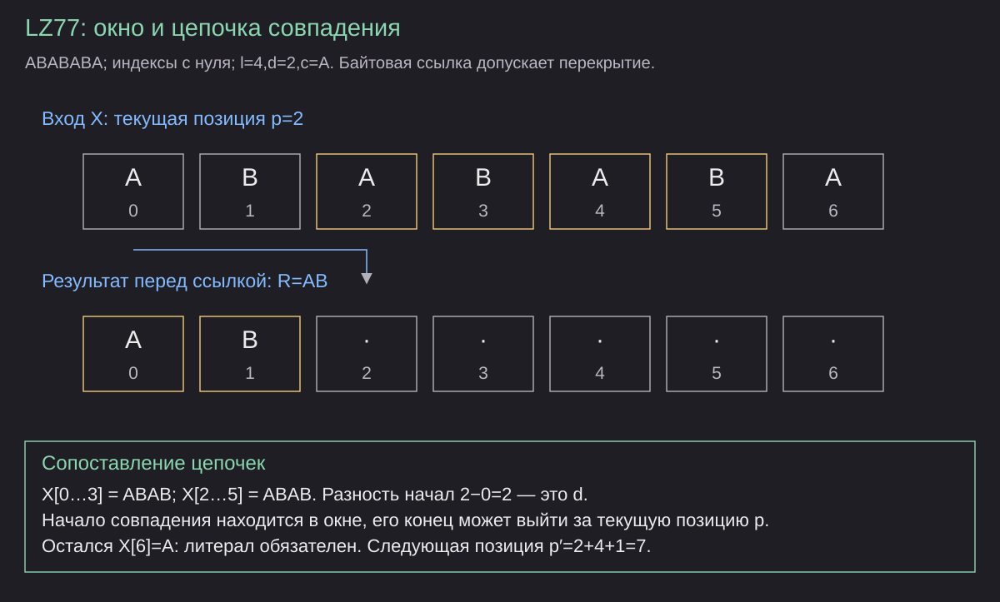](docs/figures/lz77-window.svg)

Рисунок 10 — Положение исходной и совпавшей цепочек в одном входном блоке.

### 4.2 Хеш-цепочки и предел 512

Первые два байта a,b образуют little-endian число a+256b. Хеш:

```text
h(a,b) = (((a+256b) · 0x9E3779B1) mod 2^32) >> 20
```

Получается индекс 0…4095. `heads` хранит последние позиции корзин; `previous` связывает более старые позиции; `last_byte` хранит последнее появление каждого отдельного байта. Коллизия хеша даёт дополнительного кандидата, но не неправильную ссылку: совпадение всё равно проверяется побайтово.

Поиск идёт от новых позиций к старым, не далее 4096 байтов и не более чем по **512 кандидатам**. Учитываются и кандидаты, совпавшие только из-за коллизии хеша. Лучшее совпадение заменяется только при строго большей длине ≥2. При достижении limit функция сразу возвращает результат. Если совпадения ≥2 нет, допускается ссылка длины 1 на `last_byte`, если она ещё в окне.

Ключевой фрагмент: [src/lz77/matcher.rs](src/lz77/matcher.rs), строки 38–40.

```rust

            while candidate != NONE && position - candidate <= WINDOW && candidates < MAX_CANDIDATES
            {
```

В условии `candidate` — позиция проверяемого вхождения, `position` — p, `candidates` — уже просмотренное число позиций, `WINDOW=4096`, `MAX_CANDIDATES=512`, `NONE=usize::MAX` означает отсутствие позиции. Ограничение `candidates<MAX_CANDIDATES` означает: выбирается лучшее среди просмотренных, а не гарантированно самое длинное среди всех позиций окна. При равных длинах среди просмотренных сохраняется ближайшее вхождение, так как оно проверено раньше. Декодер от способа поиска не зависит.

В таблицы вставляются все пройденные позиции p…p+l. Если вставлять только начало команды, последующие цепочки не будут отражать весь уже пройденный текст.

[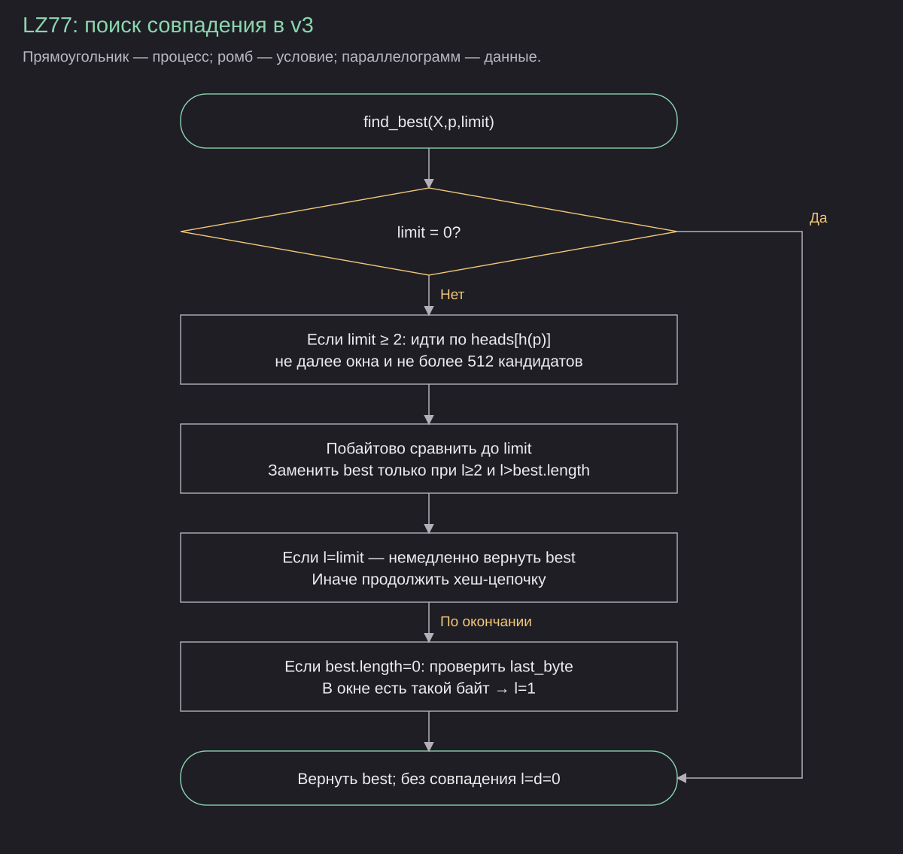](docs/figures/lz77-matcher.svg)

Рисунок 11 — Поиск совпадения с учётом ускоряющих структур v3.

[](docs/figures/lz77-flow.svg)

Рисунок 12 — Блок-схема кодера LZ77.

### 4.3 Формат и стоимость команды

```text
N : LEB128
повторять:
    l : u8
    если l>0: d : LEB128
    c : u8
```

Пусть v(d) — число байтов расстояния. Команда занимает 2 байта при l=0 и 2+v(d) при l>0, описывая l+1 исходных байтов. Изолированная ссылка выгодна только при l+1>2+v(d). Программа не оптимизирует стоимость каждой команды: даже l=1 может быть записано, хотя увеличивает LZ77-поток. Затем rANS меняет стоимость его байтов, а окончательное решение принимает блочный уровень.

Консервативная граница выхода — 3+2N≤131075 байт: до трёх байтов префикса и не более двух на каждый исходный байт. Команда со ссылкой описывает несколько байтов и не ухудшает эту границу. Грубая верхняя оценка поиска на позицию — 512·255=130560 сравнений, память таблиц — O(N+4096+256).

[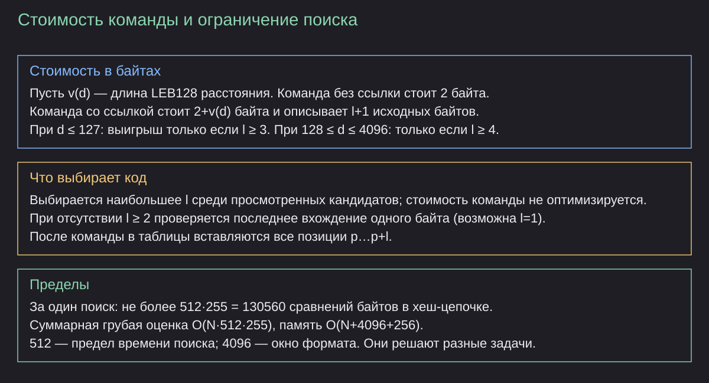](docs/figures/lz77-cost.svg)

Рисунок 13 — Связь длины ссылки, стоимости и ограничения поиска.

### 4.4 Полный пример ABABABA

X=`41 42 41 42 41 42 41`, N=7. Первые A и B записываются явно. При p=2 доступно совпадение с p−d=0, d=2. Его длина ограничена четырьмя байтами, чтобы оставить A для литерала. Получается (4,2,A).

[](docs/figures/lz77.svg)

Рисунок 14 — Все команды ABABABA и точные выходные байты.

Итог `07 00 41 00 42 04 02 41`, 8 байт вместо 7. Это работа отдельного LZ77, а не обещание сжатого физического блока. В режиме только LZ77 `encode_block` сохранит исходный X.

Для `AAAAAA` поток равен `06 00 41 04 01 41`. Для 258 байтов A: `82 02 00 41 FF 01 41 00 41` — явный A, ссылка длины 255 с литералом A, затем последний явный A. Эти случаи показывают границу длины и обязательный литерал.

### 4.5 Два кандидата и одинаковая длина

В `abXabYabZ` на p=3 цепочка `ab` совпадает с позицией 0 и обрывается на X≠Y. На p=6 ближайший кандидат — позиция 3, d=3; более дальний — позиция 0, d=6. Оба могли бы дать l=2. Ближайший достигает limit=2, поэтому второй уже не проверяется. Это не два фактически выполненных сравнения, а объяснение возможного равенства.

[](docs/figures/lz77-search-example.svg)

Рисунок 15 — Кандидаты поиска и выбор ближайшей ссылки.

### 4.6 Декодирование с перекрытием

Читатель проверяет расстояние, доступность байтов команды и остаток объявленной длины. Затем каждый байт ссылки копируется из текущего, уже выросшего результата:

Ключевой фрагмент: [src/lz77/mod.rs](src/lz77/mod.rs), строки 65–68.

```rust
        for _ in 0..length {
            output.push(output[output.len() - distance]);
        }
        output.push(byte[0]);
```

В фрагменте `output` — результат R, `length` — l, `distance` — d, `byte[0]` — явный байт c. При l=4,d=2 буфер сначала равен `AB`. Получаются `ABA`, `ABAB`, `ABABA`, `ABABAB`; затем литерал A завершает `ABABABA`. На третьем и четвёртом копировании источник создан этой же ссылкой. Поэтому одно копирование фиксированного исходного среза не эквивалентно циклу.

[](docs/figures/lz77-overlap.svg)

Рисунок 16 — Каждый шаг перекрывающейся ссылки.

[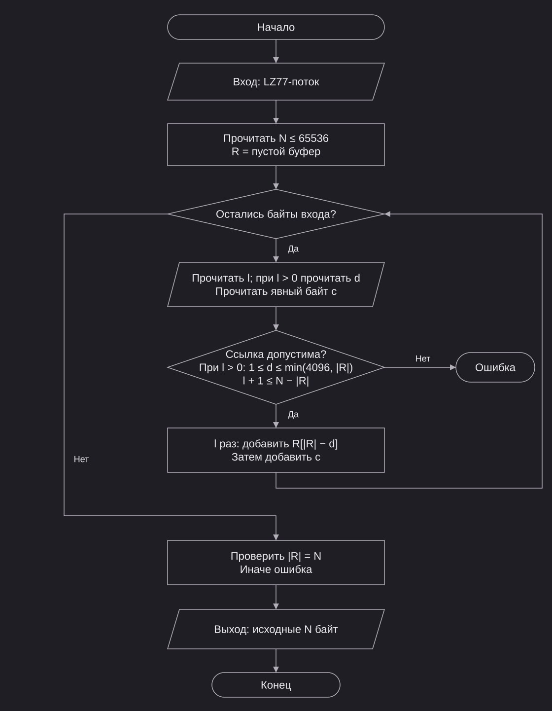](docs/figures/lz77-decode.svg)

Рисунок 17 — Блок-схема декодера LZ77.

После исчерпания команд длина результата должна совпасть с N. Нулевое расстояние при ненулевой длине, ссылка за начало результата, расстояние >4096 и выход за объявленный размер — ошибки.

<a id="sec5"></a>

## 5 rANS: модель, состояния и байтовый поток

### 5.1 Модель и нормализация

rANS — целочисленный энтропийный код со стековым состоянием. Он использует одну статическую модель на вызов, а не адаптивное изменение частот после каждого байта. Включённый LZ77 меняет его вход: n тогда является размером LZ77-потока, а не исходного блока.

Подсчитать v(s), D и n. Неприсутствующим байтам назначить f=0; каждому присутствующему заранее выделить единицу. Оставшиеся M−D единиц распределяются пропорционально v:

```text
M = 4096
w(s) = v(s)·(M−D)
f₀(s) = 1 + floor(w(s)/n)
r(s) = w(s) mod n
Δ = M − Σ f₀(s)
```

Добавить единицу Δ символам с наибольшими r(s), при равенстве — в порядке возрастания байта. Это обеспечивает f(s)≥1 для присутствующих байтов и Σf=M. Фиксированный порядок делает модель воспроизводимой. Например, для ASCII `ABC` начальные частоты (1365,1365,1365) дают 4095 и равные остатки. Первая поправка достаётся меньшему байту A: итог (1366,1365,1365). Начало интервала c(s)=Σf(t) по всем t<s; интервалы [c(s),c(s)+f(s)) образуют разбиение [0,M).

В фрагменте `remainders` содержит пары (r(s),s): поле `.0` — остаток, `.1` — значение байта; `a` и `b` — две сравниваемые пары. `sum` — сумма начальных частот, `TOTAL=4096`, поэтому `take(TOTAL−sum)` выбирает ровно Δ пар. Массив `frequencies` хранит f(s).

Ключевой фрагмент: [src/rans/model.rs](src/rans/model.rs), строки 124–128.

```rust
    // Одинаковые остатки упорядочиваются по байту для воспроизводимости архива.
    remainders.sort_by(|a, b| b.0.cmp(&a.0).then(a.1.cmp(&b.1)));
    for &(_, symbol) in remainders.iter().take((TOTAL - sum) as usize) {
        frequencies[symbol] += 1;
    }
```

[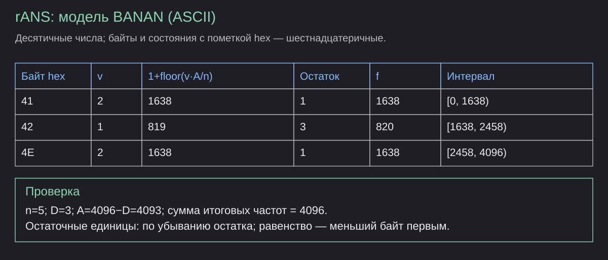](docs/figures/rans-banan-model.svg)

Рисунок 18 — Расчёт нормализованной модели ASCII BANAN.

Для BANAN: A,N встречаются по два раза, B один раз. Начальные частоты (1638,819,1638) дают 4095. Остатки (1,3,1), поэтому дополнительная единица достаётся B. Итог f=(1638,820,1638), c=(0,1638,2458).

[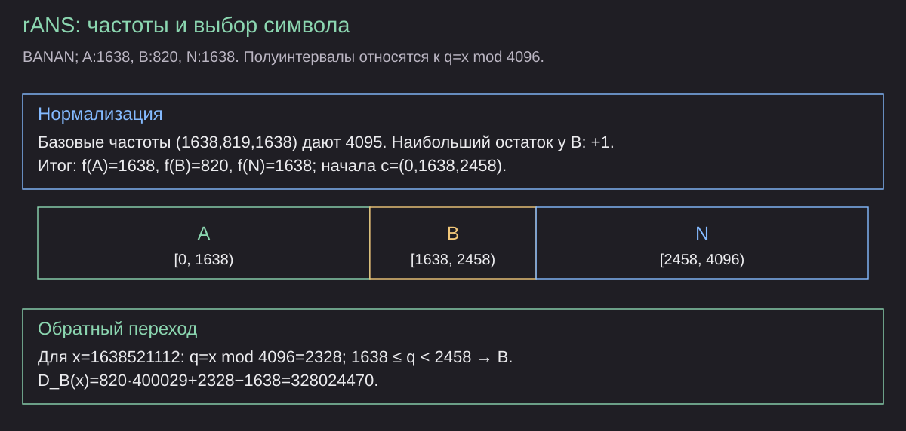](docs/figures/rans-model.svg)

Рисунок 19 — Ширины интервалов и положение остатка состояния.

### 5.2 Прямой и обратный переходы

Кодер начинает с L=2²³=8388608 и обходит вход справа налево. Для текущего байта s:

```text
C_s(x) = floor(x/f(s))·M + (x mod f(s)) + c(s)
```

Декодер берёт q=x mod M, определяет s по c(s)≤q<c(s)+f(s), затем:

```text
D_s(x) = f(s)·floor(x/M) + q − c(s)
```

Почему переход обратим: запишем x=a·f+r, 0≤r<f. Тогда C_s(x)=aM+r+c. Внутри нужного интервала q=r+c, а floor(C_s(x)/M)=a. Обратный переход даёт fa+(r+c)−c=af+r=x. В отличие от арифметического кодирования из лекции 011, здесь не сужается вложенный интервал всего сообщения: интервалы модели выбирают остаток состояния.

[](docs/figures/rans-overview.svg)

Рисунок 20 — Величины rANS и порядок обратимых действий.

[](docs/figures/rans.svg)

Рисунок 21 — Прямой и обратный проход для ABAB.

При ABAB: f(A)=f(B)=2048, c(A)=0,c(B)=2048. Перенормировка не нужна; конечное x=134238208=0x08005000, LE=`00 50 00 08`. Весь поток:

```text
04 | 01 | 41 42 | 80 10 | 00 50 00 08
n    D−1  алфавит f(A)    состояние
```

Размер 10 байт превышает вход 4 байта. Частота B не записана: 4096−2048=2048.

### 5.3 Байтовая перенормировка

Перед переходом кодер уменьшает слишком большое состояние и сохраняет отделённые младшие байты:

```text
T(s) = ((L >> 12) << 8)·f(s) = 2^19·f(s) = 524288·f(s)
пока x ≥ T(s):
    выдать x & 255
    x >>= 8
после этого применить C_s(x)
```

После обратного перехода декодер увеличивает слишком малое состояние:

```text
пока x < L:
    прочитать b
    x = (x << 8) | b
```

Порог зависит от частоты конкретного символа. Он получается из выбранных L, M и байтового основания 256. Начальное состояние декодера обязано лежать в [L,256L), то есть [8388608,2147483648). После n символов проверяются одновременно x=L и полное исчерпание байтов перенормировки. Модель строится один раз: подсчёт O(n), сортировка остатков O(D log D), заполнение таблицы декодера O(4096). Сам проход линейный: при x<2³¹ и пороге не ниже 2¹⁹ для одного символа достаточно не более двух сдвигов на 8 бит.

В приведённом фрагменте `state` — x, `frequency` — f(s), `threshold` — T(s), `symbol` — индекс байта s, `starts[symbol]` — c(s), `TOTAL` — M, `emitted` — список отделённых байтов.

Ключевой фрагмент: [src/rans/mod.rs](src/rans/mod.rs), строки 27–34.

```rust
    // rANS кодирует с конца, поскольку состояние работает как стек.
    for &symbol in data.iter().rev() {
        let symbol = symbol as usize;
        let frequency = u32::from(frequencies[symbol]);
        let threshold = ((LOWER_BOUND >> SCALE_BITS) << 8) * frequency;

        while state >= threshold {
            emitted.push(state as u8);
```

[](docs/figures/rans-flow.svg)

Рисунок 22 — Кодер rANS и цикл выдачи байтов.

[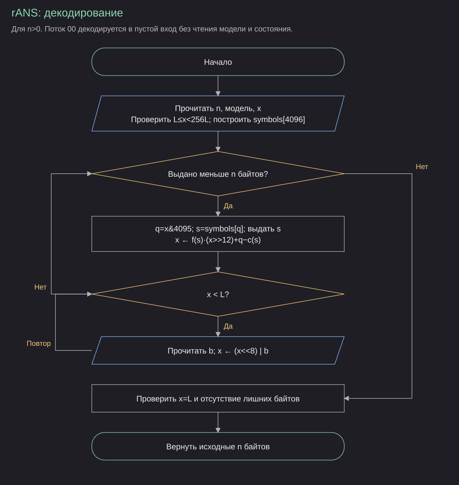](docs/figures/rans-decode.svg)

Рисунок 23 — Декодер rANS и цикл возврата байтов.

### 5.4 Полный проход BANAN

Кодер обрабатывает N,A,N,A,B. Частота и начало берутся из одной неизменной модели. Ни на одном шаге порог не достигается. Каждая строка следующей таблицы содержит деление состояния на f с остатком и результат C_s(x).

[](docs/figures/rans-banan-encode.svg)

Рисунок 24 — Все пять переходов кодера BANAN.

Первый шаг N: 8388608=5121·1638+410, x′=5121·4096+410+2458=20978484. Последний шаг B: 328024470=400029·820+690, x′=400029·4096+690+1638=1638521112.

Декодер начинает с этого результата. q=1638521112 mod 4096=2328 попадает в [1638,2458), значит первый символ B. D_B(x)=820·400029+2328−1638=328024470. Следующие строки обращают остальные шаги.

[](docs/figures/rans-banan-decode.svg)

Рисунок 25 — Все пять переходов декодера BANAN.

[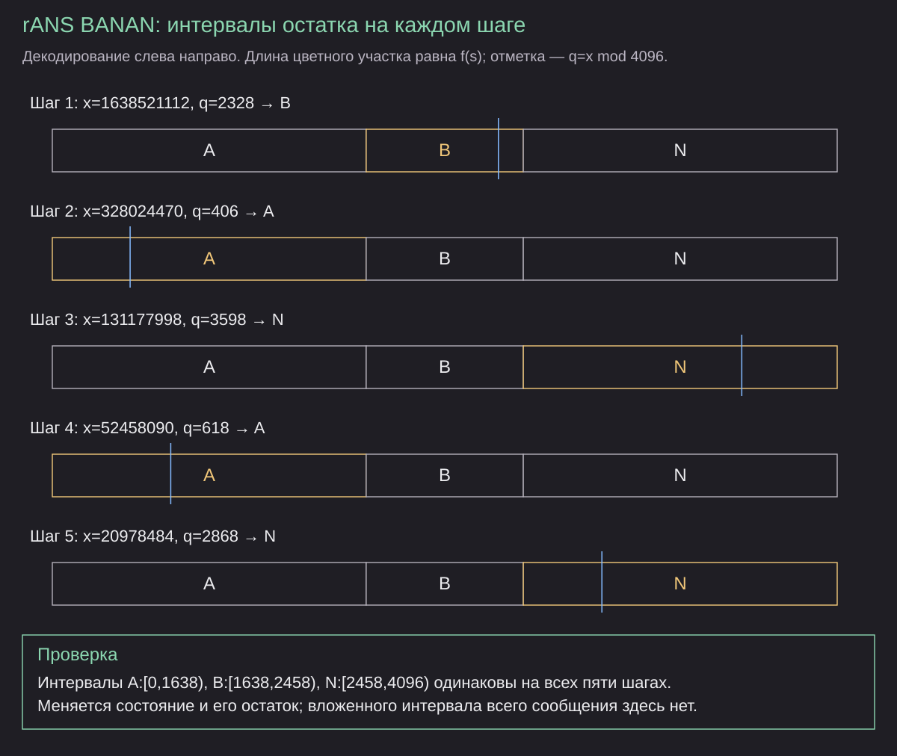](docs/figures/rans-slots.svg)

Рисунок 26 — Положение остатка состояния относительно интервалов каждого байта.

Итоговое состояние снова L; байты не требовались. Полный код:

```text
05 | 02 | 41 42 4E | E6 0C B4 06 | 18 D9 A9 61
n    D−1  алфавит     f(A),f(B)      x:u32 LE
```

5 исходных байтов превращаются в 13. Для короткого примера важна проверяемость алгоритма; реальный выигрыш зависит от модели, длины и служебных расходов.

### 5.5 БАНАН в UTF-8: байты вместо букв

Русский `БАНАН` занимает 10 байтов:

```text
Б       А       Н       А       Н
D0 91 | D0 90 | D0 9D | D0 90 | D0 9D
```

Модель: 90 встречается 2 раза, 91 — 1, 9D — 2, D0 — 5. D=4, M−D=4092. Базовая сумма равна 4094. У 90 и 9D одинаковый наибольший остаток 4, поэтому оба получают по единице: f=(820,410,819,2047). Интервалы: [0,820), [820,1230), [1230,2049), [2049,4096).

[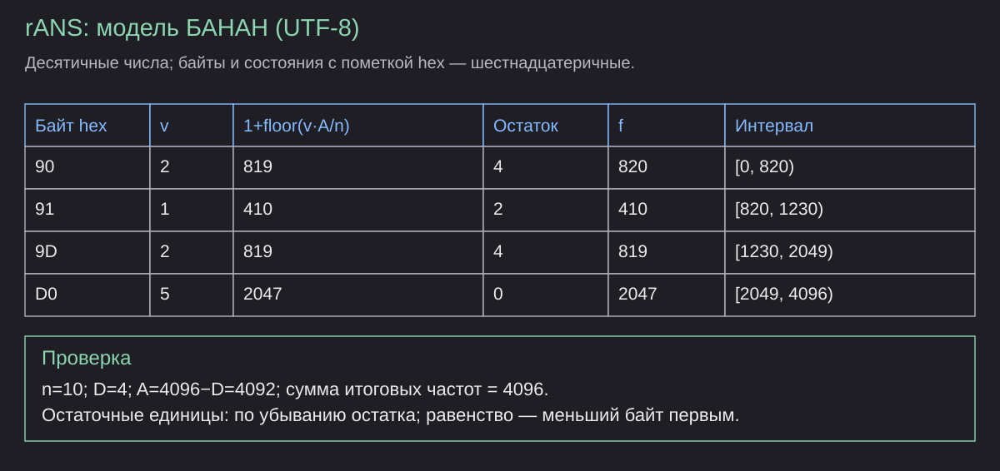](docs/figures/rans-utf8-model.svg)

Рисунок 27 — Частоты и интервалы четырёх байтов UTF-8.

[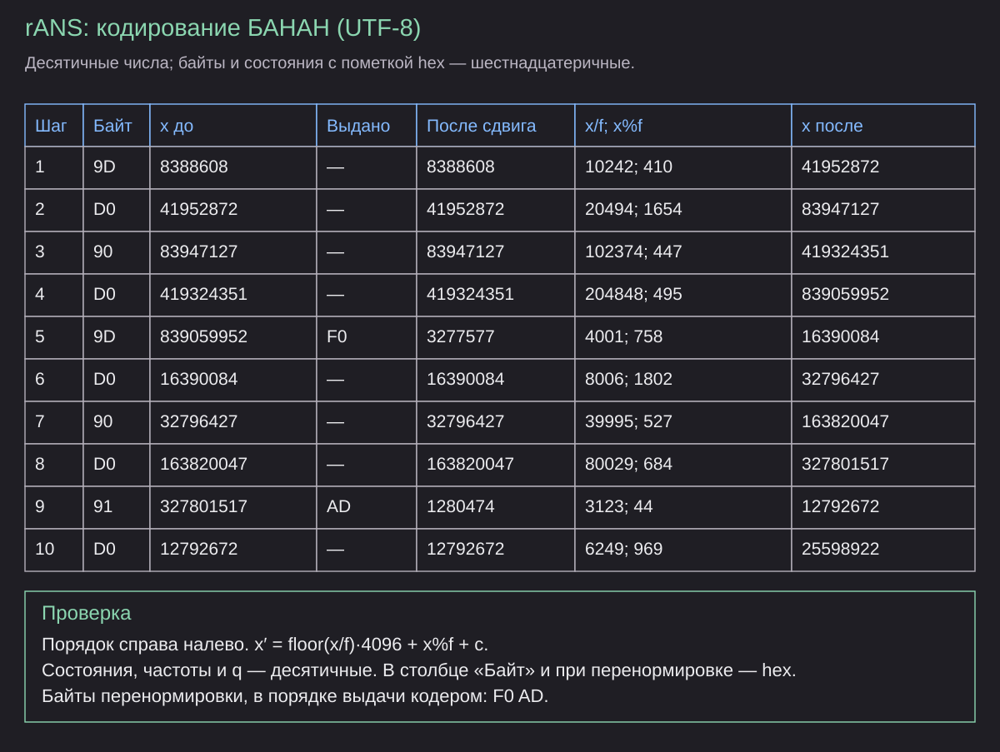](docs/figures/rans-utf8-encode.svg)

Рисунок 28 — Десять переходов кодера БАНАН.

[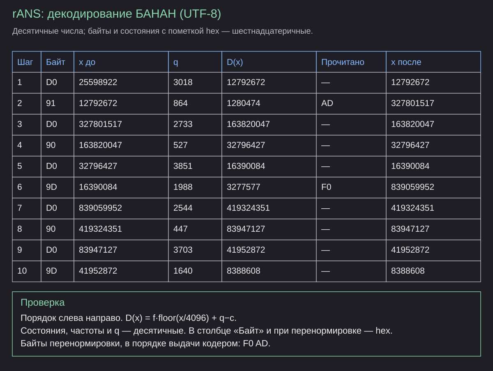](docs/figures/rans-utf8-decode.svg)

Рисунок 29 — Десять обратных переходов и восстановление UTF-8.

В этом примере уже нужны байты перенормировки: кодер выдаёт `F0 AD`, поток содержит их в обратном порядке `AD F0`. Конечное состояние x=25598922=0x01869BCA. Полный код занимает 18 байт. Исходный тест `rans_simple` проверяет именно эту русскую строку, а пример BANAN выше отдельно показывает более короткий алфавит.

### 5.6 AB×16: все 32 шага перенормировки

Вход — 32 байта, f(A)=f(B)=2048, T=2³⁰. Для читаемости каждый проход разделён на четыре таблицы по восемь шагов. Все состояния в них hex; номера шагов и остатки q — десятичные. Знак «—» означает, что байт не отделялся или не читался.

[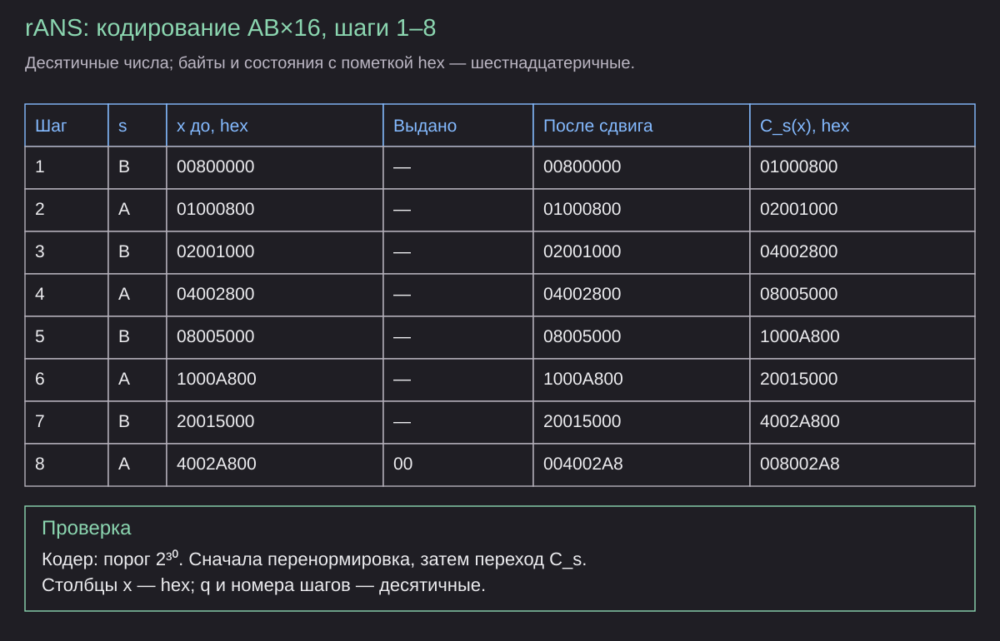](docs/figures/rans-renorm-encode-1.svg)

Рисунок 30 — Кодирование AB×16, шаги 1–8.

[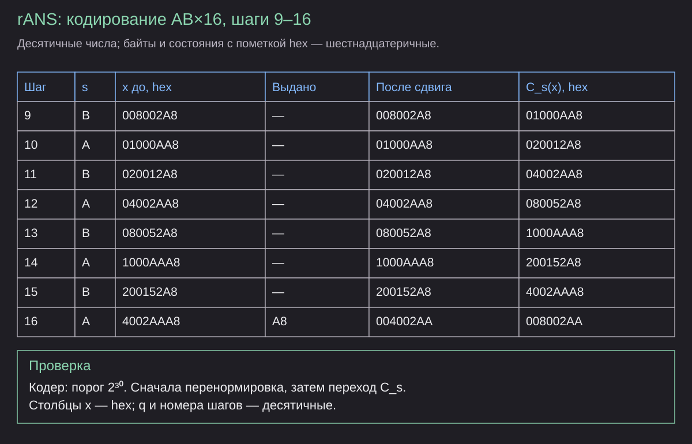](docs/figures/rans-renorm-encode-2.svg)

Рисунок 31 — Кодирование AB×16, шаги 9–16.

[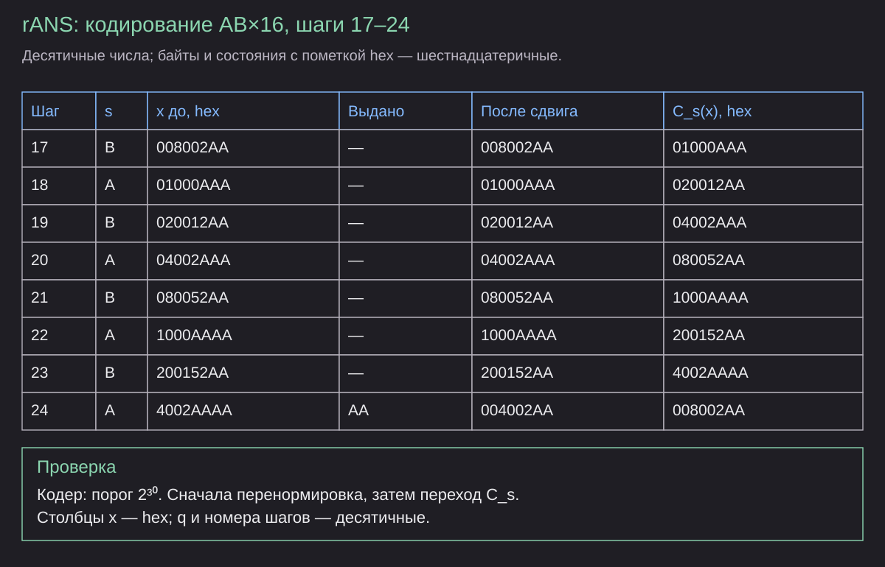](docs/figures/rans-renorm-encode-3.svg)

Рисунок 32 — Кодирование AB×16, шаги 17–24.

[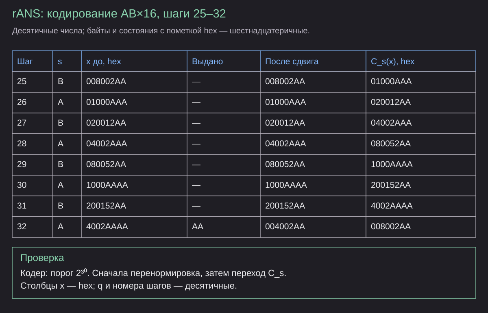](docs/figures/rans-renorm-encode-4.svg)

Рисунок 33 — Кодирование AB×16, шаги 25–32.

На шаге 8: x=0x4002A800≥0x40000000, поэтому выдаётся `00`, x становится 0x004002A8, после чего применяется C_A. События повторяются на шагах 16,24,32; выданные байты `00 A8 AA AA` образуют обратную очередь.

[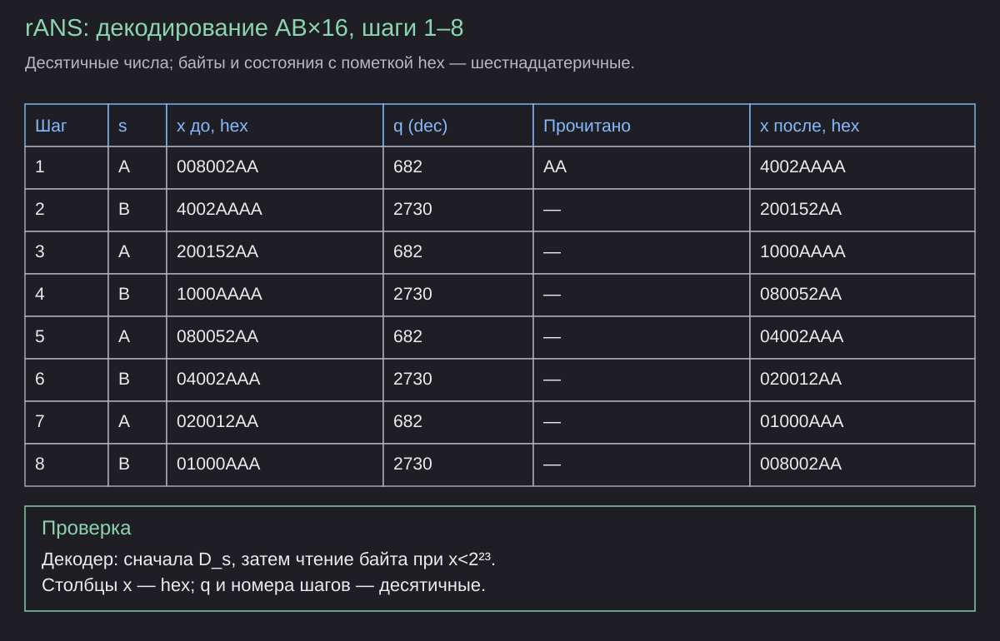](docs/figures/rans-renorm-decode-1.svg)

Рисунок 34 — Декодирование AB×16, шаги 1–8.

[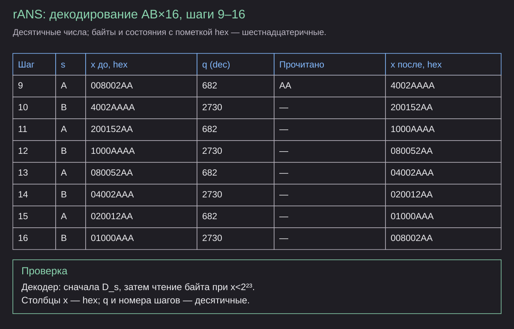](docs/figures/rans-renorm-decode-2.svg)

Рисунок 35 — Декодирование AB×16, шаги 9–16.

[](docs/figures/rans-renorm-decode-3.svg)

Рисунок 36 — Декодирование AB×16, шаги 17–24.

[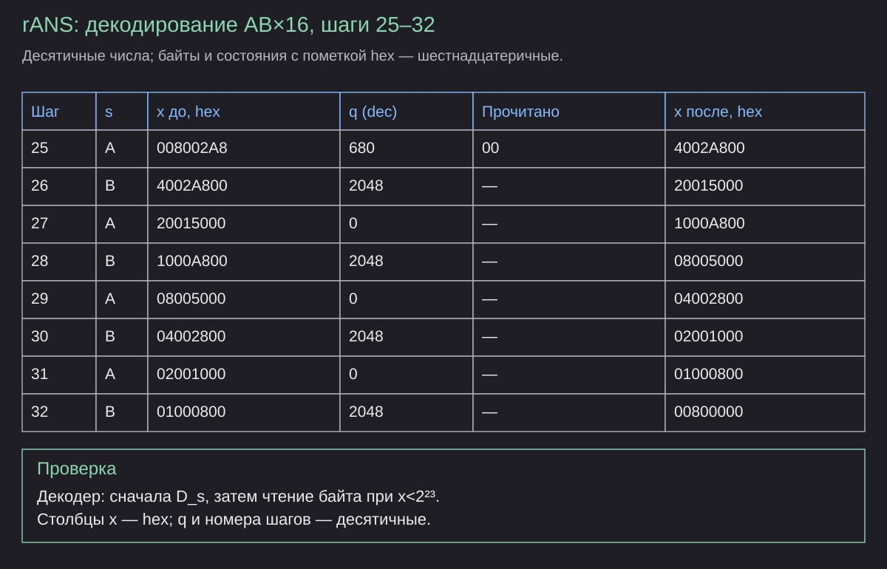](docs/figures/rans-renorm-decode-4.svg)

Рисунок 37 — Декодирование AB×16, шаги 25–32.

Первый обратный переход: q=682, выбран A, D_A(x)=4194986<L. Читается AA: 4194986·256+170=1073916586. Через 32 символа x=L и все четыре байта использованы. Поток имеет длину 14 байт, что меньше 32.

[](docs/figures/rans-byte-streams.svg)

Рисунок 38 — Вход, выдача байтов, порядок хранения и начальное состояние декодера.

### 5.7 Как записывается модель

```text
n : LEB128
если n=0: конец; код единственный 00
D−1 : u8
если D≤32: список D байтов по возрастанию
иначе: bitmap[32], бит s%8 байта s/8 отмечает s
частоты первых D−1 символов : LEB128
состояние x : u32 LE
байты перенормировки в обратном порядке выдачи
```

В рисунке `popcount` — число единичных битов всей 32-байтовой карты. Последняя частота равна M−сумма предыдущих; при D=1 частоты не записываются вообще. При одном значении байта f=M и C_s(x)=x, поэтому состояние остаётся L; длина сообщения хранится отдельно. Это конкретное описание вырожденного случая, а не нулевой размер всего кода.

При D=32 список и карта занимают по 32 байта, код выбирает список. При D>32 карта короче списка. Читатель требует строго возрастающий список, точное число установленных битов карты, D≤n и положительные частоты с суммой 4096. Минимальный заголовок непустого rANS-потока — 7 байт, консервативный максимум в коде — 550. Вход ≤131075 байт учитывает возможное увеличение LZ77.

[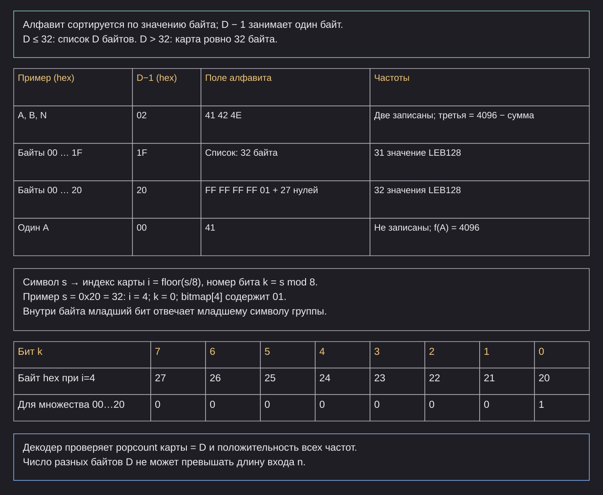](docs/figures/rans-model-bytes.svg)

Рисунок 39 — Список алфавита, битовая карта и граничные случаи модели.

<a id="sec6"></a>

## 6 CRC32: от битового шага к таблице

### 6.1 Назначение и параметры

В `ecc::encode` CRC32 вычисляется отдельно для каждого из 12 фрагментов. При чтении несовпадение превращает этот фрагмент в известное стирание для RS. CRC обнаруживает повреждение, а исправление выполняет RS. Без `--protect` этих CRC в архиве нет.

Используется `crc32fast` 1.4.2, CRC32 IEEE: начальный регистр 0xFFFFFFFF, отражённый полином 0xEDB88320, финальный XOR 0xFFFFFFFF. Контрольный вектор ASCII `123456789` даёт 0xCBF43926. В потоке это u32 LE `26 39 F4 CB`. Пустой вход даёт 0.

### 6.2 Один битовый переход

```text
crc = 0xFFFFFFFF
для каждого входного байта b:
    crc ^= b
    8 раз:
        если crc & 1: crc = (crc >> 1) XOR 0xEDB88320
        иначе:       crc = crc >> 1
результат = crc XOR 0xFFFFFFFF
```

Это логически эквивалентный разбор результата библиотеки. Он не означает, что `crc32fast` буквально выполняет такой цикл: библиотека использует ускоренные реализации.

[](docs/figures/crc32-flow.svg)

Рисунок 40 — Порядок вычислений CRC32.

[](docs/figures/crc32-bit-example.svg)

Рисунок 41 — Все восемь шагов первого байта контрольного вектора.

### 6.3 Байтовый табличный переход

Таблица TABLE из 256 элементов заранее сворачивает восемь битовых шагов для каждого возможного младшего байта. Тогда один байт обрабатывается так:

```text
index = (crc & 255) XOR b
crc = (crc >> 8) XOR TABLE[index]
```

Регистр передаётся между байтами без финального XOR; тот выполняется один раз в конце. Для первого байта 31 hex: index=CE hex, результат регистра 7C231048 hex. Полный контрольный расчёт:

[](docs/figures/crc32-byte-example.svg)

Рисунок 42 — Девять байтовых переходов и финальная запись LE.

CRC32 допускает коллизии. Поэтому совпадение CRC не доказывает неизменность содержимого, а таблица контрольных сумм не является подписью или шифрованием. В этой реализации таблица CRC сама находится вне RS; это учитывается в границах гарантии восстановления.

<a id="sec7"></a>

## 7 Reed-Solomon: поле, матрица, восстановление

### 7.1 Применяемый код

`reed-solomon-erasure` 6.0.0 предоставляет систематический код над GF(256): 10 информационных и 2 проверочных фрагмента. Систематический означает, что первые 10 фрагментов остаются исходными. Каждое смещение внутри фрагмента — отдельный столбец из 12 байтов. Поэтому при длине фрагмента h байтов кодируется h независимых столбцов RS(12,10).

CRC сообщает позиции стираний. Программа восстанавливает до двух отмеченных фрагментов одного RS-слова. Это не обещание исправить две произвольные ошибки с неизвестными позициями. Для общего кода условие 2t+e≤2, где t — неизвестные ошибки, e — известные стирания; текущий путь реализует стирания e.

### 7.2 Байт как элемент поля

Биты a₇…a₀ задают многочлен a₇z⁷+…+a₁z+a₀ над GF(2). Модуль библиотеки P(z)=z⁸+z⁴+z³+z²+1, hex 11D (285). В `build.rs` используется младшая часть 1D, потому что старший член z⁸ учитывается при редукции.

Сложение и вычитание — XOR. Умножение — произведение многочленов с остатком по P. Это отличается от целочисленного умножения modulo 256. Например, 0x80·0x02=z⁸≡z⁴+z³+z²+1=0x1D.

[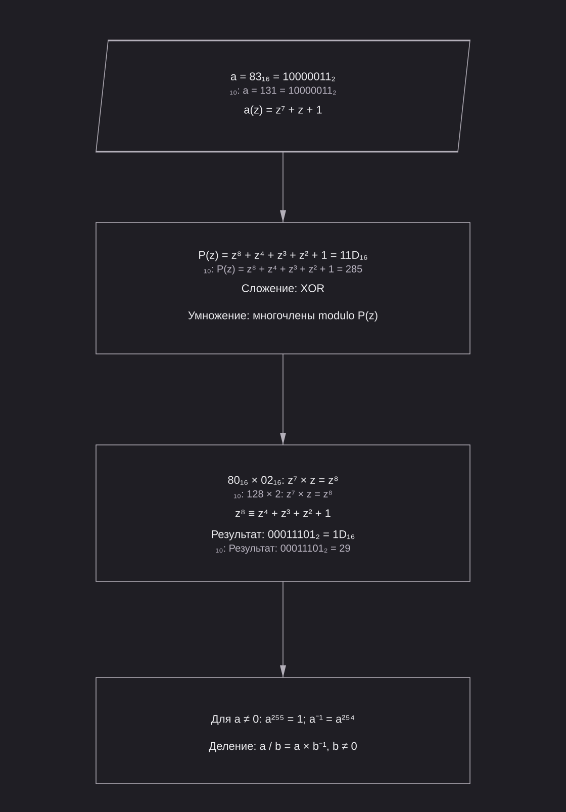](docs/figures/gf256.svg)

Рисунок 43 — Представление, операции и обратный элемент GF(256).

[](docs/figures/gf256-multiply-example.svg)

Рисунок 44 — Все битовые шаги произведения 0x57·0x83=0x31.

При переносе за восьмой разряд редукция выполняется XOR с 0x11D. Например, 0xAE<<1=0x15C, 0x15C XOR 0x11D=0x41. Модуль 0x11B дал бы иные значения в байтовом представлении; его в расчётах CLARSv03 применять нельзя.

Для a≠0 выполняется a²⁵⁵=1, следовательно a⁻¹=a²⁵⁴. Например, 0x08·0xAD=1. Это позволяет делить коэффициенты при обращении матрицы.

Ненулевые элементы поля образуют цикл степеней α=0x02: α⁰=1,…,α²⁵⁴,α²⁵⁵=1. Дискретный логарифм logα(a) — номер степени, дающей ненулевой байт a. Поэтому a·b=α^((logα(a)+logα(b)) mod 255). Нуль обрабатывается отдельно и логарифма не имеет.

Для 0x57 и 0x83: логарифмы 189 и 247; (189+247) mod 255=181, α¹⁸¹=0x31. Обратный к 0x08=α³ равен α²⁵²=0xAD. Таблица показывает, где при последовательных сдвигах впервые требуется редукция.

[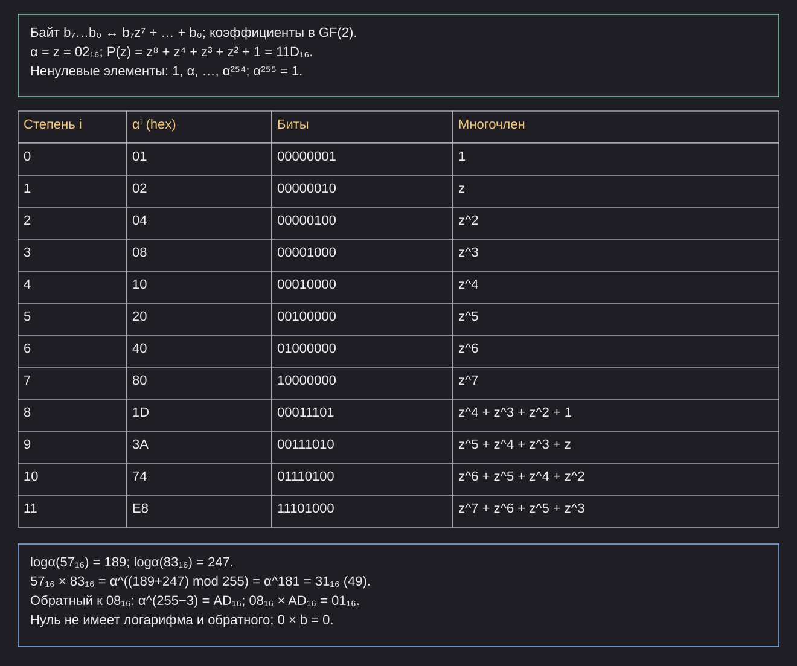](docs/figures/gf256-powers.svg)

Рисунок 45 — Степени генератора, многочлены и логарифмическое умножение GF(256).

### 7.3 Подготовка фрагментов и CRC

Для payload длины U добавить префикс U:u32 LE. Выбрать h=max(1,ceil((U+4)/10)), дополнить нулями до 10h и разрезать на D₀…D₉. Затем библиотека рассчитывает P₀,P₁ той же длины. Для всех 12 фрагментов вычислить CRC; записать сначала таблицу 48 байт, затем все фрагменты.

```text
RS(payload) = CRC32[12] | D₀ | … | D₉ | P₀ | P₁
E(U) = 48 + 12·max(1,ceil((U+4)/10))
```

Префикс возвращает точную исходную длину без заполнения. При защите блока код вызывается дважды: для B длиной 4, затем для Y длиной S. У каждого вызова свои 12 CRC и независимый бюджет двух стираний.

[](docs/figures/reed-solomon.svg)

Рисунок 46 — Подготовка и физическое устройство одного RS-слова.

[](docs/figures/rs-erasure-encode.svg)

Рисунок 47 — Кодирование произвольного payload в RS-слово.

Чтобы увидеть разницу между байтом и фрагментом, возьмём Y=`ABCDEFGHIJKLMNOP`, S=16. Длина фрагмента h=ceil((16+4)/10)=2 байта. Префикс `10 00 00 00` и 16 байтов данных заполняют 20 информационных байтов без нулевого дополнения. Два столбца кодируются независимо; P₀=`D2 2C`, P₁=`93 F0`. CRC считается от всей двухбайтовой строки, поэтому повреждения обоих её байтов образуют одно стирание.

[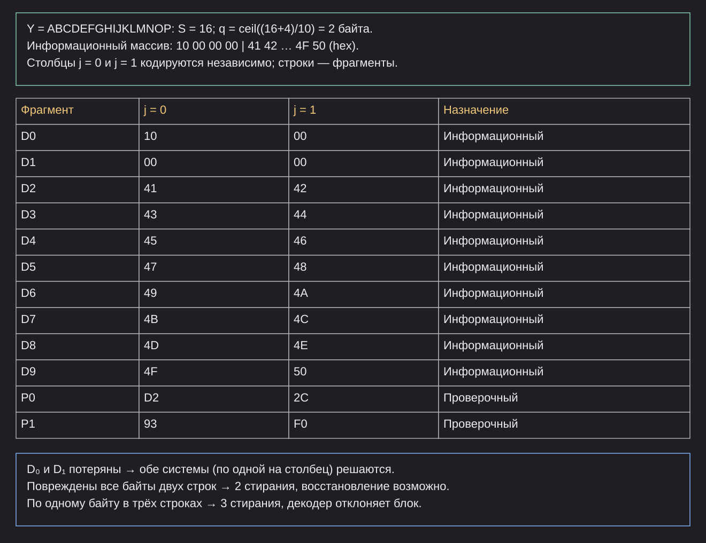](docs/figures/rs-columns.svg)

Рисунок 48 — Два независимых байтовых столбца внутри одних RS-фрагментов.

### 7.4 От Вандермонда к систематической матрице

Библиотека строит V[i,k]=iᵏ в GF(256), i=0…11,k=0…9. Значение i — байтовое представление элемента поля; i⁰=1, в том числе при i=0. Первые 10 строк образуют обратимую T. Затем G=V·T⁻¹. Верх G равен I₁₀; нижние две строки дают коэффициенты parity:

```text
P_r[j] = XOR по k=0…9 (G[10+r,k] · D_k[j]), r=0,1
```

Каждая операция выполняется в поле. Именно эта матричная реализация используется проектом. Полиномиальные примеры над GF(5) и Z₇ из 030 и sem44 объясняют код, но их коэффициенты, синдромы и модуль нельзя выдавать за расчёты данного архиватора.

[](docs/figures/rs-matrix.svg)

Рисунок 49 — Точные две проверочные строки матрицы библиотеки 6.0.0.

### 7.5 Полный численный пример ABCDEF

Y=`41 42 43 44 45 46`, U=6, h=1. Префикс даёт 10 информационных байтов `06 00 00 00 41 42 43 44 45 46`; заполнения нет. Каждый D содержит один байт. Умножим каждый байт на коэффициент строки и последовательно накопим XOR:

[](docs/figures/rs-parity-example.svg)

Рисунок 50 — Все произведения и накопления двух проверочных байтов.

Получены P₀=BD hex (189), P₁=94 hex (148). Например, первый вклад в P₀: 81 hex·06 hex=21 hex. Нулевая исходная величина даёт нулевой вклад независимо от коэффициента. Все 12 фрагментов проверены прямым вызовом `ecc::encode` исходного кода.

### 7.6 Декодирование и два стирания

Читатель проверяет физическую длину 48+12h. Для каждого фрагмента сравнивает CRC с таблицей, несовпавшие передаёт библиотеке как `None`. Если e>2, немедленно возвращает ошибку. Если e=1 или 2, вызывается `reconstruct`; при e=0 реконструкция пропускается.

Ключевой фрагмент: [src/ecc.rs](src/ecc.rs), строки 90–98.

```rust
    if repaired > PARITY_SHARDS as u64 {
        return Err(invalid("Слишком много повреждённых фрагментов"));
    }

    if repaired > 0 {
        codec()
            .reconstruct(&mut shards)
            .map_err(|_| invalid("RS не удалось восстановить фрагменты"))?;
    }
```

`repaired` — число e обнаруженных стираний; `PARITY_SHARDS=2`; `shards` — массив фрагментов, где `None` отмечает отсутствующие. `codec()` возвращает переиспользуемый RS-кодек.

В общем случае берутся любые 10 исправных строк G_J и соответствующий столбец y_J. Информационный столбец d=G_J⁻¹·y_J. Библиотека использует первые доступные строки для построения системы. Если утрачены только проверочные фрагменты, информационные данные уже известны, и восстанавливается parity.

Для двух неизвестных D₀,D₁ достаточно удалить известные вклады из P₀,P₁. Остатки y₀=21 hex,y₁=53 hex. Получается система с A=[81 96;96 81] hex. Её определитель 08 hex ненулевой, обратная матрица [BD DB;DB BD] hex. Подстановка возвращает D₀=06,D₁=00.

[](docs/figures/rs-inverse-example.svg)

Рисунок 51 — Решение системы двух стираний с проверкой каждого произведения.

[](docs/figures/rs-erasure-decode.svg)

Рисунок 52 — Реальный порядок проверок, реконструкции и удаления заполнения.

После реконструкции D₀…D₉ объединяются, из первых четырёх байтов читается U. Проверяется U≤10h−4; возвращаются ровно U байт после префикса. В `ecc::decode` нет непосредственного сравнения внутренней U с внешней S. Дальнейшая проверка N и декодеры ограничивают допустимый результат, но не заменяют проверку подлинности данных.

### 7.7 Граница защиты

В одном фрагменте может измениться много байтов — это всё ещё одно стирание, если CRC его обнаружила. По одному испорченному байту в трёх разных фрагментах — уже три стирания и отказ. Для v3 заголовок блока и payload защищены независимо: допустимы по два обнаруженных стирания в каждом из двух слов.

[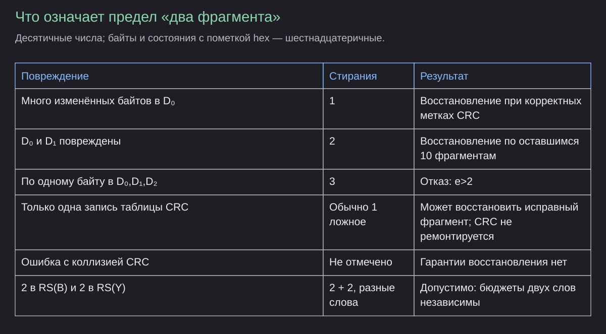](docs/figures/rs-failure-budget.svg)

Рисунок 53 — Какие повреждения входят в бюджет восстановления.

Гарантия относится к обнаруженным стираниям при корректных метках и параметрах. CRC-таблица находится вне RS; повреждённая запись может дать ложное стирание. Совпадение CRC при коллизии оставляет повреждённый фрагмент «исправным». После реконструкции все CRC повторно не проверяются; при нуле несовпадений уравнения parity отдельно не проверяются. Общий заголовок защищён троированием, а не этим кодом. Шифрования и аутентификации нет.

<a id="sec8"></a>

## 8 Троирование общего заголовка

### 8.1 Что троируется в v3

H=`CLARSv03 | flags`, 9 байт. `BlockWriter::with_threads` всегда записывает H|H|H, 27 байт, включая режим без RS. Защита сигнатуры и режима не зависит от защиты данных. Заголовки блоков B в v3 не троируются: без RS они обычные, с RS проходят отдельное кодирование длиной 60 байт.

[](docs/figures/triplication.svg)

Рисунок 54 — Два различных способа защиты общего и блочного заголовков.

### 8.2 Побайтовое большинство

Для каждой позиции i=0…8 берутся a=H₀[i],b=H₁[i],c=H₂[i]. Если a=b или a=c, принять a; иначе если b=c, принять b; иначе ошибка. Это голосование целых байтов, не отдельных битов.

В фрагменте Rust `a`, `b`, `c` — целые массивы трёх копий H, `i` — текущая позиция, `result` — восстанавливаемый заголовок. В правиле выше теми же буквами обозначены взятые из массивов байты.

Ключевой фрагмент: [src/block/mod.rs](src/block/mod.rs), строки 22–30.

```rust
        if a[i] == b[i] || a[i] == c[i] {
            result.push(a[i]);
        } else if b[i] == c[i] {
            result.push(b[i]);
        } else {
            return None;
        }
    }
    Some(result)
```

[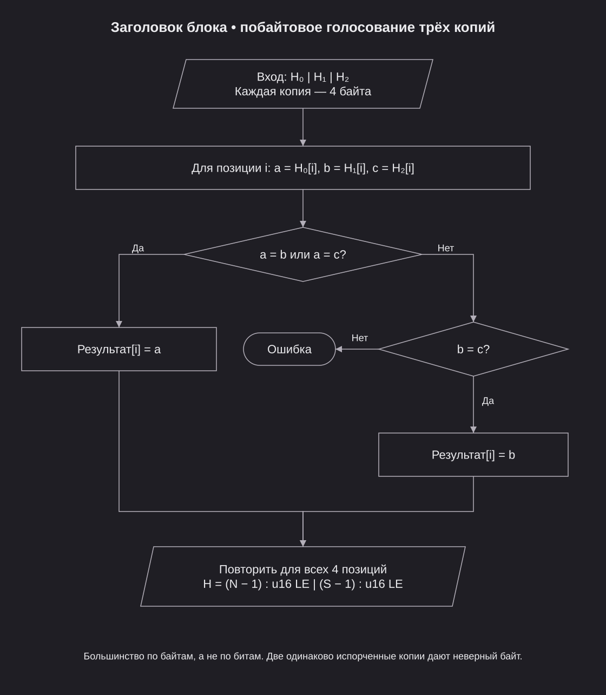](docs/figures/header-vote.svg)

Рисунок 55 — Алгоритм голосования и последующая проверка сигнатуры.

[](docs/figures/header-vote-example.svg)

Рисунок 56 — Восстановление при разных повреждённых позициях трёх копий.

Одна испорченная копия каждого байта исправляется; целиком исправной копии может не быть. Если две копии одного байта одинаково повреждены, ложное большинство принимается. Три разных значения означают отсутствие решения. После голосования проверяются сигнатура `CLARSv03` и нулевые неизвестные биты 3…7. Тесты троирования используют учебный массив из четырёх байтов, но реальный общий заголовок имеет девять.

<a id="sec9"></a>

## 9 Формат CLARSv03 и полные байтовые примеры

### 9.1 Общий заголовок и режимы

| Смещение dec | Длина | Поле |
| --- | --- | --- |
| 0…7 | 8 | 43 4C 41 52 53 76 30 33 — CLARSv03 |
| 8 | 1 | Флаги: бит 0 LZ77, бит 1 rANS, бит 2 RS |
| 9…17 | 9 | Вторая копия всего H |
| 18…26 | 9 | Третья копия всего H |
| 27 | Переменная | Первый блок |

| Флаги hex | Сжатие | Защита данных |
| --- | --- | --- |
| 00 | Нет | Нет |
| 01 | LZ77 | Нет |
| 02 | rANS | Нет |
| 03 | LZ77 → rANS | Нет |
| 04 | Нет | RS |
| 05 | LZ77 | RS |
| 06 | rANS | RS |
| 07 | LZ77 → rANS | RS |

Троирование H выполняется во всех восьми режимах. Отдельного поля числа блоков нет; физическое окончание проверяется вместе с логическим маркером 00. Форматы `CLARSv02` и `CLARSv03` несовместимы.

### 9.2 Блок без защиты и с защитой

| Режим | Физические поля | Размер |
| --- | --- | --- |
| Без RS | B:u16 LE(N−1),u16 LE(S−1) \| Y | 4+S |
| С RS | RS(B) \| RS(Y) | 60+48+12·ceil((S+4)/10) |

Для B длиной 4: h=ceil((4+4)/10)=1, E(4)=48+12=60. Поэтому первый заголовок с RS всегда можно прочитать до того, как известна S. После восстановления B читатель вычисляет E(S) и читает слово данных. Объединение B и Y в одно неизвестное по длине слово потребовало бы ещё одного внешнего механизма длины.

[](docs/figures/format.svg)

Рисунок 57 — Смещения и размеры полей физического формата.

### 9.3 Минимальный архив без сжатия и RS

Файл `a` содержит один байт ASCII A. Логический поток имеет шесть байтов:

```text
01 | 01 | 61 | 01 | 41 | 00
файл длина имя размер данные конец
```

N=S=6, значит B=`05 00 05 00`. H заканчивается флагом 00 и повторяется трижды. Полный архив равен 37 байтам: 27+4+6.

[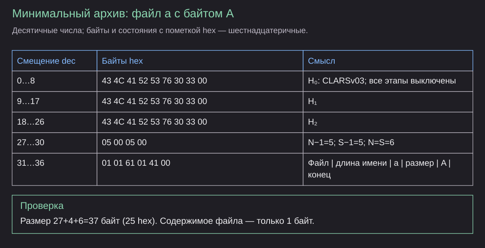](docs/figures/archive-minimal.svg)

Рисунок 58 — Все байты минимального незащищённого архива.

### 9.4 Тот же файл с RS, без сжатия

Флаги 04. H занимает 27 байт. Для B: префикс 04, h=1, информационные байты `04 00 00 00 05 00 05 00 00 00`, parity `A2 FE`. Для Y: префикс 06, h=1, информационные байты `06 00 00 00 01 01 61 01 41 00`, parity `25 05`. Каждое слово занимает 60 байт. Полный архив 27+60+60=147 байт, hex 93.

[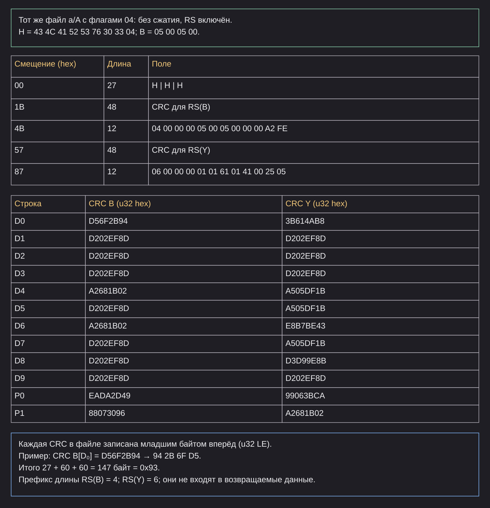](docs/figures/archive-protected-summary.svg)

Рисунок 59 — Защищённый архив целиком: смещения, фрагменты и обе CRC-таблицы.

На этом рисунке смещения и значения CRC — hex, длины — десятичные. Для строки с индексом i=0…11 положение её CRC в архиве равно 27+4i для B и 87+4i для Y; фрагменты находятся по адресам 75+i и 135+i. Индексы 0…9 обозначают D₀…D₉, 10 и 11 — P₀,P₁. Например, CRC заголовка D₀=0xD56F2B94 хранится как `94 2B 6F D5`.

Полные файлы для проверки hex-редактором: [без RS](docs/examples/minimal.mrx), [с RS](docs/examples/minimal-protected.mrx). Они созданы настоящей командой `arch create`, сверены с раскладкой и извлечены с проверкой содержимого.

### 9.5 Размер и избыточность

Для сохранённого payload S≥1:

```text
h(S) = ceil((S+4)/10)
E(S) = 48 + 12h(S)
B₀(S) = 4 + S
B_RS(S) = E(4) + E(S) = 108 + 12h(S)
A = 27 + Σ B(S_i)
```

Обозначим z=10h−(S+4), 0≤z≤9. Тогда B_RS(S)=112+S+z+2h. Расходы: 60 байт защищённого B, 48 байт CRC слова Y, 4 байта внутренней длины Y, z заполнения и 2h проверочных байтов. Скорость кода фрагментов — 10/12=5/6; проверочных байтов 20% относительно информационных фрагментов. Полные расходы архива больше, особенно на коротких блоках.

| S | h | Без RS: B₀ | С RS: B_RS | Прирост к B₀ |
| --- | --- | --- | --- | --- |
| 1 | 1 | 5 | 120 | 2300.00% |
| 6 | 1 | 10 | 120 | 1100.00% |
| 7 | 2 | 11 | 132 | 1100.00% |
| 16 | 2 | 20 | 132 | 560.00% |
| 64 | 7 | 68 | 192 | 182.35% |
| 256 | 26 | 260 | 420 | 61.54% |
| 1024 | 103 | 1028 | 1344 | 30.74% |
| 4096 | 410 | 4100 | 5028 | 22.63% |
| 65536 | 6554 | 65540 | 78756 | 20.16% |

[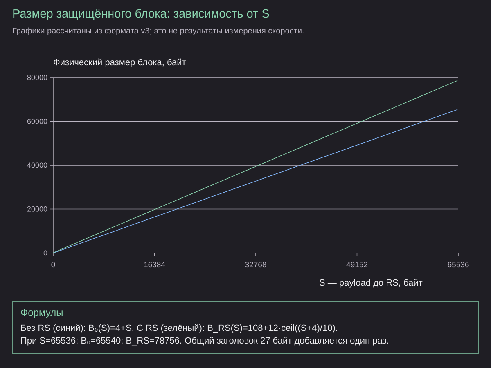](docs/figures/rs-overhead.svg)

Рисунок 60 — Расчётная зависимость физического размера блока от payload.

[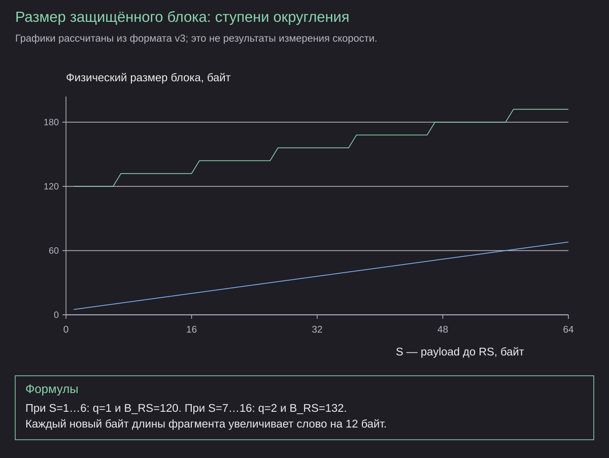](docs/figures/rs-staircase.svg)

Рисунок 61 — Округление фрагментов на малых размерах.

При S=65536 защищённый блок занимает 78756 байт, обычный — 65540. Прирост к обычному блоку ≈20,165%; к самому payload — ≈20,172%. Эти разные знаменатели нельзя смешивать. Для S=1…6 RS-блок остаётся 120 байт, затем увеличивается на 12 байт при каждом росте h. Уменьшение S до RS никогда не увеличивает физический размер, но иногда не изменяет его из-за округления.

Для данных до защиты ρ_payload=S/N, экономия g=1−S/N. Для файлового архива ρ_archive=A/F; при F=0 отношение не определено. Имена, папки, завершающая запись и заголовки входят в A, но не в F. Размер файла архива также отличается от занятого места с учётом кластеров файловой системы.

<a id="sec10"></a>

## 10 Параллельность, пути и обработка ошибок

### 10.1 Партии и исходный порядок

Потоки T∈[1,64]. По умолчанию min(available_parallelism(),64), при ошибке определения — 1. Партия b(T)=1 при T=1 и max(4,2T) при T>1. Пул Rayon создаётся при выборе T>1, даже если впоследствии окажется одно задание. Партия из одного элемента обрабатывается последовательно внутри уже выбранного Executor.

`items` — упорядоченный список блоков, `operation` — функция кодирования или декодирования блока, `pool` — локальный пул Rayon. Варианты `Sequential` и `Parallel` выбирают последовательный или параллельный путь.

Ключевой фрагмент: [src/parallel.rs](src/parallel.rs), строки 49–55.

```rust
        match self {
            Self::Sequential => Ok(items.into_iter().map(operation).collect()),
            Self::Parallel { pool, .. } if items.len() > 1 => {
                Ok(pool.install(|| items.into_par_iter().map(operation).collect()))
            }
            Self::Parallel { .. } => Ok(items.into_iter().map(operation).collect()),
        }
```

[](docs/figures/parallel.svg)

Рисунок 62 — Несовпадение порядка завершения и порядка записи блоков.

`into_par_iter` для Vec — индексируемый параллельный итератор. Сборка результатов в Vec сохраняет порядок. `flush_batch` затем записывает этот Vec по очереди. На чтении партия физических блоков декодируется параллельно, складывается в `VecDeque` и выдаётся в исходном порядке. Чтение и запись потока остаются последовательными.

Дополнительный объём исходных блоков партии не более b(T)·65536 байт; это не оценка всей памяти. Одновременно существуют исходные, промежуточные и защищённые буферы, таблицы поиска и модели, ожидающие результаты и пул потоков. Для T=64 партия содержит 128 блоков, только их исходные данные занимают 8 МиБ. Время и память всей программы не равны T×скорость одного блока и T×64 КиБ.

### 10.2 Имена и дерево

| Проверка | Фактическое условие кода |
| --- | --- |
| Путь | Непустой UTF-8, ≤4096 байт |
| Компоненты | ≤128, каждый непустой и ≤255 байт |
| Конец компонента | Не точка и не пробел |
| Символы | Нет управляющих и / \ : * ? " < > \| |
| Устройства | con, prn, aux, nul, conin$, conout$ до первой точки |
| Порядок | Родитель уже объявлен папкой |
| Дубликаты | Запрещены после Unicode to_lowercase() |
| Объём метаданных | ≤100000 записей |
| Тип источника | Обычный файл или папка; symlink/reparse point отклоняются |

[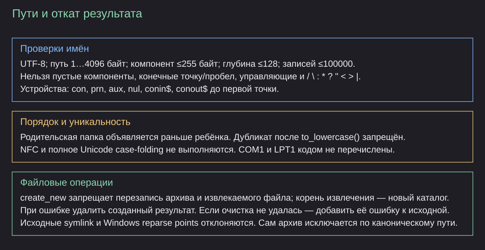](docs/figures/paths.svg)

Рисунок 63 — Проверки путей, порядок создания и откат.

Точки `.` и `..` отклоняются как компоненты, заканчивающиеся точкой. Полное Unicode case-folding и нормализация NFC не выполняются. `com1` и `lpt1` в списке запрещённых имён кода отсутствуют; возможен последующий отказ файловой системы. Поэтому документация не приписывает коду полный список имён Windows.

Сам создаваемый архив исключается из обхода по каноническому пути. `pack_file` фиксирует длину файла, проверяет ранний конец и появление лишнего байта после чтения ожидаемой длины. Изменение содержимого с сохранением длины этот механизм не обязан обнаружить; это не снимок файловой системы.

### 10.3 Успех и откат

Создание открывает архив через `create_new(true)`. Извлечение сначала создаёт новый корневой каталог. Ошибка упаковки удаляет незавершённый архив, ошибка извлечения — созданный каталог вместе с частично извлечёнными файлами. Если очистка сама завершилась ошибкой, исходное сообщение дополняется описанием очистки. Существующие результаты не являются объектом отката.

`info` может напечатать некоторые записи до обнаружения повреждения дальше по потоку; вывод списка не означает окончательного успеха. Полная проверка заканчивается только после успешного `reader.finish()` и всех проверок конца.

### 10.4 Проверки повреждённого формата

| Уровень | Причины отказа |
| --- | --- |
| Общий заголовок | Нет большинства; сигнатура не CLARSv03; неизвестные флаги |
| Физический блок | Обрыв; S>N; сжатие при выключенных обоих кодерах; слишком короткий непустой rANS |
| RS | Неверная длина слова; e>2; неудача реконструкции; внутренняя длина за доступными данными |
| LZ77 | Недопустимая длина потока; ссылка за результат; d=0 при l>0; превышен N; неверный итоговый размер |
| rANS | Некорректный алфавит/частоты; недопустимое состояние; обрыв перенормировки; остаток байтов; x≠L |
| Записи | Неизвестный тип; пустой/некорректный путь; дубликат; отсутствующий родитель; обрыв содержимого |
| Окончание | После 00 остались декодированные байты, ожидающие блоки или физические данные |

Без RS нет независимой контрольной суммы исходного блока. Некоторые изменения могут сохранить синтаксически допустимый поток. С RS действуют условия обнаружения и бюджета стираний из раздела 7. Нет шифрования, цифровой подписи и лимита общего объёма извлечения; эти функции не следует описывать как существующие.

### 10.5 Что означает вывод info и extract

| Поле вывода | Что считается |
| --- | --- |
| Файлов / папок | Число логических записей соответствующего типа; папки включают корни источников |
| Исходные файлы | Сумма F содержимого файлов; без имён, папок и метаданных |
| Архив | Физическая длина файла .mrx |
| LZ77 / rANS / защита | Общие режимы из восстановленного H |
| Сжатых блоков | Число прочитанных блоков с S<N |
| Блоков без сжатия | Число блоков с S=N |
| Исправлено фрагментов | Сумма отмеченных стираний RS по заголовкам B и данным Y; не число байтов |

`info` печатает записи через обратный вызов `on_entry` и только после полного успешного прохода — итоговую статистику. `extract` печатает статистику после завершения извлечения. Блоки не совпадают с файлами, поэтому число файлов не определяет число сжатых блоков.

<a id="sec11"></a>

### 11.3 Методика измерения полного архиватора

15.10.2026, Windows x86_64, Rust 1.99.0, release, один рабочий поток. Каждый вход — файл `data` длиной 1048576 байт. Один прогрев, затем пять измерений; приведена медиана. Отсчёт ведётся вокруг полного запуска `arch create` и `arch extract`, включает запуск процесса, файловый ввод-вывод и `sync_all`. Кэш ОС не очищался, фоновые процессы не изолировались. Малые различия времени одного прогона не доказывают превосходство режима.

Наборы: A — одинаковые байты 0x41; текст — период ASCII `one two three four\n`; 256 — циклические 0…255; случайный — xorshift32, seed=0x12345678, сдвиги 13/17/5 с приведением к u32 после левых сдвигов, в выход берётся младший байт; смешанный — тот же случайный поток, в котором чётные блоки по 65536 байт заменены A. Нумерация блоков с нуля.

Скорость V=F/(t·1048576), где F — байты содержимого файла, t — секунды. Экономия=100·(1−A/F), A — весь архив с метаданными. Эти величины отличаются от S/N отдельного блока до RS.

### 11.4 Размеры и скорость полного CLI

| Набор, 1 МиБ | Архив без RS, байт | Экономия | Создание, МиБ/с | Извлечение, МиБ/с |
| --- | --- | --- | --- | --- |
| Одинаковые A | 3010 | 99.713% | 21.409 | 22.573 |
| Повтор строки | 5672 | 99.459% | 20.658 | 24.854 |
| Все 256 байтов | 16813 | 98.397% | 20.106 | 25.447 |
| Псевдослучайный | 1048681 | -0.010% | 6.995 | 26.222 |
| Смешанный | 526126 | 49.825% | 10.015 | 23.227 |

[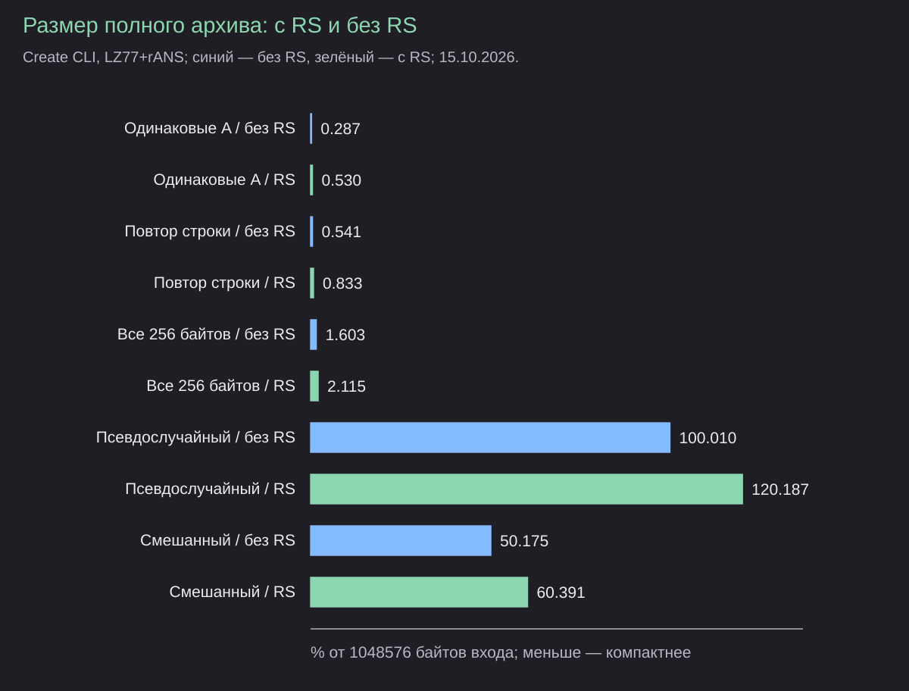](docs/figures/benchmark-compression.svg)

Рисунок 64 — Полный размер архивов с RS и без RS, относительно входного файла.

[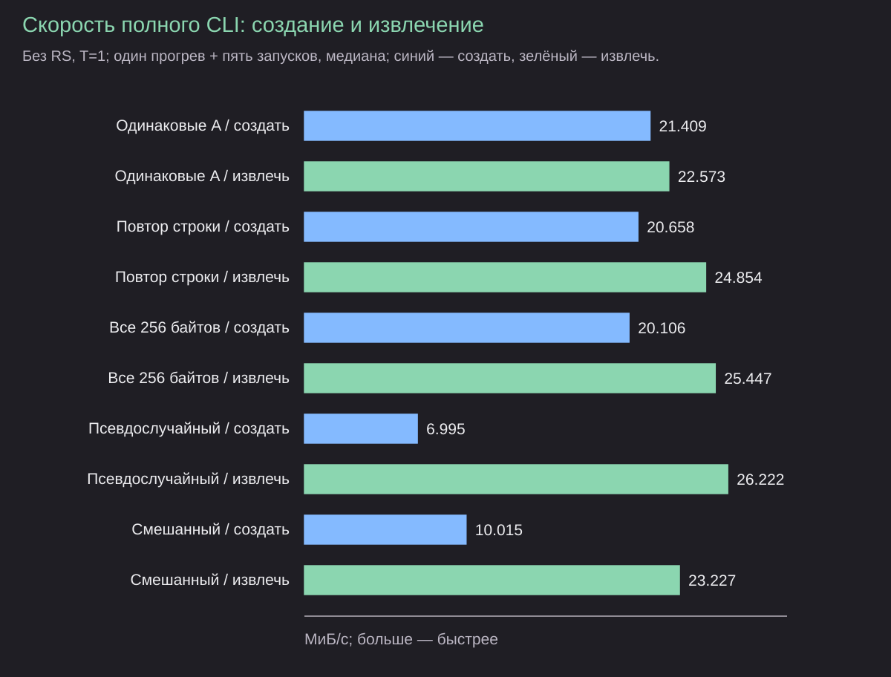](docs/figures/benchmark-speed.svg)

Рисунок 65 — Скорость полного создания и извлечения при выключенной RS-защите.

Для случайного файла нет выигрыша сжатия. Логический поток занимает F+10 байт: тип (1), длина имени (1), `data` (4), LEB128 размера файла (3), содержимое (F), конец (1). Получается 17 блоков; полный размер F+10+17·4+27=1048681 байт. Так объясняются все 105 дополнительных байтов.

### 11.5 Измеренная цена RS

| Набор | Без RS, байт | С RS, байт | Прирост размера | Создание с RS, МиБ/с | Извлечение с RS, МиБ/с |
| --- | --- | --- | --- | --- | --- |
| Одинаковые A | 3010 | 5559 | 84.68% | 19.982 | 22.505 |
| Повтор строки | 5672 | 8739 | 54.07% | 20.117 | 25.081 |
| Все 256 байтов | 16813 | 22179 | 31.92% | 19.604 | 24.557 |
| Псевдослучайный | 1048681 | 1260255 | 20.18% | 4.987 | 22.574 |
| Смешанный | 526126 | 633243 | 20.36% | 9.511 | 22.527 |

На малых сжатых блоках фиксированные 108 байт и округление фрагментов дают большой процент расходов. Поэтому «RS добавляет 20%» верно для предела крупных информационных фрагментов, а не для любого файла. Точные формулы и графики размера находятся в §9.5.

### 11.6 Масштабирование блочного кодирования

Отдельный локальный опыт встроенного `tests/bench.rs` обрабатывает 2 МиБ смешанных данных **в памяти**, без файловых записей и запуска CLI. Release, один прогрев, пять измерений, медиана. Он не сравнивается по абсолютной скорости с предыдущими таблицами полного архиватора.

| Потоки | Упаковка, мс | Скорость, МиБ/с | Ускорение t₁/t_T |
| --- | --- | --- | --- |
| 1 | 109.981 | 18.185 | 1.0 |
| 2 | 64.85 | 30.84 | 1.696 |
| 4 | 38.63 | 51.774 | 2.847 |

[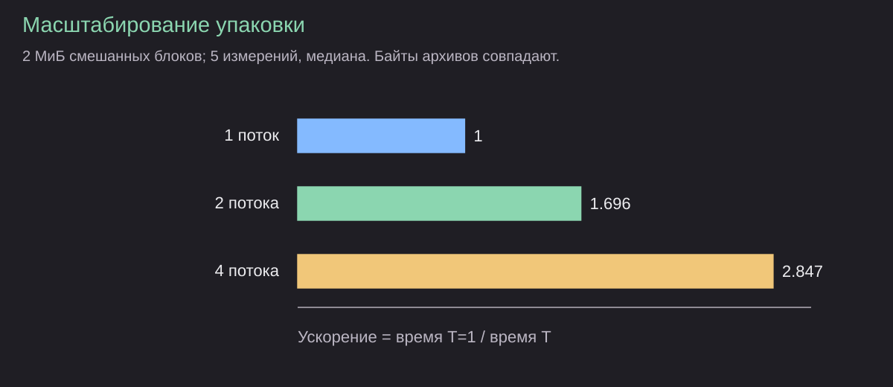](docs/figures/benchmark-threads.svg)

Рисунок 66 — Измеренное ускорение упаковки независимых блоков.

Бенчмарк проверяет равенство архивов и обратное восстановление для T=1,2,4. Измерения сохранены в [block-benchmark.log](docs/verification/block-benchmark.log). Для повторения всех его разделов:

```sh
cargo test --release --locked --test bench
```

По умолчанию `CLARSLIB_BENCH_BYTES=1048576`, `CLARSLIB_BENCH_RUNS=5`; эти переменные меняют синтетические измерения. Для раздела потоков используется не менее 32 блоков, то есть 2 МиБ. Файловый `demo_corpus` обрабатывается отдельно один раз и от переменных не зависит.

<a id="sec12"></a>

## 13 Справочник констант и функций

### 13.1 Константы и основания выбора

| Константа | Значение | Связь с кодом и форматом |
| --- | --- | --- |
| BLOCK_SIZE | 65536 | Максимальное положительное N при хранении N−1:u16 |
| ARCHIVE_HEADER_SIZE | 9 | 8 байтов сигнатуры и флаги; физически 3×9=27 |
| BLOCK_HEADER_SIZE | 4 | Два u16 LE; RS(4)=60 байт |
| WINDOW | 4096 | Предельное расстояние ссылки; до 2 байтов LEB128 |
| MAX_MATCH | 255 | Однобайтовая длина команды |
| HASH_BITS/HASH_SIZE | 12 / 4096 | Индекс по старшим 12 битам смешанной пары |
| MAX_CANDIDATES | 512 | Подобрано по времени и степени сжатия |
| NONE | usize::MAX | Значение отсутствующего индекса Matcher |
| MAX_ENCODED_SIZE | 131075 | 3+2·65536; предел промежуточного LZ77-потока |
| SCALE_BITS/TOTAL | 12 / 4096 | Масштаб частот и размер таблицы выбора rANS |
| LOWER_BOUND | 8388608 | 2^23; вместе с основанием 256 даёт диапазон состояния <2^31 |
| Порог rANS | 524288·f | ((L>>12)<<8)·f; зависит от текущего символа |
| Порог списка алфавита | 32 | Список <=32 байтов не длиннее карты 32 байта |
| MIN_HEADER_SIZE | 7 | Непустой rANS: n,D−1,символ и состояние |
| MAX_HEADER_SIZE | 550 | 3+1+32+255*2+4 — консервативная верхняя оценка |
| DATA/PARITY/TOTAL_SHARDS | 10 / 2 / 12 | Два стирания; 20% от информационных фрагментов |
| CRC / внутренняя U | 4 / 4 байта | u32 LE; таблица CRC=12·4=48 |
| MAX_THREADS | 64 | Ограничение пула потоков |
| MAX_PATH_BYTES / MAX_DEPTH | 4096 / 128 | Предел длины UTF-8 и компонентов пути |
| MAX_ENTRIES / компонент | 100000 / 255 байт | Ограничение метаданных и длины имени |
